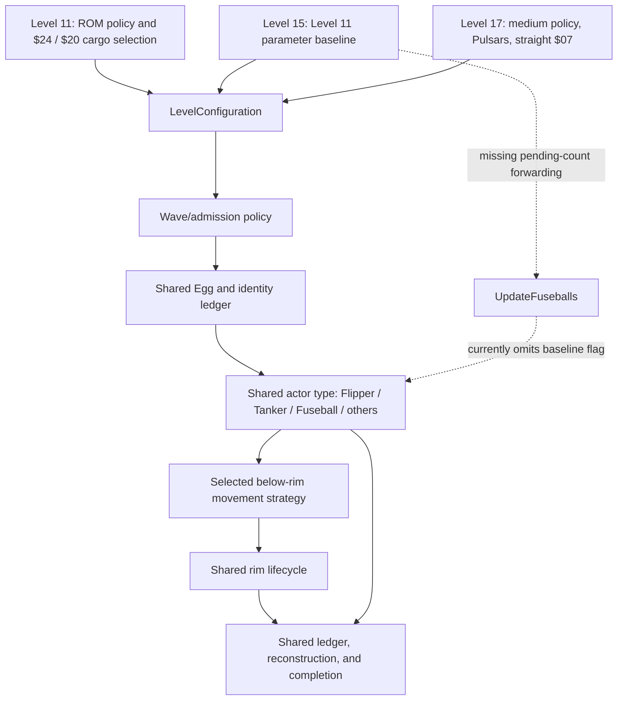

# Levels 11 / 15 / 17 Behavioral Special-Case and Generic-Lifecycle Bypass Audit

Date: 2026-11-25

**Disposition: BOUNDED GENERIC-LIFECYCLE PROBLEM.**

One active Level 15 lifecycle-policy wiring gap was found: the accepted
Level-11-parameter-development baseline can admit a Fuseball, but the shared
production Fuseball update does not receive that baseline's generic pending
count. It therefore cannot enter the already implemented terminal-rimward
state when generic supply is exhausted. This is a missing connection to shared
behavior, not a duplicate Level 15 Fuseball implementation or proof of a
Level-15-specific ROM behavior.

Otherwise, Levels 11, 15, and 17 use the shared actor types, identity ledger,
reconstruction, collision, and completion paths. The current Level 17
straight-$07$ route relinquishes control at the rim and reaches the shared
rim-pursuit lifecycle. The historical Level 17 freeze and Level 11/15 cargo
regression are not present in the current production route.

No source, test, durable behavior-specification, or project-configuration
changes were made. The required prompt and this report are the only files
created for this audit. Nothing was staged, committed, or pushed.

## 1. Executive summary

- **Current architecture:** no separate Level 11, Level 15, or Level 17
  Flipper/Tanker actor, identity ledger, death-reconstruction engine,
  completion system, or collision implementation exists.
- **ROM/program specialization:** Level 11/15 use a repeating `$24` Flipper
  program and the Level-11-derived cargo route policy; Level 17 uses straight
  `$07`. These select routes on shared `Flipper` instances.
- **Shared rim lifecycle:** all inspected below-rim strategies converge on
  common pause/pivot/pursuit behavior. Level 17 clears its straight-route
  ownership and calls `HandOffToRim`.
- **Level 15 gap:** `UpdateSpikers` correctly includes
  `UsesLevel11ParameterDevelopmentBaseline` in its restart/terminal-conversion
  lifecycle. `UpdateFuseballs` does not include that same flag when supplying
  `PendingGenericOriginalCount`. Since the Level 15 baseline selector admits
  one Fuseball, that runtime actor receives `null` and continues ordinary
  cycling instead of using the shared terminal-rimward transition.
- **Architecture outcome:** one bounded, behaviorally relevant wiring
  correction should be completed and manually accepted before Level 18 work.
  This does not justify a broad actor, ledger, or campaign refactor.
- **Manual acceptance remains authoritative:** Level 17's accepted gameplay
  must not be reopened. Any future Level 15 Fuseball correction needs
  focused automation and Neal's manual check of the affected terminal-wave
  behavior.

## 2. Starting Git/worktree state

- Branch: `master`
- HEAD: `4c7365a01f944cf2b501164e5015f4954110434f`
- Upstream: `origin/master`
- Ahead/behind: `0/0`
- Tracked worktree diff: none
- Index/staged diff: none
- Pre-existing untracked paths: nine:
  - Four existing prompt records under `AI-Logs/Prompts/`:
    `2026-11-25-debugmcp-controlled-installation-proof-prompt.md`,
    `2026-11-25-debugmcp-post-restart-continuation-prompt.md`,
    `2026-11-25-debugmcp-prerequisite-resolution-prompt.md`, and
    `2026-11-25-vscode-copilot-development-tool-assessment-prompt.md`.
  - Four corresponding report records under `AI-Logs/Reports/`.
  - `Reference/arcade/MBUCOD.V05.txt`.
- The current HEAD is the Level 17 closeout-report finalization commit. The
  only change from the accepted Level 17 production commit `5587e15` to HEAD
  is the final Level 17 closeout report. No unexplained production-code
  difference from that accepted closeout was found.
- All pre-existing untracked files were preserved. The local arcade reference
  file was not opened, searched, changed, or otherwise used.

The required audit prompt was copied from the read-only user attachment into
`AI-Logs/Prompts/2026-11-25-level11-15-17-behavior-special-case-architecture-audit-prompt.md`.
This report is its required paired record. No unrelated report or prompt was
changed.

## 3. Audit question and definition of a hack

The audit asked whether target-level production behavior has separate
implementation because shared behavior cannot support Levels 11, 15, or 17.
Configuration, ROM-selected programs, eligibility, speed, cargo, and palette
are not hacks merely because they are level-specific.

For this report, a Category D finding is an active target-level path that
duplicates or fails to enter an applicable shared lifecycle for reasons not
supported by a distinct behavior requirement. The Level 15 Fuseball finding
is a **policy-wiring omission** rather than a deliberate duplicate
workaround. It is still Category D under the supplied audit taxonomy because
the target configuration bypasses an applicable shared behavior.

The finding establishes current C# control flow. It does **not** establish
independent Level 15 ROM behavior: Level 15's current enemy policy is an
explicit Level 11 parameter-development baseline, not a claim that its entire
gameplay profile is ROM-backed.

## 4. Evidence sources

Primary current-code evidence:

- [LevelConfiguration.cs](../../src/Tempest.Game/Levels/LevelConfiguration.cs):
  configuration flags, program selection, and target profiles.
- [TempestGame.cs](../../src/Tempest.Game/TempestGame.cs): hatching,
  target policy selection, Spiker/Fuseball update, cargo release, death
  reconstruction, and completion.
- [Flipper.cs](../../src/Tempest.Game/Gameplay/Flipper.cs): shared actor,
  below-rim route initialization, factory paths, and rim handoff.
- [Tanker.cs](../../src/Tempest.Game/Gameplay/Tanker.cs): shared carrier and
  cargo-program selection/release.
- [Level3WaveLedger.cs](../../src/Tempest.Game/Levels/Level3WaveLedger.cs):
  shared original/cargo identity transitions and representation checks.
- [Level.cs](../../src/Tempest.Game/Levels/Level.cs): production ledger use
  and reconstruction entry point.
- [Fuseball.cs](../../src/Tempest.Game/Gameplay/Fuseball.cs): shared
  terminal-rimward movement state and boundary condition.
- [Level11WaveSelection.cs](../../src/Tempest.Game/Levels/Level11WaveSelection.cs)
  and [Level17WaveSelection.cs](../../src/Tempest.Game/Levels/Level17WaveSelection.cs):
  selected eligibility and bounded wave policy.

Durable decisions and historical provenance:

- [TEMPEST-BEHAVIOR-SPEC.md](../../TEMPEST-BEHAVIOR-SPEC.md), especially
  sections on Flippers, Tankers, Levels 11 and 15, and production progression.
- [TEMPEST-DEVELOPMENT-NOTES.md](../../TEMPEST-DEVELOPMENT-NOTES.md),
  especially the Level 11 closeout, Level 15 terminal-Spiker acceptance, and
  Level 17 closeout entries.
- Level 11 runtime representation and implementation reports dated
  2026-11-21.
- Level 15 terminal-Spiker investigation/correction and production-promotion
  reports dated 2026-11-24.
- All five required Level 17 implementation, shared-regression,
  bounded-correction, rim-Flipper-correction, and final-closeout reports dated
  2026-11-25.
- Fuseball terminal behavior investigation and correction reports dated
  2026-11-22.

No test, build, game launch, recording playback, ROM-image, screenshot, or
video was used as an audit experiment. The ROM behavior claims below are
attributed to already-maintained project reports and durable documentation;
no raw ROM material was opened.

## 5. Control-level selection

- **Level 11** is the direct control for its own `$24` ordinary Flippers,
  `$07`/`$24` cargo policy, production ledger, terminal Spiker conversion,
  Fuseball eligibility, and accepted Fuseball terminal translation.
- **Level 15** is compared to Level 11 only where its explicit
  `UsesLevel11ParameterDevelopmentBaseline` flag selects the Level 11 wave
  selector or an explicitly shared lifecycle. Its separate tube and `$A0`
  starting-Spike data are not taken as evidence that all Level 11 gameplay
  applies to Level 15.
- **Level 17** is compared to Level 1 for reused Shape 1, Level 14 for generic
  `$07` Tanker cargo, Level 16 for a later production `$24` route and shared
  identity lifecycle, and the historical Levels 1-16 campaign oracle for
  shared-regression risk.
- **Levels 14 and 16** are useful controls for cargo strategy and later-level
  production. Level 14 uses the shared `Straight07` cargo path; Level 16 uses
  shared repeating `$24`, a reusable ledger, and topology-keyed geometry.
- **Earlier production Levels 5-9** provide additional examples of
  configuration-selected route programs and terminal-Spiker policies. Their
  route selectors remain within shared actor and ledger implementations.

## 6. Level configuration inventory

| Target | Current configuration/policy | Classification |
|---|---|---|
| 11 | `Level11Production`; genuine Level 11 wave selector; `$24` ordinary Flippers; ordinary Flipper bottom selection disabled; seven physical enemy records; Tanker cargo chosen between `$07` and `$24` using converted ROM along-position threshold `$20`; Fuseball eligible at 1/1. | ROM-justified policy and route configuration, implemented through shared actors. |
| 15 | `Level15Production`; separate displayed identity/geometry and `$A0` Spike translation; effective gameplay-parameter level 11; `UsesLevel11ParameterDevelopmentBaseline=true`; ordinary Flipper selection disabled; Level 11 wave selector reused. | Accepted project baseline, not a complete claim of Level 11 or Level 15 ROM gameplay identity. The baseline must be propagated consistently to applicable shared policies. |
| 17 | `Level17Production`; dedicated medium/default wave selector; shared Shape 1 definition; cycle palette 1; Flipper movement byte `$07`; Flipper/Tanker speed and shot policy; no starting Spikes, Spikers, or Fuseballs; Pulsars eligible. | ROM-selected configuration and project translations; shared actor/ledger lifecycle. |

`UsesGenericRomDeathReconstruction` includes all three target configurations:
Level 11 by ROM-policy flag, Level 15 by the separate parameter-baseline flag,
and Level 17 by ROM-policy flag. `AllowsOrdinaryFlipperSelection` also drives
generic Flipper reselection after death; Level 11/15 set it false, Level 17
sets it true.

## 7. Direct target-level production checks

No target-level simulation branch compares `DisplayedLevel` numerically to
11, 15, or 17. Production uses semantic configuration properties and selected
strategies.

| Production check | Current effect | Classification |
|---|---|---|
| `UsesLevel11RomWavePolicy` / `UsesLevel11ParameterDevelopmentBaseline` in `TempestGame.CreateLevel3MixedEnemy` | Selects Level 11 policy for Level 11 and Level 15 baseline; configures admission, cargo, and species creation. | A for Level 11 policy data; B for deliberate Level 15 baseline reuse. |
| `UsesLevel17RomWavePolicy` in `CreateLevel3MixedEnemy` | Selects Level 17 wave policy and its eligible species, capacities, speed, ammo, and cargo route. | A/B; policy selection, not an actor-lifecycle fork. |
| Target flags in `UpdateSpikers` | Level 11 and Level 15 baseline participate in pending-supply restart and terminal in-place Spiker-to-Tanker conversion; Level 17 has no eligible Spikers. | Shared lifecycle predicate; current Level 15 Spiker path is wired. |
| `UsesLevel11...`, `UsesLevel12...`, `UsesLevel13...`, `UsesLevel14...`, and `UsesLevel16...` in `UpdateFuseballs` | Supplies generic pending count to terminal Fuseball state. The Level 15 baseline flag is absent. Level 17 has no eligible Fuseballs. | **D for Level 15**; see sections 32-39. |
| `UsesLevel17RomWavePolicy` in `Tanker.GetCargoMovementProgram` | Selects `Level17Straight07` for Level 17 cargo. | Strategy selection in shared carrier/factory. |
| `UsesGenericRomDeathReconstruction` in `TempestGame.ResetAfterDeath` and `Level.ResetAfterDeath` | Retains unresolved identities and rebuilds fresh Eggs through shared ledger logic. | Shared lifecycle; no target-level fork. |
| `LevelConfiguration.Level11Production`, `Level15Production`, `Level17Production` in `LevelProgression` | Makes each configuration reachable in campaign/direct-start order. | Level-selection table; not a behavioral workaround. |
| Effective parameter switch cases 11 and 17 | Resolve configured shot holdoff/shot capacity. Level 15 intentionally resolves through effective parameter 11. | Configuration data. |
| Level 11/15/17 calibration, model-frame, and metadata entries | Select presentation transforms/metadata only. | Presentation specialization; not behavioral coupling. |

The Level 17 branch that assigns a Spiker speed is downstream of species
selection, while `Level17WaveSelection.MaximumSpikers` is zero and the
selector cannot return Spiker. The branch is dormant under current Level 17
eligibility; it does not activate a disallowed feature merely because a
parameter exists.

## 8. Target-specific type and enum inventory

- `BelowRimFlipperProgram.Level11Repeating24` selects the repeating program
  for ordinary Level 11 and Level 15 baseline Flippers.
- `BelowRimFlipperProgram.Level16Repeating24` selects the same repeating
  sequence for Level 16. The separate configuration labels do not imply
  separate actor lifecycle.
- `BelowRimFlipperProgram.Straight07` selects ordinary Level 17 straight
  climb behavior.
- `TankerCargoMovementProgram.Repeating24` selects repeating `$24` cargo.
- `TankerCargoMovementProgram.Straight07` retains the established generic
  straight-cargo factory behavior used by Levels 11/14/15 where selected.
- `TankerCargoMovementProgram.Level17Straight07` selects Level 17's direct
  straight-climb cargo initialization.
- `Level11WaveSelection`, `Level17WaveSelection`, and `UsesLevel11ParameterDevelopmentBaseline`
  hold policy/configuration, not actor subclasses.
- No production type named `Level11Flipper`, `Level15Tanker`,
  `Level17Flipper`, or target-specific ledger exists.

The two `Straight07` enum names are historical/semantic naming debt. Their
distinction currently protects different C# cargo initializations; it is not
safe to merge them based on the shared ROM byte alone.

## 9. Flipper construction comparison

Ordinary originals are created as `new Flipper(edge, 0)` in the common
production Egg factory and receive their original identity from the ledger.
No target level returns another actor class.

Tanker cargo is allocated as two ledger identities, then the common
`ReleaseTankerCargo` method calls `Flipper.CreateTankerCargo` with the selected
route program. Natural release, shot destruction, and Super Zapper release
share this construction path, with release-kind differences applied by the
ledger and zap timer.

After death, unresolved cargo returns through `CreateFreshTankerCargo`, also
from the shared rebuild/re-entry flow. Level 17 chooses
`Level17Straight07`; Level 16 chooses `Repeating24`; Level 14 chooses
`Straight07`; other programs use the existing shared/default routes.

Level 11, Level 15, and Level 17 therefore do not construct distinct Flipper
types. They do initialize below-rim program state differently, as expected
for their selected routes. The Level 17 route's special initialization sets
the common `useStraight07Program` flag, `Climbing` state, and release
direction; it does not add a separate identity or rim lifecycle.

## 10. Below-rim strategy inventory

| Strategy | Levels / use | Ordinary and cargo support | Owned state and termination |
|---|---|---|---|
| Existing climbing / rim pursuit | General shared route; ordinary Flippers and `Existing` cargo. | Both, subject to existing config and factory selectors. | Shared `FlipperState`; ordinary `AdvanceClimb` reaches rim and begins shared pause. |
| Repeating `$24` | Ordinary Level 11/15 baseline and Level 16; cargo selected as `Repeating24` for the relevant deep release. | Ordinary route is configuration-selected; cargo uses the common cargo factory. | `useRepeating24Program`, phase index, flip count, direction, programmed route step. Repeats 2 then 3 turns with direction reversal; ends below-rim ownership at rim. |
| Level 17 straight `$07` | Ordinary Level 17 via `BelowRimFlipperProgram.Straight07`; cargo via `Level17Straight07`. | Both. | `useStraight07Program`; climbs without below-rim lane changes; at rim it clamps, clears route ownership, and calls common handoff. |
| Generic cargo `Straight07` | Level 11 shallow cargo and Level 14 cargo; the Level 15 baseline can select the Level-11-derived route. | Cargo. | Uses the existing Level-8 straight-cargo pivot initialization, then straight progress and shared rim handoff. It is not the direct Level 17 route. |
| Level 6 cargo programs | Level 6 `$0B` deep and `$07` straight. | Cargo. | Dedicated route steps in the same Flipper state machine; both call shared rim handoff. |
| Level 9 cargo / ordinary `$53` and straight `$07` | Level 9 program-selected ordinary/cargo routes. | Both, selected by configuration/release semantics. | Level-9 route steps; route update ends at shared handoff. |
| Level 7 observed / Level 8 constant / Level 12 constant | Program/configuration-selected lower-level controls. | Route-specific ordinary/cargo behavior as selected by existing factories. | Existing programmed route steps; no Level 11/15/17 actor lifecycle. |

The inventory comes from `Flipper.Update`, the cargo factory methods, and
`HandOffToRim`; no Level 11/15/17 path creates an independent movement object.

## 11. `$24` behavior assessment

The ROM-backed Level 11 program is `$24`; the accepted project translation
repeats two lane flips in one direction, reverses, then three in the other
direction, and repeats. The implementation uses one `Repeating24FlipCounts`
table `[2, 3]`, `useRepeating24Program`, and the generic programmed route
machine. Level 16 uses that same movement translation under a different
configuration marker.

The program owns only below-rim phase/count/direction state. `AdvanceProgrammedAlong`,
`ContinueProgrammedPivot`, and route-boundary processing end in
`HandOffToRim` at rim arrival. There is no Level 11 or Level 15-specific
rim-pursuit implementation.

For Tanker cargo, `Repeating24` treats the cargo release pivot as the first
turn in the sequence. That is a route initialization detail; identity,
collision, reconstruction, and rim pursuit remain shared.

## 12. `$07` behavior assessment

The shared ROM byte is not sufficient by itself to collapse the C# route
strategies. Current C# behavior distinguishes:

1. **Level 17 ordinary `$07`:** config selects the direct straight route. The
   Flipper climbs to the rim without below-rim flipping/reversal.
2. **Level 17 cargo `$07`:** `Level17Straight07` initializes the same direct
   route from the cargo lane and release direction.
3. **Generic cargo `Straight07`:** retains the established generic cargo
   factory's release pivot followed by straight climb.
4. **Level 11/15 cargo:** the Level 11 ROM-along `$20` split selects
   `Repeating24` at/above the threshold and `Straight07` below it.

These are different C# route initializations in one shared actor, not separate
actor lifecycles. The historical Level 17 shared-regression report provides
causal evidence that changing the generic `Straight07` branch to direct climb
changed Level 11/15 cargo behavior and broke the campaign/Level 15 soak. The
correction restored the generic branch and added `Level17Straight07`.

The Level 17 rim-freeze report documents a separate defect in the first
straight-route version: it kept route ownership after reaching the rim.
Current code clears that ownership and calls `HandOffToRim`; the old freeze is
historical, not an active bypass.

## 13. `Straight07` assessment

`Straight07` currently means the established generic cargo route. In
`CreateTankerCargo` and `CreateFreshTankerCargo`, it sets
`useLevel8StraightCargoProgram` and starts through
`InitializeLevel8CargoRoute(..., constantFlipProgram: false)`. This includes
the factory's initial release pivot and then straight climbing. Level 14 tests
explicitly exercise the generic route at both deep and near-rim release
positions.

This name is ambiguous because it sounds like a single ROM movement program,
while the C# path also encodes a cargo-release lifecycle convention. Do not
reassign its meaning without preserving the Level 11/14/15-compatible
behavior.

## 14. `Level17Straight07` assessment

`Level17Straight07` means direct straight climb from the release lane for
Level 17 cargo, with no inherited generic release-pivot route. It is selected
by `Tanker.GetCargoMovementProgram` for the Level 17 production policy and
used by both the release and fresh-cargo factory paths.

The route still uses `Flipper`, shares rim-pursuit state and calls the same
rim handoff. Its name is tied to a level rather than only to its route
semantics, which is minor naming debt. The prior regression demonstrates why
keeping its behavior distinct from `Straight07` is currently necessary.

## 15. Endpoint-hinge assessment

`FlipperPivotGeometry.EndpointHinge` is configured on Levels 11, 15, and 17,
as it is on other relevant production levels. It chooses shared directed
transition geometry; no target-level branch in Flipper movement replaces the
generic pivot or rim state machine.

Level 16 has topology-specific shared-center handling based on repeated
vertices and available ROM lane-angle metadata. That path is a geometry/
metadata condition, not a Level 16 lifecycle fork. The target levels do not
use a special endpoint-hinge workaround.

## 16. Rim-entry handoff matrix

| Strategy | Levels | Rim detector | Handoff method | Shared pause | Shared pivot | Shared pursuit | Exception |
|---|---|---|---|---|---|---|---|
| Ordinary/default climb | General; controls and target configurations when selected | `AdvanceClimb` clamps at `Level.Depth` | `BeginPause` directly in the common climbing state machine | Yes | `BeginPivot` on pause expiry | Yes; `RimPursuitDirection` is initialized/latches in `BeginPivot` | Direct arrival in player's lane reports collision before ordinary pause, as shared rule. |
| Repeating `$24` | 11, 15 baseline, 16 | `AdvanceProgrammedAlong` / programmed pivot completion | `HandOffToRim` | Yes, via `BeginPause` | Yes | Yes | None for target levels. |
| Level 17 direct straight `$07` | 17 ordinary and cargo | Straight route branch tests `Height >= Level.Depth` | Clamp; choose/latch rim direction; clear `useStraight07Program`; `HandOffToRim` | Yes | Yes | Yes | None in current code. |
| Generic cargo `Straight07` | 11/14 and 15 baseline when selected | `AdvanceLevel8Straight` | `HandOffToRim` | Yes | Yes | Yes | Release pivot is part of below-rim route only. |
| Level 9 programs | 9 controls | Level 9 along/turning route | `HandOffToRim` | Yes | Yes | Yes | Route may have its own below-rim turns, not a target-level lifecycle exception. |
| Level 6 cargo | 6 control | `AdvanceLevel6DeepAlong` / `AdvanceLevel6Straight` | `HandOffToRim` | Yes | Yes | Yes | Eight-advance cadence applies only to Level 6 deep program. |

All relevant target strategies converge on shared rim pause/pivot/pursuit.
None uses a Level 11/15/17-specific pursuit function.

## 17. Rim-pursuit comparison

After handoff, `BeginPivot` chooses or uses the Flipper's latched
`RimPursuitDirection`, selects an adjacent playable lane, creates a shared
directed transition, and enters `Flipping`. `CompletePivot` commits the lane
and starts the next pause. A forced reversal at an open endpoint updates the
latched direction through topology-aware shared code.

Level 11 is open; Level 15 is open; Level 17 reuses closed Shape 1. Open-tube
endpoint handling is based on level topology, not displayed-level identity.
No special target-level lane-selection, pursuit, pause, pivot, collision, or
destroyability branch was found.

The common shot-hit path, completed-pivot player collision, and
`CompletedIntoPlayer` signal remain shared. Level 17's below-rim `$07` route
does not continue to own a Flipper after rim arrival.

## 18. Tanker core comparison

All target Tankers are the same `Tanker` class. Their constructor receives
lane, original identity, speed, ammunition, timer, and ammunition mode.
Climbing, firing opportunity, natural release, hit/zap state, and cargo
release are shared.

Target-specific differences are supplied as config or selected cargo route:

- Level 11/15 baseline: Level-11-derived cargo route selection, including the
  `$20` along-position split.
- Level 17: configured medium climb speed, unlimited ammunition mode, shot
  policy, and `Level17Straight07` cargo.

No target-specific Tanker type, movement engine, destruction path, or cargo
release function exists.

## 19. Tanker cargo comparison

The shared ledger allocates two cargo identities per Tanker using owner
original ID and ordinal 0/1. `Tanker.ReleaseFlipperCargo` emits the common
pair; `TempestGame.ReleaseTankerCargo` handles natural, shot, and Super Zapper
release with common identity transitions and calls the shared Flipper
factory.

Natural release materializes active cargo and marks the carrier escaped.
Player-shot release queues cargo for next-tick activation and marks the
carrier destroyed. Super Zapper release materializes stillborn children with
their shared delayed zap lifecycle. Re-entry reconstructs surviving cargo
through generic cargo Eggs. These transitions do not vary by target level.

The route program is the only inspected target-related cargo distinction.
There is no duplicated release geometry, cargo ownership, latency, scoring,
activation, or completion rule for Levels 11, 15, or 17.

## 20. Cargo identity/lifecycle comparison

`Level3WaveLedger.CargoUnitId(owner, ordinal)` maps IDs into a separate cargo
namespace while retaining explicit ownership. The ledger validates each
Tanker has exactly two unique ordinals, prevents latent cargo from surviving
a terminal carrier, and validates runtime representations across Egg,
reserve, pending activation, and active-enemy locations.

The same ledger functions handle all target levels. `Level17` added Pulsar
original type/state and validation to this shared ledger; it did not add a
parallel Level 17 ledger. Level 11/15 direct Fuseball identity is also
represented by the shared original identity path.

## 21. Ledger comparison

No Level 11, Level 15, or Level 17 condition appears in
`Level3WaveLedger`. The ledger operates on semantic original/cargo type,
state, ownership, and representation. It provides generic commit, terminal,
cargo materialization, reconstruction, and fail-closed validation.

The only target policy input is provided by callers: selected species,
whether unresolved Flipper selections should be cleared on reconstruction,
and which identities are being committed or resolved. This is parameterized
shared lifecycle, not separate per-level ledger rules.

## 22. Death and reconstruction comparison

`TempestGame.ResetAfterDeath` clears runtime actors and delegates production
reconstruction through `Level.ResetAfterDeath` and
`Level3WaveLedger.RebuildAfterDeath`. Unresolved original and materialized
cargo identities are rebuilt as fresh reserve/Egg obligations; terminal
identities and cargo ownership are validated/preserved.

Level 11 and Level 17 opt into generic ROM reconstruction through their
policy flags. Level 15 opts in through its explicit development-baseline flag.
The common `CreateFreshTankerCargo` selects only the route strategy when an
unresolved cargo identity hatches. There is no separate target-level
death/reconstruction engine.

Historical Level 11 runtime-representation failure was a missing Fuseball
identity transfer/representation path and missing active-type accounting.
That integration was corrected in the shared Fuseball/ledger/runtime
representation code. It is not active as a Level 11 special reconstruction
path.

## 23. Completion comparison

Production completion checks the shared unresolved-original and
unresolved-cargo sets, Eggs, reserves, pending activation, and active actor
collections. All-rim completion validates that active runtime identities
match unresolved ledger identities before marking them rim-cleared.

Tanker latent cargo and pending shot activation block all-rim completion.
Pulsars, added for Level 17, use the same unresolved identity/representation
rules. Level 15 terminal Spiker conversion keeps the same original active as
a Tanker and adds two unresolved cargo obligations, preventing false
completion.

No target-specific completion counter or Level 11/15/17 completion branch was
found. The Level 15 Fuseball issue is earlier in its movement policy input,
not in the completion ledger.

## 24. Firing comparison

Flipper firing uses the common `FlipperShotHoldoffTicks` and
`MaximumActiveEnemyShots` configuration values. Level 11 and Level 15 resolve
the effective parameter level to 11; Level 17 uses its explicit holdoff and
three-slot capacity. This is configuration consumed by the shared Flipper
firing phase, not duplicated shooter code.

Tanker and Spiker firing use shared actor update paths with policy-specific
gates in `TempestGame`. Their implementation branches do not create target
actor types. Level 17 receives its configured speed/holdoff/ammunition
handling; Level 11/15 use the common production Tanker path. Existing
documentation records Level 11 firing as manually accepted, but this audit
does not infer exact Atari timing from that acceptance.

No duplicated Level 11/15/17 shooter loop or special firing workaround was
found. The various policy gates are explicit strategy/config choices; whether
all raw ROM shot-capacity parameters map identically to every shooter type is
outside this lifecycle audit and remains an evidence/translation boundary.

## 25. Collision and destruction comparison

Player-shot collision dispatches on shared actor type. Flippers, Tankers,
Spikers, Fuseballs, and Pulsars use their common hit checks and ledger
transitions. Tanker destruction releases cargo through the shared method;
Flipper cargo destruction resolves its cargo ID, while ordinary Flipper
destruction resolves its original ID.

Player collision and all-rim resolution similarly use actor/identity type,
not target displayed level. No target-level collision semantic, score
exception, or destruction path was found.

## 26. Rendering-behavior coupling

Level 11/15/17 checks in the inspected rendering area select tube metadata,
calibration, or model-frame mapping. Level 17 maps to Level 1's Shape 1 frame;
Level 15 and Level 11 retain their own accepted presentation configuration.
These are presentation-only differences.

No rendering condition hides an invalid target-level gameplay state, changes
actor type because of malformed simulation state, or masks a lifecycle
failure. The terminal Fuseball divergence is in simulation input to
`Fuseball.Update`, not rendering.

## 27. Level 11 specializations

- Genuine ROM-backed Level 11 policy and dedicated wave selector.
- Shared ordinary Flipper with the repeating `$24` route.
- Shared Tanker, ledger, and two-cargo ownership.
- Cargo route chosen by Level 11's `$20` converted along-position threshold,
  with `$24` deep and `$07` shallow.
- Shared direct Fuseball identity, terminal-rimward movement, Spiker
  restart/conversion, death/re-entry, and completion.
- Level 11-specific tube geometry, open topology, Spike data, and presentation
  calibration are configuration/presentation specialization.

No current Level 11 duplicate lifecycle or generic rim-handoff bypass was
found.

## 28. Level 15 specializations

- Separate geometry, displayed identity, starting Spike `$A0` translation,
  and accepted presentation values.
- Explicit Level 11 parameter-development baseline, including Level 11
  species selection and cargo route policy.
- Generic reconstruction is enabled by the baseline flag.
- The previously missing Level 15 terminal-Spiker wiring is present:
  pending-positive restart and zero-pending in-place conversion share the
  existing Level 11 lifecycle.
- **Current gap:** baseline Fuseballs do not receive the generic pending count
  in `UpdateFuseballs`, and therefore do not enter the accepted shared
  terminal-rimward behavior.

No separate Level 15 actor, ledger, cargo engine, or completion system was
found. The Fuseball gap is the only Category D item identified.

## 29. Level 17 specializations

- Dedicated wave selector and medium/default data; Pulsar eligibility and
  ledger state are integrated into shared actors/ledger.
- Ordinary and cargo Flippers select straight `$07` below-rim behavior.
- Tanker cargo has a distinct route enum from the generic `Straight07`
  factory path to preserve Level 11/14/15 behavior.
- At rim arrival, straight-route ownership is cleared and shared handoff
  starts. The old frozen-rim defect is historical and corrected.
- Level 17 Spiker and Fuseball behavior is ineligible under current zero
  min/max policies. The dormant Spiker-speed branch is not reached.
- Shape 1/palette/cycle and Level 1 calibration reuse are presentation/data
  choices; they do not fork gameplay lifecycle.

No current Level 17 lifecycle bypass was found.

## 30. Level 14/16 control comparison

Level 14 cargo uses the generic `Straight07` cargo route at both deep and
near-rim release positions, then common Flipper rim handling. Level 16
ordinary Flippers and cargo use the repeating `$24` route and common
handoff. Its shared-center pivot handling is selected by repeated-vertex
topology and metadata rather than a Level 16 actor engine.

These controls show that later-level policy-specific route selection and
geometry specialization can coexist with shared actor lifecycle. Level 15's
Fuseball pending-count omission is not explained by a different actor model
or a unique route.

## 31. Test architecture findings

- Level 11 tests protect ROM/config data, identity conservation, terminal
  Spiker conversion, and the generic cargo factory. Their internal-state
  setup is bounded fixture construction, not production behavior.
- Level 15 terminal-Spiker tests verify same-ID restart/conversion, cargo
  ownership, capacity bypass, and completion blocking. They use reflected
  state setup for the rare endpoint and preserve shared ledger invariants.
- Level 17 tests cover configuration and a theory for ordinary and cargo
  straight-$07$ rim handoff. The handoff test asserts both reach the same
  shared pursuit behavior.
- Level 14 tests protect generic `Straight07` at different release positions.
- `FuseballTerminalMovementTests` cover generic terminal movement and
  production ledger sourcing. The Level 15 tube-candidate tests cover a
  direct Fuseball/all-rim case, not the Level 15 terminal pending-supply
  policy.
- No Level 15 test was found that asserts its baseline Fuseball receives
  pending generic supply or transitions to `TerminalRimward` after supply
  exhaustion.

The existing target-level tests protect distinct configuration/ROM behavior
and shared lifecycle boundaries. No evidence of duplicated test-only actor
implementations or target-specific bypass fixture used by production was
found. Add focused Level 15 Fuseball policy coverage only in a separately
authorized correction.

## 32. Classification table

Each active specialization or historically relevant specialization receives
one primary classification:

| Specialization | Primary category | Reason |
|---|---|---|
| Level 11 ROM wave policy and `$24` movement | A. ROM-justified specialization | Distinct selected ROM policy/program; shared actor and rim lifecycle. |
| Level 11 `$20` Tanker cargo split between `$07`/`$24` | A. ROM-justified specialization | Route selection reflects the recovered ROM cargo threshold. |
| Level 15 Level-11 parameter-development baseline | B. Project-architecture specialization | Explicit accepted project configuration reuses selector/parameters without claiming complete Level 11 ROM identity. |
| Level 15 terminal-Spiker restart/conversion wiring | C. Historical / obsolete specialization | Earlier missing wiring was corrected; current path reuses generic ledger conversion. |
| Level 15 baseline Fuseball pending-count omission | D. Potential generic-lifecycle bypass / hack | An eligible baseline Fuseball does not enter the shared terminal-rimward behavior because caller policy omits the baseline flag. |
| Level 17 wave selector, Pulsar support, and medium parameters | A. ROM-justified specialization | ROM-selected policy/eligibility; same actor and generic identity lifecycle. |
| Level 17 `Level17Straight07` cargo route | B. Project-architecture specialization | Separate initialization protects a distinct project route while using common Flipper lifecycle and rim handoff. |
| Level 17 rim-freeze correction | C. Historical / obsolete specialization | The prior route-owned-at-rim defect is fixed; the active branch now hands off. |
| Per-level shape, palette, and calibration entries | B. Project-architecture specialization | Data/presentation selection only; no simulation lifecycle fork. |
| Level 17 Spiker speed branch under zero Spiker eligibility | B. Project-architecture specialization | Dormant after eligibility selection; no current actor behavior. |

No active separate Level 11/15/17 ledger or actor implementation was found.
No additional Category E item was necessary for the identified code paths;
the Level 15 ROM-versus-baseline authority limit is recorded as uncertainty
below.

## 33. Category D potential hacks

### D1. Level 15 baseline Fuseball bypasses shared terminal-rimward movement

**Current path:** `Level15Production` enables
`UsesLevel11ParameterDevelopmentBaseline`. Hatching uses
`Level11WaveSelection`, whose minimum/maximum permits one Fuseball. `Fuseball`
has a shared `TerminalRimward` state which is entered when generic pending
supply is zero at the toward-rim boundary. `UpdateFuseballs` passes
`PendingGenericOriginalCount` for Level 11, Levels 12-14, and Level 16, but
does not include `UsesLevel11ParameterDevelopmentBaseline`.

**Observed consequence from static control flow:** Level 15's Fuseball gets
`pendingGenericSupply = null`; the zero-pending terminal branch is not taken.
At the rim, ordinary Fuseball logic may resume lateral cycling rather than
remaining on the terminal-rimward route. This can delay the expected terminal
behavior when other obligations prevent immediate all-rim completion.

**Classification boundary:** this is not evidence that Level 15 has an
independent ROM terminal program. It is an inconsistency in applying the
selected Level 11 baseline to a shared lifecycle. The Level 15 baseline is an
accepted project configuration, and no documented Level 15-specific
exception to terminal Fuseball movement was found.

**Confidence:** high that the call site omits the flag and that the policy
can select a Fuseball; medium-high that restoring the Level-11-derived
terminal behavior is the intended Level 15 candidate behavior. No runtime
experiment or Neal-specific terminal-Fuseball observation was performed.

## 34. Historical / obsolete specializations

- **Level 11 runtime representation crash:** previously a direct Fuseball
  hatch failed to transfer identity into runtime representation. The common
  Fuseball/ledger/runtime collector was extended; no Level 11-only runtime
  representation engine remains.
- **Level 11 cargo factory rejection:** `$24` and `$07` initially reached a
  factory that rejected them. The generic cargo route paths now accept the
  selected programs.
- **Level 15 terminal Spiker:** the parameter-baseline flag was initially
  omitted from generic Spiker pending/restart/conversion gates. Current code
  includes it at the three relevant decisions; the same original converts
  through the common ledger.
- **Level 17 straight `$07` campaign regression:** repurposing the existing
  `Straight07` generic cargo branch changed Level 11/15 behavior. The generic
  meaning was restored and Level 17 received a separate route enum.
- **Level 17 frozen rim Flipper:** the original direct-climb branch kept
  ownership after rim arrival. Current code clears route control and invokes
  common `HandOffToRim`.

These historical defects explain present distinctions but are not evidence
that the corresponding old bypass remains active.

## 35. Naming debt

- `Straight07` sounds like a complete ROM program identity but currently
  selects a generic cargo initialization that includes a release pivot.
- `Level17Straight07` is level-named even though its meaningful distinction
  is direct straight climb from the cargo release lane followed by shared rim
  handoff.
- `Level11ParameterDevelopmentBaseline` is explicit and useful for preserving
  the boundary between Level 11 ROM identity and Level 15 project reuse, but
  every shared policy caller must deliberately include it when that policy is
  intended to follow the baseline.
- Multiple wave-selector flags and repeated policy ladders in `TempestGame`
  require manual synchronization. This is a maintenance risk, not proof that
  shared actor lifecycle has been duplicated.

No renaming or refactoring is recommended as part of this audit.

## 36. Conceptual behavior dependency graph

The only identified target divergence that fails to reach a shared behavior
is the Level 15 baseline-to-Fuseball pending-count connection.

## 37. Future-level risk assessment

| Risk | Rank | Evidence and scope |
|---|---|---|
| A policy flag is added to selectors but omitted from another lifecycle caller | **HIGH** | The Level 15 baseline is handled in Spiker lifecycle but omitted from Fuseball pending-supply forwarding. New eligibility/policy flags need a cross-call-site checklist. |
| Reusing a program enum with different C# initialization semantics regresses older levels | **HIGH** | The Level 17 candidate's `Straight07` cargo change demonstrably regressed Level 11/15 campaign/soak behavior; `Level17Straight07` restored separation. |
| Another below-rim route bypasses shared rim handoff | **MEDIUM** | Level 17's original route did freeze at the rim, but the current route has a direct handoff test for ordinary and cargo actors. Protect every new strategy with that invariant. |
| Separate ledger/reconstruction/completion systems proliferate | **LOW** | Current target levels use one semantic identity ledger, runtime representation validator, rebuild, and completion path. |
| Target-level branches accidentally enable an ineligible feature through nonzero parameters | **LOW** | Level 17's selector excludes Spikers/Fuseballs before actor construction; its Spiker speed branch is unreachable under current eligibility. Preserve this order. |
| Displayed-level identity leaks into lifecycle | **LOW** | No direct `DisplayedLevel == 11/15/17` gameplay branch was found; target code uses configuration flags/strategies. |

## 38. Refactor necessity result

**BOUNDED GENERIC-LIFECYCLE PROBLEM.**

Do not stop all development for a broad actor or ledger redesign. Before
Level 18 work, close the Level 15 baseline Fuseball pending-count gap with a
small correction to the shared policy handoff and focused regression tests.
After that, the inspected target-level movement, cargo, reconstruction,
ledger, and completion architecture is sufficiently shared; no broader
pre-Level-18 refactor is justified by this audit.

This recommendation does not reopen Level 17 manual acceptance or claim a
new Level 15 manual defect. It proposes a focused review/acceptance of one
current code path.

## 39. Bounded remediation proposal

For D1 only:

1. **Desired generic responsibility:** the production caller supplies the
   current generic pending-original count to the shared Fuseball movement
   state machine for every configuration whose selected Fuseball policy
   requires the Level-11-derived terminal translation.
2. **Current omission:** `UpdateFuseballs` includes genuine Level 11 and
   Levels 12-14/16 policy flags but omits
   `UsesLevel11ParameterDevelopmentBaseline`.
3. **ROM behavior to preserve:** the accepted Level 11 translation enters
   terminal rimward movement only at its qualified toward-rim boundary after
   pending supply reaches zero; it does not count fixed extra traversals.
4. **Shared lifecycle to preserve:** keep one `Fuseball.Update`, one
   `TerminalRimward` state, one original identity, generic death/re-entry,
   shot destruction, all-rim, and completion logic.
5. **Smallest correction:** include the baseline flag in the existing
   `UpdateFuseballs` pending-count eligibility predicate. Do not relabel
   Level 15 as genuine `UsesLevel11RomWavePolicy`, alter the selector, or add
   a Level 15 Fuseball class/terminal state.
6. **Migration order:** inspect/reconfirm the Level 15 baseline intent;
   apply the narrow call-site correction; add focused Level 15 coverage;
   run Level 11/15 Fuseball and ledger regressions; then run the
   authorized broader test gate.
7. **Regression gates:** preserve generic cycling while pending supply is
   positive; verify a zero-pending Fuseball enters `TerminalRimward` only at
   the established boundary; verify rim completion still waits for all
   unresolved identities; preserve shot destruction and death reconstruction.
8. **Risk to Levels 1-17:** low if only the omitted flag is added. Level 11
   already receives the same count; Level 15 alone gains the behavior through
   its existing baseline; Levels 1-10/12-14/16 retain their current policy
   inputs; Level 17 remains ineligible for Fuseballs. Neal's manual acceptance
   is still required for the affected Level 15 behavior.

## 40. Required future regression gates

Any authorized correction must preserve:

- `TEMP/GameplayRecordings/lvl1-16.json`
- `TEMP/GameplayRecordings/lvl-17-test.json`
- Level 15 seed-1982 soak
- Focused Level 11 Flipper/Tanker/Fuseball tests
- Focused Level 15 Fuseball pending/terminal and Spiker tests
- Level 17 ordinary/cargo Flipper rim-handoff tests
- Shared ledger, death/reconstruction, collision, and completion tests
- Full automated suite at the task-appropriate stage
- Neal's manual gameplay acceptance of the affected Level 15 terminal
  Fuseball behavior

No recordings were run in this read-only audit.

## 41. Remaining uncertainties

- No independent Level 15 ROM-backed gameplay policy was established by this
  audit. The active configuration intentionally uses a Level 11 parameter
  development baseline, but the exact intended scope of that baseline should
  be reaffirmed before changing behavior.
- No live Level 15 terminal-Fuseball run was performed. The control-flow
  consequence is established statically; visible timing/impact remains for
  Neal's manual acceptance.
- The Level 17 report records final manual acceptance; this audit adds no
  gameplay-fidelity claim and does not reopen it.
- The literal Atari and translated C# cargo release paths are not identical
  internal models. Existing accepted visible behavior and project decisions
  remain authoritative; this audit does not redesign cargo routing.
- Exact shooter-specific interpretation of raw shot-capacity/timing values
  was not re-investigated. No target-specific shooter duplication was found.

## 42. Files/resources inspected

- `TEMPEST-DEVELOPMENT-NOTES.md`
- `TEMPEST-BEHAVIOR-SPEC.md`
- `AI-Logs/Reports/2026-11-21-genuine-level11-production-implementation-report.md`
- `AI-Logs/Reports/2026-11-21-level11-runtime-representation-crash-correction-report.md`
- `AI-Logs/Reports/2026-11-22-fuseball-terminal-behavior-readonly-report.md`
- `AI-Logs/Reports/2026-11-22-rom-backed-fuseball-terminal-correction-report.md`
- `AI-Logs/Reports/2026-11-24-level15-terminal-spiker-readonly-report.md`
- `AI-Logs/Reports/2026-11-24-level15-terminal-spiker-correction-report.md`
- `AI-Logs/Reports/2026-11-24-level15-production-promotion-report.md`
- `AI-Logs/Reports/2026-11-25-level17-bounded-production-implementation-report.md`
- `AI-Logs/Reports/2026-11-25-level17-levels1-16-shared-regression-investigation-report.md`
- `AI-Logs/Reports/2026-11-25-level17-shared-regression-bounded-correction-report.md`
- `AI-Logs/Reports/2026-11-25-level17-frozen-rim-flipper-correction-report.md`
- `AI-Logs/Reports/2026-11-25-level17-final-closeout-report.md`
- `src/Tempest.Game/Gameplay/Flipper.cs`
- `src/Tempest.Game/Gameplay/Tanker.cs`
- `src/Tempest.Game/Gameplay/Fuseball.cs`
- `src/Tempest.Game/Levels/Level.cs`
- `src/Tempest.Game/Levels/LevelConfiguration.cs`
- `src/Tempest.Game/Levels/Level11WaveSelection.cs`
- `src/Tempest.Game/Levels/Level17WaveSelection.cs`
- `src/Tempest.Game/Levels/Level3WaveLedger.cs`
- `src/Tempest.Game/Levels/LevelProgression.cs`
- `src/Tempest.Game/TempestGame.cs`
- `src/Tempest.Game/Rendering/AtariPresentationAdapter.cs`
- `src/Tempest.Game/Rendering/AtariPresentationCalibration.cs`
- `tests/Tempest.Game.Tests/Level11ProductionCorrectionTests.cs`
- `tests/Tempest.Game.Tests/Level14ProductionTests.cs`
- `tests/Tempest.Game.Tests/Level15TerminalSpikerTests.cs`
- `tests/Tempest.Game.Tests/Level15TubeCandidateTests.cs`
- `tests/Tempest.Game.Tests/Level17ProductionTests.cs`
- `tests/Tempest.Game.Tests/FuseballTerminalMovementTests.cs`

The untracked `Reference/arcade/MBUCOD.V05.txt`, protected local ROM copies,
recordings, screenshots, videos, and `TEMP/` user material were not opened.

## 43. Commands/searches run

- `git status --short --branch`
- `git branch --show-current`
- `git rev-parse HEAD`
- `git rev-parse --abbrev-ref --symbolic-full-name '@{u}'`
- `git diff --stat`
- `git diff --cached --stat`
- `git ls-files --others --exclude-standard`
- Bounded `git log --oneline --decorate` and a closeout-to-HEAD diff summary.
- Targeted `rg` searches in `src/Tempest.Game/` for:
  `Level11`, `Level15`, `Level17`, wave-policy/baseline flags,
  `Straight07`, `Repeating24`, direct displayed-level conditions,
  `HandOffToRim`, cargo, ledger, death/reconstruction, completion, firing,
  and collision.
- Targeted `rg` searches in `tests/Tempest.Game.Tests/` for target markers,
  movement programs, terminal Fuseball state, pending supply, rim handoff,
  ledger reconstruction, and Level 15 terminal coverage.
- Targeted report/document heading and content searches for Level 11/15/17,
  Fuseball terminal behavior, Tanker cargo, and historical corrections.
- The read-only user prompt attachment was copied verbatim to its required
  `AI-Logs/Prompts/` path and verified to contain one standalone completion
  token.

No build, test suite, game, recording, debugger, ROM binary, or long-running
command was run.

## 44. Production code changed

**No.**

## 45. Tests changed

**No.**

## 46. Durable documentation changed

**No.** This required audit report is a historical AI report, not a change to
the behavior specification or development authority.

## 47. Project configuration changed

**No.**

## 48. Stage/commit/push

**None.**

## 49. Level 18+ work

**None.**

## 50. Recommended next step

Authorize a separate, bounded Level 15 Fuseball-policy correction that
propagates the generic pending-original count for the existing Level 11
parameter-development baseline, adds focused pending-positive/terminal-boundary
coverage, runs the applicable regression gates, and then stops for Neal's
manual acceptance. Do not begin Level 18 work until that bounded result is
resolved.
