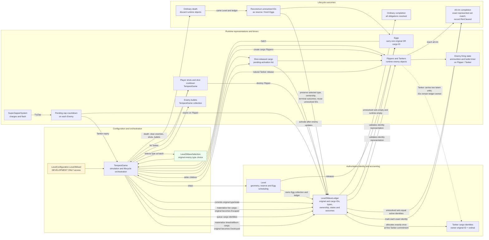
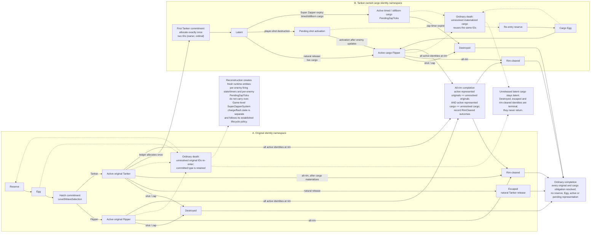

# Tempest C# Development Reference

## Purpose

This document is the durable development reference for the C# Tempest recreation. It exists so future AI sessions and coding agents do not need to reconstruct important gameplay decisions from chat history.

The goal is to recreate the behavior and feel of the original Atari Tempest arcade game. Mark Incitti's BlitzMax `tempest.bmx` is an important implementation reference, but observed arcade behavior takes priority when the two differ or when an interpretation of the source produces behavior that does not match the arcade game.

## Authority Order

When deciding behavior, use this order:

1. Observed original Atari Tempest arcade behavior, including manual comparison with real arcade controls and reliable gameplay footage.
2. Mark Incitti's `tempest.bmx` implementation as an engineering reference.
3. The current tested C# implementation.
4. New assumptions only when the first three do not answer the question.

Do not silently change established arcade behavior because another implementation seems cleaner.

## Current Development Workflow

- Develop and reason about gameplay behavior in small, testable milestones.
- Use the VS Code coding agent for coordinated multi-file work.
- Require `dotnet build` and `dotnet test` after significant changes.
- Manually validate graphical and control behavior after automated tests pass.
- VS Code Copilot must not launch the interactive Tempest game for manual acceptance.
  Neal often walks away while an agent prompt runs because completion time is
  unpredictable. After automated validation, stop and provide the exact command:
  `dotnet run --project src\Tempest.Game -- --lives 10`. Neal launches and tests it.
- Use the four-layer development and testing strategy below; automated validation
  supplements rather than replaces Neal's manual gameplay acceptance.
- Commit only known-good milestones to Git.
- Do not rely on AI conversation history as the permanent project record.

## Active Development Repository

The active development repository is
`C:\Users\nrnob\source\repos\Tempest`. The former
`C:\Users\nrnob\OneDrive\Repro\Tempest` copy is a frozen temporary safety copy
and is not the active repository. Recurring Windows Application Control
blocking was observed while generated development assemblies were under the
synchronized OneDrive project path. After moving to the local repository,
removing generated `bin`/`obj` output and rebuilding, the build, test assembly,
tests and game launch worked normally. This supports the practical move; it
does not prove the underlying Windows security root cause.

## Four-Layer Development and Testing Strategy

1. **Unit/integration tests** verify precise mechanical correctness.
2. **Headless gameplay and campaign regression** rapidly exercises real game-state sequences.
3. **Visible deterministic gameplay playback** lets Neal watch selected levels and scenarios
   without manually reaching them, and may eventually support a recorded-player arcade-style
   attract mode.
4. **Normal manual gameplay** remains the final authority for arcade fidelity, visual and audio
   behavior, responsiveness, feel, and playability.

Automated validation supplements Neal's manual gameplay acceptance. It does not replace it.

## Current Architecture

The repository is organized under `src/Tempest.Game` and `tests/Tempest.Game.Tests`.

Important areas include:

- `Program.cs` - startup/composition and main frame loop only.
- `TempestGame.cs` - high-level simulation/game orchestration.
- `Gameplay/Player.cs` - player state and movement.
- `Gameplay/Shot.cs` - player projectile state.
- `Gameplay/Flipper.cs` - Flipper behavior/state.
- `Gameplay/Egg.cs` - incoming enemy precursor state and hatching behavior.
- `Levels/Level.cs` - Level 1 state, enemy reserve/accounting, and level progression data.
- `Rendering/Projection.cs` - established perspective projection.
- `Rendering/VectorRenderer.cs` - tube, player, projectile, enemy, Egg, and HUD drawing.
- `Systems/InputSystem.cs` - input sampling.
- `Systems/ScoreSystem.cs` - score state.
- `tests/Tempest.Game.Tests/SimulationTests.cs` - headless simulation tests protecting established gameplay behavior.

Existing scaffold files for later enemy and system types should be reused rather than creating duplicate concepts.

## Known-Good Git Milestones

Important confirmed commits in the history include:

- `b024828` - Working Level 1 prototype with spinner, Flipper, scoring and lives.
- `2c610ac` - Level 1 multi-Flipper wave and arcade-accurate rim collision.
- `1e5ccbb` - Refactor prototype into game systems and add tests.
- `597ca6b` - Remove an accidentally created file after the refactor.

The Egg/hatching work should receive its own commit only after full manual validation.

## Established Display and Projection

Preserve unless intentionally revisited:

- Logical rendering/projection canvas: 800 x 600.
- Windowed client area: 1280 x 960 (PROJECT DECISION candidate; manual
  acceptance pending), uniformly scaling the logical canvas by
  1.6 with one Raylib camera transform. The full scene, text and HUD share the
  same 4:3 presentation scale; gameplay geometry and HUD coordinates remain
  on the 800 x 600 canvas.
- `Projection.K = 70`.
- `Projection.ZOffset = 5`.
- Level 1 uses the established 16-segment circular tube geometry.
- Ordinary Level 1 tube rendering is blue; the occupied Blaster lane's two
  full-depth longitudinal boundaries are yellow.
- Player Blaster is yellow.
- Player shots are white.
- Level 1 Flippers and incoming Egg/precursor points are red.

Neal's arcade observation establishes that the two boundaries of the occupied
lane are recolored along the tube depth and follow the Blaster; early levels
use yellow. Incitti's source marks the indexed edge's two depth-running rails,
uses palette-specific `COL_CLAW` color, lets Pulsar pulse coloring supersede
the player color, and otherwise draws the player color over the Super Zapper
flash. C# uses `Player.EdgeIndex` and the adjacent topology vertex; its palette
0 lane color is yellow. The palette resolver is deliberately narrow; later
palette colors/cycling remain deferred. The lane cue is shown in Playing,
Approach, PlayerDying and active AvoidSpikes, and hidden during ExitDelay,
ExitZoom and terminal presentations. This visibility policy is a project
decision where Atari presentation behavior is not established. Neal manually
accepted the C# rendering across Levels 1-3, both approaches, spinner/lane
movement, Super Zapper and Pulsar interactions, with no flicker or rendering
artifacts. Later palette colors/cycling have not been validated.

Do not tune projection or Level 1 geometry casually. These were established early and have remained stable through subsequent gameplay work.

The checked-in Incitti implementation also declares an 800 x 600 logical
canvas and opens that size directly in windowed mode, with no separate
presentation upscaling. It defaults to windowed mode and toggles between
windowed and fullscreen with F12; fullscreen requests an available
800 x 600 display mode. The larger C# window keeps Incitti's fixed-canvas
approach while applying one uniform 1.6x output transform. This does not
change the 60 Hz simulation or relative mouse/controller input. Fullscreen is
not currently implemented; the larger fixed window is the display target.
Manually validate the enlarged native window and gameplay presentation before
treating the display change as visually accepted.

The original cabinet's vertical vector monitor is not a reason to switch
this recreation to portrait or alter its established projection/model
geometry. Gameplay starts and resets with K = 70 and ZOffset = 5; the
pre-existing Projection type initializer of K = 65 is not a presentation
setting and remains unchanged. Existing exit/reverse zoom animation remains
unchanged.

For Neal's 1920 x 1080 desktop, 960 client pixels leave only 120 vertical
pixels for the title bar, borders, taskbar and placement margins at 100%
desktop scaling. Decorations and DPI scaling can reduce usable space further;
manually check the entire outer window against the desktop work area.
Do not silently shrink the 1280 x 960 candidate to address this concern.
The camera changes drawing only, not raw relative mouse deltas, cursor
capture, keyboard/controller mappings or the standalone diagnostic's event
logging. Native visual quality and input feel remain manual checks.

## Player Controls

### Arcade Spinner

A real arcade spinner is connected to the development PC. Windows presents spinner rotation as horizontal mouse movement.

The game uses relative mouse movement and captures/hides the cursor during gameplay so the spinner can rotate indefinitely without the OS cursor leaving the game window.

Preserve:

- Spinner horizontal direction.
- Current spinner sensitivity unless deliberately recalibrating against the arcade experience.
- Cursor capture during gameplay.
- Left/right keyboard movement as a development fallback.

Tempest is fundamentally designed around a spinner. Keyboard/mouse fallback may technically operate the game, but arcade-spinner behavior is a critical requirement.

### Fire

Firing currently accepts keyboard Ctrl and left mouse/arcade-button input. The existing maximum active player-shot limit and shot timing should remain unless intentionally changed from a verified source.

### ROM-derived player-shot vector picture (2026-11-08)

- **ROM-LISTING-BACKED** — Graphic-table entry `$ced0` selects the static vector
  picture at `$1594` (`$3594-$3620`). It enables sparkle and contains nine
  zero-displacement point instructions in color index 8 followed by eight in
  color index 1. Blank movement vectors reposition the beam; they do not draw
  connecting segments. The picture does not vary by age or lane orientation;
  `graphic_at_mid` supplies its external lane/depth projection and scale.
- **ROM-LISTING-BACKED / COORDINATE QUALIFICATION** — Raw words at `$3600` and
  `$3608` decode as `(0,-11)`; `$3610` and `$3618` decode as `(+11,0)`.
  This preserves the local listing's decoded repeated moves despite conflicting
  inline guesses. The final accumulated points are `(-11,0)`, `(-11,-11)`,
  `(0,-11)`, `(11,-11)`; do not infer a symmetric outer ring from comments.
- **ARCADE/MAME-OBSERVED** — Supplied captures show small warm-colored lane
  marks and a separate, brighter white target-destruction burst. They support
  the qualitative distinction but do not establish this picture's exact RGB
  values or individual point locations.
- **PROJECT TRANSLATION** — C# accumulates ROM
  relative moves into immutable point groups and renders compact pixel marks.
  ROM Y-up is converted to screen Y-down. The existing 4.5 project size is
  retained as the scale of the maximum ROM point radius `sqrt(11^2+11^2)`,
  then reduced by the existing reciprocal depth projection. Project RGB
  translations are index 8 `#FFB000` and index 1 `#FF4000`; the ROM listing
  establishes the indices, not these RGB values.
- **UNKNOWN / UNRESOLVED** — The listing does not specify literal RGB values,
  C# pixel size, or exact hardware sparkle/flicker appearance.
- **PREVIOUSLY ACCEPTED PROJECT BEHAVIOR PRESERVED** — Firing input/cadence,
  ten-shot capacity, three-tick cooldown, six-unit movement, collision,
  scoring, Spike interactions, recording/playback, and all other shot lifecycle
  behavior remain unchanged. `Shot.Rotation` still advances as legacy state
  but no longer transforms rendering.
- **MANUAL ARCADE-FIDELITY ACCEPTANCE** — Neal has manually play-tested this
  candidate and considers its shot shape, appearance, size, colors, scaling,
  and overall visual presentation perfectly recreated. This accepts the
  resulting project presentation without reclassifying the RGB translations
  or 4.5 normalization as literal Atari hardware constants. No further
  Blaster-shot visual tuning is currently required.

Firing input, cooldown, capacity, shot simulation, collision, Spike behavior,
score, sound, recording/playback, and all other gameplay behavior remained
unchanged during this rendering milestone.

### Controller keyboard compatibility (2026-10-31)

Neal's physical USB controller run in `--input-diagnostic` confirmed ordinary
Raylib keyboard press and release events for P, Enter, Space, left Ctrl,
left Alt, left Shift, Z, X, C and V. Text-producing buttons also exposed
character events, but production input uses only the existing key-state APIs.
This establishes usable Raylib events, not a particular USB/HID or Windows
injection mechanism. Subsequent physical-controller gameplay testing passed
for Space when available, resolving the earlier uncertainty for practical
validation without attributing a cause to the earlier isolated failure.

P remains an additive R alias for the existing Game Over/Level Complete
restart/replay request, using `IsKeyPressed` and the same state gates.

**Current production mapping (2026-11-06):** the physical controller button
that emits ordinary V must not quit or acquire another gameplay action, so V
is intentionally unmapped in production. Enter is the controller-friendly
immediate quit alias. The main loop checks Enter before the next simulation
step and uses the existing cursor/audio/window cleanup. Raylib's default
Escape and window-close behavior remain unchanged. The standalone input
diagnostic still reports both V and Enter key events without performing game
actions. Neal manually accepted these controls on 2026-11-06: V no longer exits,
Enter exits immediately without confirmation, Escape/window close remain
available, and other controller mappings are unchanged. These are control
convenience decisions, not ARCADE VERIFIED rules.

Space/right mouse zap, Ctrl/left mouse Fire, spinner and keyboard arrows are
unchanged. Z/X/C/Alt/Shift/1/5 have no new actions. The 2026-10-31 manual
controller validation recorded P/V behavior before this remapping; the
2026-11-06 acceptance covers the new Enter/V behavior.

The small red Atari-style Player 1/Player 2 volcano buttons under Turbo Mode
produced no observable Raylib diagnostic event. Their investigation, including
a possible future Player 1 Start binding, is explicitly deferred; no lower-
level Windows hook, Raw Input or remapping software was introduced.

The standalone DEVELOPMENT ONLY diagnostic remains available and does not
run during gameplay. Its readability and Neal's reported Tee-Object capture
issue are non-blocking diagnostic usability concerns, not part of this change.
Manual controller/input validation completed PASS on 2026-10-31 on both the
ordinary keyboard and physical USB controller, using the then-current P/V
aliases. That historical validation predates the 2026-11-06 V removal and
Enter quit mapping. Neal's 2026-11-06 manual acceptance covers the newly
reported direct-start and exit-control behaviors; it is not additional
acceptance of other controller controls.

### Deferred fidelity comparisons

- **Spinner:** current C# movement is good, very playable and not a blocker.
  Using the same physical USB spinner, Neal found Incitti's response
  effectively perfect without changing Windows mouse settings. A dedicated
  future task should compare actual spinner/input/movement processing before
  changing sensitivity; no spinner refinement is part of this checkpoint.
- **Timing:** Neal's qualitative assessment, informed by extensive Atari
  arcade experience, is that Incitti's timing feels extremely close to the
  arcade. C#/Incitti timing differences are useful future investigation
  targets, not grounds for casual dismissal. Direct arcade observations
  remain highest authority; Incitti remains an engineering/reference source,
  not automatically ARCADE VERIFIED.
- **Visuals:** Neal rates C# Blaster/enemy rendering impressive and reasonably
  faithful at roughly 3.5/5, versus approximately 5/5 for Incitti's arcade
  resemblance. These subjective ratings are neither measurements nor
  automated acceptance criteria. Defer a visual-fidelity milestone comparing
  actual vector/object definitions, transforms, projection, scale, animation
  and rendering behavior before changing graphics.

## Confirmed Player Projectile Behavior

Established prototype behavior includes:

- Maximum of 10 simultaneous player shots.
- Player shots travel inward/down the tube.
- Shot movement uses the established 6-unit update rate.
- Shots use a static ROM-derived two-color point-picture translation, manually
  accepted by Neal as arcade-fidelity correct; its RGB and project-space size
  remain C# translations rather than literal Atari hardware constants.
- Shot collision must be processed before completed Flipper-to-player collision in the frame update order.

## Flipper Behavior

### Level 1 Climb

For Level 1:

- Flippers enter at the far end of a lane.
- They climb toward the player at the established Level 1 rate of 2 units per update.
- Level 1 Flippers do not perform mid-tube lane flipping.
- On reaching the player rim, they pause and then pivot between adjacent rim segments while pursuing the player.
- Rim pause is currently 24 update ticks.
- The accepted normal rim-turn rate is 2.5 times each level's configured Flipper turn rate: Level 1 is 20 degrees per update, while Levels 6-7 are 22.5. The former configured rates still govern below-rim turning.
- Destroying a Flipper awards 150 points.

### Critical Arcade Rim-Collision Rule

This behavior has been manually verified as matching the original arcade game and must not be "simplified" into ordinary overlap collision:

- A Flipper that arrives directly at the rim in the Blaster's lane kills on
  that arrival. A Flipper arriving in another lane pauses and pivots toward the
  Blaster; visual overlap during that pivot is safe until the pivot completes
  into the occupied lane.
- A Flipper paused on the rim remains shootable.
- A Flipper remains shootable during the entire visible pivot toward the Blaster.
- The player can rapidly move the Blaster underneath a Flipper while that Flipper is visibly pivoting. Visual overlap during that pivot does not kill the Blaster.
- The Blaster is destroyed when the Flipper directly arrives in its lane or
  fully completes a pivot into the lane/location currently occupied by it.
- If the player destroys the Flipper before pivot completion, the Blaster survives.

Automated tests should continue protecting this behavior.

## Lives and Player Death

Established behavior includes:

- Three lives at the beginning of the current game prototype.
- A 60-tick player destruction state.
- Gameplay resets after a lost life without resetting score.
- Previously destroyed enemies must remain destroyed after losing a life.
- Game Over occurs after the last life is lost.
- Restart behavior must remain functional.

Enemy reset/accounting after death must never duplicate or lose enemies.

Neal directly observed active enemies retracting backward/down the tube while
inactive after the Blaster is destroyed. He observed that Spikes remain fixed
on the web and that complete retraction takes no more than approximately two
seconds; the duration is a qualitative upper bound, not an exact measurement.
The C# implementation keeps the existing 60-update death boundary and applies
a deterministic linear render-only depth offset over those updates (one
second at 60 Hz). This timing and curve are **PROJECT DECISIONS**, not
arcade-exact values. Logical enemy state and accounting stay frozen; Spikes,
Eggs, bullets and hazards retain their distinct existing policies. Incitti's
shared depth/projection shift is **REFERENCE VERIFIED**, but it is not a
dedicated enemy retreat routine. Neal manually accepted the visible C#
retraction on Levels 1-3, including mixed-wave/Tanker behavior, fixed Spike
persistence and the pre-existing terminal Game Over/R-to-restart placeholder.
The final-life presentation described below was accepted separately. The
supplied Atari frames establish the Blaster-location effect's qualitative
layered, multicolor expansion/contraction/remnant progression; exact geometry,
timing, and scale remain unmeasured. The C# renderer uses the accepted 150% visual-radius
implementation, independently from gameplay. Neal judged the enlarged result
nearly perfect, reported no gameplay issue, and requested no further visual
tweaking. The project targets acceptably faithful arcade experience with
reasonable compromises, not a frame-perfect or identical clone; the exact
implementation constants remain project decisions.

### Game Over presentation (manual acceptance: good enough for now)

The local Atari disassembly shows the shared vector-text renderer selecting
centered `GAME OVER` at scale 1 and palette index 5, with display selection
involving play state and `timectr & $20`; it establishes no standalone
Game-Over-only hold duration. The distinct state `$24` is labeled a
high-score explosion and is reached on a score-qualifying route, not after
every arcade Game Over. Its 16 indexed records use randomized movement data,
start from `$80` coordinates, stop spawning as `$010E` counts down from `$20`
on alternating `timectr` values (32 decrements over 64 ticks), and drain until
the active-record flag clears. The pending-vector drawing layer selects
palette index `$0C`; graphic ID `$1F` selects a 16-entry template with two
nonzero subrecord values, `$47` and `$4A`. This establishes multiple vector
elements per parent record, not their literal geometry.

### Sequential arcade-frame observations

The 99 ordered images `Videos/fireworks/Fireworks_frame_0001.png` through
`Fireworks_frame_0099.png` show one bright central point developing into an
asymmetric, changing cloud of many point-like marks. Uneven rays/fans and
small groupings spread and redistribute; different groups coexist as new
marks appear and older ones disperse. The overall extent grows through the
middle of the sequence, then thins to sparse colored remnants near the end.
White/blue, cyan, green, yellow, red/orange and magenta/violet categories
coexist; these photos do not establish exact Atari RGB values. All people,
phone, hands, clothing, room, bezel, glass reflections, glare and photographic
artifacts were excluded. The image sequence does not establish a frame rate,
and visible streaks cannot be reliably classified as vector geometry versus
CRT/camera persistence.

The clean MAME-derived set at `Videos/Fireworks-MAME` contains 103 images. A
small chronological sample (0003, 0012, 0020, 0025, 0050, 0075, 0090 and 0103)
shows the tiny colored marks against the otherwise empty black display while
the effect is active. It materially supports, and does not contradict, the
previous 99-frame structure analysis. Neal directly observes that the tube and
GAME OVER presentation disappear immediately before the effect and remain
absent during it. Earlier review judged the then-current marks too dim and/or
small; later density calibration and overlapping bursts led to the accepted
presentation below.

The arcade celebration is associated with qualifying for the leaderboard and
high-score path. The current C# project does not implement that front end.

Neal's manual acceptance is **GOOD ENOUGH FOR NOW**. The GAME OVER text is
excellent and visually fits Tempest's vector style; no glyph/font tuning is
wanted. Tube suppression before the celebration is correct. During the
celebration, ordinary presentation is suppressed and only the effect appears
against black. The accepted sequence is final one-player death, GAME OVER over
the tube, ordinary tube/text/gameplay presentation disappearing, isolated
celebration on black, all burst records draining, terminal Game Over, then R
starting a fresh Level 1 game. The earlier single-burst
presentation was too sparse. The current presentation is sufficiently close
for this project stage, and no further Game Over visual tuning is requested.

The C# recreation deliberately runs the Game Over text and a state-`$24`-inspired
vector interlude after every final one-player death, then returns to its
existing terminal Game Over/R-to-restart behavior. This unconditional route is
a **PROJECT DECISION**, not literal arcade control flow. ROM movement,
16-record capacity, spawn/drain behavior and alternating `$010E` countdown
remain in place. Each active record is translated into a deterministic compact
two-dimensional cluster of tiny vector specks; child positions do not follow
the parent's velocity. The renderer-side `--game-over-density` multiplier
controls child-speck count only: 1 is the nominal two-speck baseline and 0.5
emits one speck per parent. The accepted default 2 emits four specks per
parent. Fractional density values deterministically distribute integer
counts across parent spawn ordinals. A stable parent rotation and golden-angle
sequence position the children within a 3-logical-pixel radius. The existing
2.0-logical-pixel line length and deterministic cycle through established
white, yellow, green, red, cyan, magenta and blue vector colors are unchanged.
Density 2 is **MANUALLY CALIBRATED / PROJECT DECISION**, not ROM-derived. The
positive finite `--game-over-density` multiplier remains development-only, is
not exposed in gameplay UI, and is not persisted; explicit 2 matches the
default, while values such as 0.5, 1, and 4 remain available for investigation.
The multiplier does not change mark geometry, parent motion, palette
translation, or gameplay.

The shape, cluster and color cycle are **ARCADE-OBSERVED / PROJECT
TRANSLATIONS**, not decoded `$47/$4A` geometry or ROM palette assignments; the
children represent unresolved visible structure and are not extra ROM
simulation records. Exact Atari RGB values remain unknown. During
`GameOverAnimation`, rendering clears to black and draws only the vector
effect; the tube/web, GAME OVER text, gameplay objects, projectiles,
explosions, HUD and gameplay messages are suppressed. The
`GameOverPresentation` tube and accepted GAME OVER text remain unchanged. The
120-tick text hold, C# projection and rare zero-velocity drain guard remain
**PROJECT APPROXIMATIONS**. The sequence's last image still contains sparse
marks; the complete arcade end condition, exact RGB values, per-element paths
and real-time duration remain **UNKNOWN**. No bloom/shader or image playback
is used.

`--game-over-density <multiplier>` is a development diagnostic for calibrating
the unresolved visual translation between ROM state-`$24` records and the
arcade-observed number of visible marks; density is not ROM-derived. The
previous velocity-aligned replication strategy was rejected after Neal found
that higher values increasingly looked like lines. Neal found the diagnostic
useful and preferred the tiny-speck appearance at 0.5 before the overlapping
bursts were introduced.

### Four-burst presentation (arcade observation / project translation)

- **ARCADE OBSERVED / MANUAL COMPARISON** — Neal observes approximately four
  distinct burst patterns in rapid overlapping succession. Each later pattern
  appears to begin around halfway through the preceding one; they are not the
  same pattern repeated, and their overlap accounts for much of the perceived
  richness. Density 0.5 had the best individual-speck character before the
  four-burst presentation; density 2 gives the best overall brightness/richness
  with the current presentation.
- **ARCADE OBSERVED (targeted clean MAME frames)** — Chronological sample:
  0001, 0003-0008, 0012, 0020, 0025, 0032, 0050, 0075, 0090 and 0103.
  The effect develops from one central area into an asymmetric spread. The
  sampled frames do not confidently establish four distinct origins or map
  individual marks to four groups; no exhaustive 103-frame review was done.
- **ROM-BACKED** — State `$24` iterates 16 indexed parents, initializes
  coordinates to `$80`, seeds signed POKEY-derived movement, and drains/reuses
  slots after the `$010E` spawn counter reaches zero. The counter yields a
  64-tick spawn window. Graphic `$1F` selects two nonzero vector subrecords,
  `$47` and `$4A`, but neither these subrecords nor the state loop identifies
  four groups, staggered four-event timing, records per event or multiple
  origins. Reuse can produce later records but is not evidence for a four-burst
  schedule.
- **PROJECT TRANSLATION** — Four separate instances each retain 16 parent
  slots and the existing movement, bounds, spawn/drain and seeded-random
  behavior. They start at ticks 0, 32, 64 and 96: 32 ticks is half the
  ROM-inspired 64-tick spawn phase. Earlier instances keep advancing while
  later ones start. All instances use the existing `$80` center; no spatial
  offsets unsupported by the sample were added. Their seeded parent
  arrangements and deterministic burst-index speck rotations yield different
  procedural patterns. The density multiplier remains per burst; 0.5 affects
  mark count, not the existing 2.0-logical-pixel mark size. Colors remain the
  existing per-parent multicolor cycle, not fixed burst colors.
- **MANUAL ACCEPTANCE** — The current four-burst presentation and density 2
  are accepted as good enough for now. Exact fidelity may be revisited later;
  no further visual tuning is requested now. The project grouping/schedule
  remains distinct from the arcade observation and is not ROM-derived.

## Egg Terminology and Behavior

### What "Egg" Means

`Egg` is Mark Incitti's internal name for the tiny incoming enemy precursor seen traveling in distant space toward the far/lower rim of the web.

Do **not** interpret `Egg` as a literal egg-shaped enemy.

The expected visual/gameplay idea is:

1. A very small incoming object is visible in distant space beyond the far end of the tube.
2. Incoming objects move around in the distance while waiting to enter play.
3. An incoming object approaches the far rim/web.
4. At the web, the Egg/precursor hatches into its real enemy type.
5. On Level 1, that enemy type is a Flipper.
6. The resulting Flipper begins the normal established Flipper behavior.

This presentation matches the developer's recollection of original Tempest gameplay; current Egg rendering is producing the expected visual behavior.

### Incitti Egg Mechanics Used as Reference

Important Level 1 Egg concepts from `tempest.bmx`:

- Level 1 begins with a total enemy supply represented by 10 Eggs/enemies.
- Four Eggs are initially active; the remainder are held for later release.
- General enemy release timing uses 50 ticks on the first level setup.
- A newly created Egg begins at height `-10`.
- Incitti draws an Egg as a single Flipper-colored point.
- While roaming, Egg movement operates on an eight-update cadence and moves between edges while changing negative height.
- Roaming height is kept behind the web, roughly between `-20` and `-1` in the reference implementation.
- No more than two Eggs are intended to be in the hatching process simultaneously.
- An approaching Egg increases height toward zero.
- At height zero, the Egg hatches into an enemy.
- Level 1 enables Flippers while the later enemy categories are disabled, so Level 1 Eggs produce Flippers.

Our C# implementation may use deterministic policies where needed to keep automated tests repeatable, but the visible pacing should still resemble the arcade game.

### Egg Rendering

The current intended projection relationship is:

`projectedDepth = Level.Position + Level.Depth - (egg.Height * 20)`

Because roaming Egg heights are negative, the incoming point is projected behind/beyond the far rim.

Eggs are currently rendered as small red points. Do not invent literal egg artwork unless strong arcade evidence calls for it.

## Enemy Accounting Invariant

For the current Level 1 Egg/Flipper implementation, enemy accounting must remain coherent across release, hatching, kills, and lost lives.

Before enemies are destroyed, the conceptual total is always 10 across:

- Unreleased/reserve Eggs.
- Active roaming/approaching Eggs.
- Active Flippers produced by hatching.
- Destroyed enemies.

Hatching is a conversion, not a kill and not creation of an additional enemy.

Previously destroyed enemies must never reappear following player death.

Level completion must not occur merely because no Flipper is currently visible if reserve or active Eggs still exist.

## Level 1 Completion Goal

Historical prototype rule (superseded): completion required destroying all ten
enemies. Current Level 1 completion also permits the established all-rim clear:
after Eggs are exhausted, enemies reaching the rim resolve without kill score.
The current behavior and evidence boundaries are recorded in
`TEMPEST-BEHAVIOR-SPEC.md`.

The Level Complete, Game Over, score, and lives displays already exist and should be preserved while new gameplay systems are added.

## Automated Testing Policy

Automated tests are valuable but are not sufficient proof that graphical gameplay works.

The Egg feature demonstrated this clearly: an early implementation passed its test suite but initially produced no visible Eggs in the running game because runtime integration still required correction.

Therefore every significant gameplay feature needs both:

1. Headless logic tests.
2. Manual runtime validation in the actual Raylib game window.

Important test areas include:

- Spinner-independent pure simulation logic where practical.
- Shot-before-collision update ordering.
- Flipper pivot shootability.
- Safe player movement beneath a pivoting Flipper.
- Collision only at completed pivot.
- Death timing and lives.
- Enemy accounting.
- Egg roaming/hatching behavior.
- Level completion.

Do not write automated tests that require opening or controlling a Raylib window unless there is a deliberate future decision to add an appropriate integration-test harness.

## Manual Validation Checklist

After significant code changes, manually check:

1. Tube geometry and projection look unchanged unless the feature intentionally changes them.
2. Physical arcade spinner direction and sensitivity remain correct.
3. Cursor stays captured during gameplay.
4. Arcade fire button works.
5. Player shots move and render correctly.
6. Flippers climb correctly.
7. Flippers remain shootable on the rim and throughout pivots.
8. Blaster can pass beneath a pivoting Flipper safely.
9. Completed pivot into the occupied lane destroys the player.
10. Incoming Egg/precursor points appear in distant space and hatch into Flippers.
11. Lives, reset, Game Over, restart, and Level Complete remain correct.
12. Rendering remains smooth during rapid spinner movement and multiple enemies.

## External Gameplay Reference

A useful visual gameplay reference supplied during development is the YouTube video titled:

`TEMPEST (ARCADE - FULL GAME)`

URL:

`https://www.youtube.com/watch?v=AiTgA3ZOoSo&t=198s`

The user identified approximately 23 seconds as the beginning of Level 0 gameplay in that video. Use it as a presentation/gameplay reference, not as a substitute for source analysis or hands-on arcade knowledge.

## Git and AI-Agent Safety

Before large AI-agent changes:

1. Ensure the working tree is clean.
2. Make a known-good commit.
3. Instruct the coding agent not to commit or push.
4. Require `dotnet build`, `dotnet test`, `git diff --check`, and `git status --short` at completion.
5. Inspect every changed path before committing.
6. Manually run the game and validate behavior.
7. Commit only after manual validation succeeds.

A previous VS Code agent task accidentally created an unrelated root-level file with a malformed filename. It was removed in commit `597ca6b`. Future coding-agent prompts should explicitly prohibit scratch, memory, prompt, report, or task-wording files outside legitimate project paths.

## Important Development Principle

Do not blindly translate Incitti's implementation.

Use Incitti's code to understand mechanics and constants, then compare the result with observed arcade behavior. If a literal source interpretation produces behavior that conflicts with confirmed arcade behavior, investigate and preserve the arcade behavior.

The Flipper rim-collision timing is the current canonical example of this principle.

## Incitti rimit / Hurry-Up Development Milestone

Starting checkpoint: `37535eb`. Only the direct `--fuseball-test` and
`--pulsar-test` scenarios enable this source-derived mechanic. It does not add
normal level composition or progression, and is not arcade-verified hurry-up.

`TempestGame.HurryUp` is a read-only game-owned latch. Active play advances the
shared pulse clock, player/firing, shots and enemy bullets, then checks for
completion. If still playing, it releases and updates Eggs, removes ready Eggs
through hatching, updates enemies (including those hatchlings), checks player
collisions, latches hurry-up, then checks completion again. The trigger requires
zero reserve Eggs, zero active Eggs, and at least one active enemy below
`Level.Depth`. The below-rim predicate also guarantees an active enemy exists.
Post-update height matters: an enemy reaching the rim on this tick does not
qualify just because it was below the rim before its update.

The trigger tick's enemy updates use the previous latch value. The next active
tick is the first to use newly activated hurry-up. Pulsars hatch at zero and
reach height one on their hatch tick; Fuseballs hatch at zero and increment
their lateral counter on that tick. Tests pin the last approaching Egg's
39th/40th updates, ordinary trigger-tick behavior and next-tick effects.
If a collision begins PlayerDying on the trigger tick, the end-of-tick latch
does not activate: PlayerDying skips the remaining Hurry-Up/all-rim/completion
checks. A latch that was already active still freezes with the established
death policy.

The latch starts false, never unlatches during the same-level attempt, and
survives all 60 PlayerDying updates and ordinary fresh-Egg reconstruction.
Replenished reserve/active Eggs after life loss do not clear or recalculate it.
Re-entered enemies receive the existing latch from their first active update:
Fuseballs first double the climb term when they enter climbing; Pulsars first
redirect when they next evaluate a top-end decision. Full Game Over restart
and Level Complete replay clear the latch through level initialization.
Existing restart/replay score and lives policies are unchanged.

Fuseballs still consume the ordinary boundary random roll, then hurry-up
overrides descent with climbing. A climbing update adds the existing source
term twice before clamping (3.3 + 3.3 = 6.6 in this development wave).
Already-descending Fuseballs retain their original speed and duration rules.
Lateral cadence, retargeting, collision windows, score bands and four-frame
five-color animation are unchanged.

Pulsars still consume their top-end random roll, but hurry-up forces the
18-update lane pause / flip branch rather than the descending rim-pause
branch. It does not interrupt an existing pause/descent or alter mid-tube and
bottom decisions. Climb, descent and climbing flips remain one unit per
movement update. The 14-update rim pause, lane transfer, shared 181-update
oscillator, pulsing-lane collisions and existing rendering are unchanged.

Hurry-up itself neither removes nor resolves a unit, awards points, increments
destroyed count nor changes Egg totals. The separate all-rim completion
milestone below now takes precedence after Eggs are exhausted and every active
enemy reaches the rim; below-rim Fuseballs/Pulsars continue to trigger
Hurry-Up.

Automated validation: focused hurry-up/Fuseball/Pulsar selection 121 passed,
0 failed, 0 skipped; full suite 289 passed, 0 failed, 0 skipped. Solution build:
0 warnings, 0 errors. These are headless C# checks, not manual/arcade validation.
Run these separately for Neal's pending manual comparison:

```powershell
dotnet run --project src\Tempest.Game -- --fuseball-test --lives 10
dotnet run --project src\Tempest.Game -- --pulsar-test --lives 10
```

Observe exhaustion of both Egg sources, later boundary/top decisions, death
freeze and fresh-Egg re-entry, final-kill exit, and restart/replay. Exact arcade
trigger/timing, speed and random tuning remain unverified. The behavior
specification is intentionally unchanged pending implementation review,
automated validation and Neal's manual validation. No Super Zapper,
onrim-based exit, new levels, canflip, Tanker-carried Fuseballs/Pulsars, promoted
enemy bullets, new rendering or new scoring are included.

## Next Development Direction

After the Level 1 Egg/hatching milestone is fully validated and committed:

1. Preserve this document and update it with the resulting Git checkpoint and final automated test count.
2. Review Level 1 pacing against arcade gameplay.
3. Decide whether the next feature should be a missing Level 1 mechanic or the transition/zoom behavior after clearing the level before implementing later enemy categories.
4. Continue using small, manually verified gameplay milestones.

Do not begin later enemy types merely because scaffold files already exist. Introduce them according to verified Tempest level progression.

## Level 1 Clear and Exit Zoom

The final enemy kill now enters `LevelState.ExitDelay` on the same update,
provided all 10 enemies are destroyed and reserve Eggs, active Eggs and active
Flippers are exhausted. Shots are cleared. Firing, restart and enemy simulation
are ignored throughout the ordinary exit, with cursor capture unchanged.
Movement is frozen during ordinary ExitDelay, but remains available during
actual ExitZoom travel through the normal player movement path.

ExitDelay lasts exactly 21 subsequent updates. The transition update enters
`ExitZoom`; active zoom movement starts on the following update. The Blaster can
change lanes during travel, and the cleared tube and Blaster stay visible.

Player depth starts at 400, with projected depth computed as
`Level.Position + Level.Depth - Player.Depth`. Phase 1 reduces `Projection.ZOffset`
by 2 and player depth by 3 each update while the offset is at least -40. Starting
at 5, this takes 23 updates and leaves the offset at -41. Phase 2 increases
`Projection.K` by 2, adds another 2 when the updated K exceeds 100, and reduces
player depth by 3.2 each update. The existing claw proportions scale with depth;
normal gameplay retains its established shape and near-rim placement.

When player depth falls below 10, the game enters the existing `Complete` state,
restores K to 70 and ZOffset to 5, and displays the existing Level Complete text.
R replays Level 1 with normal depth, projection, Egg supply and exit counters;
the established replay score/lives behavior is preserved. No Level 2 or bonus
is implemented.

Automated validation: 54 headless tests pass, with no failures or skipped tests.
This includes exit eligibility, timing, phase changes, projection finiteness,
final-shot precedence, replay and the established gameplay regressions.
Manual visual validation is still required for recognizable cleared-level travel,
Blaster scale and lane alignment, zoom smoothness/framing, the final projection
restoration, message timing and physical spinner/cursor behavior after replay.

### Ordinary exit lane-control correction (2026-11-03)

Cause D: the ordinary exit had two gates absent from the working Spike exit:
Program discarded input during travel, and the simulation only advanced zoom.
Actual exit travel now polls input and reuses `UpdatePlayerMovement` /
`Player.MoveAlongTube`, without invoking ordinary firing. The final travel
update does not apply outgoing-tube movement after the approach handoff.

Focused coverage checks both directions of spinner, keyboard and controller
movement on Levels 1-3, exact delay/travel/projection progression, firing/restart
gates, and the normal approach. Level 4-5 movement, waiting and Spike
collision/reversal/retry remain covered and unchanged. All 686 solution tests
pass; the full build has no warnings or errors.

Neal manually accepted the correction on 2026-11-03: the Blaster can change
lanes during actual tube-exit travel on every implemented Level 1-5. Levels
1-3 now retain ordinary-exit lane control; Levels 4-5 retain their previously
working Spike/Avoid Spikes exit lane control. No new gameplay issue was
observed. This records acceptance of the C# correction, not new arcade fidelity.

## Spiker and Spike Development Milestone

Normal Level 1 remains Flipper-only with its validated input, collision order
and exit sequence. The explicit `--spiker-test` application argument selects a
development wave on the same geometry; it does not implement arcade progression.
Use `dotnet run --project src/Tempest.Game -- --spiker-test` to launch it.

The scenario starts height-60 spikes on all 16 lanes and uses the existing
ten-enemy Egg supply. Only Spikers and Flippers are eligible. Spiker selection
uses the source's negative-result bias, four-Spiker limit and active-enemies-plus-
Eggs restriction (reserve is excluded). Assigned Spiker speed is fixed at 3 for
this development wave: the fractional-argument coercion of BlitzMax's
`Rand(2.5,4.5)` is still unverified, so no claim of matching that distribution is
made. Tests inject Random to control selection and retreat decisions.

Spikers initialize without moving, build outward, and reuse their lane's spike.
The source-specific assignment `spike.Height = spiker.Height - 4` is preserved,
including possible brief shortening. Missing spikes are recreated at the
builder's current height. Retreat uses speed times 0.90 and returns one pending
Egg on removal, without a defeat or points. Spiker shots score 50; spike shots
score 1 and subtract 10 height, deleting at zero or below. Spikes persist through
builder death, retreat and life loss. Replay/full restart restores initial spikes.

Development-wave shot targets retain insertion order, including replacement
spikes created after their builders; they are not sorted by proximity. Normal
Level 1 retains its existing reverse Flipper collision scan. Spikers update in
creation order. The spiral follows the reference geometry and rotates 45 degrees
per simulation update (one update per displayed game frame); spikes are green
lines with white tips using the established projection.

Residual spikes do not count as enemies or block clear. This scenario uses the
first spike-enabled reference avoidance interval: 151 updates, followed by the
21-update delay and the established zoom. Movement and firing are allowed while
alive in those states; shots originate at current player depth. Locally, travel
processes depth, existing shots, spike hazards, then player input. A same-lane
spike with height greater than player depth triggers reverse zoom. The source's
K-minus-4/offset-plus-1 restoration and depth snap are preserved; the game always
waits for the full 60-tick life loss before retrying, rather than allowing a short
reverse zoom to cancel the loss. Spike-free Level 1 controls/timing are unchanged.

Automated validation: 81 tests passed, zero failed/skipped. Includes production
mixed-wave completion, insertion-order collisions, retreat accounting, spike
persistence, reverse-zoom retry/Game Over/replay, and finite render submissions.
The optional retreat bullet, other enemies, bonuses, audio and multi-level
progression are intentionally omitted. Manual comparison is still required for
spiral appearance/rotation, spike growth/damage feel, initial spikes, scoring,
avoidance timing and reverse-zoom presentation against original Atari Tempest.
Physical spinner, cursor capture, Flipper regressions and normal exit visuals
also require manual rechecking. Automated tests did not open a game window.

## Flipper Enemy Bullet Development Milestone

Historical implementation note: at this milestone, normal Level 1 was silent
and `--enemy-bullets-test` enabled a finite-ammunition Flipper model. That
movement-bound model was retired by the arcade firing correction below. The
flag remains a development seam in supported isolated scenarios. Examples:

```powershell
dotnet run --project src/Tempest.Game -- --enemy-bullets-test
dotnet run --project src/Tempest.Game -- --enemy-bullets-test --lives 10
dotnet run --project src/Tempest.Game -- --spiker-test --enemy-bullets-test --lives 10
```

The retired model assigned 1-3 bullet attempts and a 16-call timer. The retained
bullet starts on the firing lane at the Flipper's post-movement height, moves
outward by 3 per update, and expires only after exceeding depth 400. Same-lane
player collision requires
`Depth - bullet.Height < 8`; same-lane player shots hit when shot depth is
strictly below bullet height. Bullet hits award 25 points and do not alter enemy
accounting. Bullets remain frozen through the death animation and are cleared on
life reset; they are also cleared when exit starts.

Development shot collision dispatch uses explicit insertion order: hatching
adds a Flipper to the test target list; bullets append when created. Thus a
Flipper precedes its bullets in a collision tie. Normal Level 1 retains its
existing reverse Flipper-only collision path. Player/Flipper movement, firing,
projection and exit behavior are unchanged. Bullets render as distinct white
radial lines using projected size based on 6 units and rotate 15 degrees per
simulation update.

Automated validation: 111 headless tests passed, zero failed/skipped. Manual
comparison remains required for Flipper bullet cadence/ammunition, visible scale
and speed, rim hit reach, score display and arcade hit feel. The original source
is an engineering reference, not confirmation of arcade accuracy.

## Tanker Cargo Development Milestone

Normal Level 1 and `--spiker-test` remain unchanged. The mutually exclusive
`--tanker-test` scenario creates exactly one deterministic Tanker from original
Egg slot 0; the other nine original slots hatch as ordinary Flippers. Run it with:

```powershell
dotnet run --project src/Tempest.Game -- --tanker-test --lives 10
```

The Tanker is fixed to its hatch lane, starts at height 10, carries two latent
Flipper units, and now uses the C2-corrected reference-tier climb speed of 1.75
(the original milestone used the unsupported 1.85 approximation). It releases
only after updated height exceeds 385. Natural release awards no Tanker score;
shooting the Tanker requires same lane and shot depth strictly below its height,
consumes that shot, awards 200, and releases live cargo. Neither path changes
ordinary Flipper behavior. Cargo appears on opposite adjacent lanes at release
height, starts in the existing Flipping state with calculated geometry and
opposing directions, and advances beginning on the next simulation update.

Tanker mode keeps a separate original-slot ledger and materialized cargo-unit
ledger; it does not change `Level.EnemyTotal`, normal `EnemiesDestroyed`, or the
normal/Spiker ten-unit invariant. Original slot 0 is stable across resets. Before
release it returns as one Tanker Egg after a life loss, still carrying two latent
units. After release the Tanker slot stays resolved and surviving cargo snapshots
return as pending cargo Flippers, not Eggs. Level clear waits for every original
slot and materialized cargo unit to resolve, and for all active/pending entities
to be gone. The Tanker HUD separately displays unresolved original slots, cargo
units (including latent cargo) and active objects.

The shared development shot list retains insertion order: a Tanker is tested
before cargo appended after its destruction; the consuming shot cannot hit those
new children. Normal Level 1 keeps its existing collision path. Existing
Flipper-fired bullets can be explicitly enabled with
`--tanker-test --enemy-bullets-test`; this does not enable Tanker-fired bullets.
Tanker bullets, Super Zapper, zap timing, stillborn cargo, other carrier types and
full progression are deferred.

Automated validation: at the completion of the Tanker cargo milestone, 142 headless
tests passed, zero failed/skipped (per the Tanker implementation report; later
milestones changed the suite total). Manual
arcade comparison remains required for Tanker geometry/color/scale, climb speed,
release point, child placement and pivot appearance, score/pacing, player danger,
and reset/exit presentation. This scenario uses an intentionally deterministic
slot and cargo-side choice; it is a development test, not normal arcade progression.

## Flipper Enemy Bullet Development Milestone

Historical implementation note: normal Level 1 was then silent and the opt-in
`--enemy-bullets-test` flag enabled a finite-ammunition Flipper model. That
movement-bound model was retired by the arcade firing correction below. The
flag remains a development seam in supported isolated scenarios. Examples:

```powershell
dotnet run --project src/Tempest.Game -- --enemy-bullets-test
dotnet run --project src/Tempest.Game -- --enemy-bullets-test --lives 10
dotnet run --project src/Tempest.Game -- --spiker-test --enemy-bullets-test --lives 10
```

The retired model assigned 1-3 bullet attempts and a 16-call timer. The retained
bullet starts on the firing lane at the Flipper's post-movement height, moves
outward by 3 per update, and expires only after exceeding depth 400. Same-lane
player collision
requires `Depth - bullet.Height < 8`; same-lane player shots hit when shot depth
is strictly below bullet height. Bullet hits award 25 points and do not alter
enemy accounting. Bullets remain frozen through the death animation and are
cleared on life reset; they are also cleared when exit starts.

Development shot collision dispatch uses explicit insertion order: hatching
adds a Flipper to the test target list; bullets append when created. Thus a
Flipper precedes its own bullets in a collision tie. Normal Level 1 retains its
existing reverse Flipper-only collision path. Player/Flipper movement, firing,
projection, and exit behavior are unchanged. Bullets render as distinct white
radial lines using projected size based on 6 units and rotate 15 degrees per
simulation update.

Automated validation: 111 headless tests passed, zero failed/skipped. Manual
comparison remains required for Flipper bullet cadence/ammunition, visible scale
and speed, rim hit reach, score display, and arcade hit feel. The original source
is an engineering reference, not confirmation of arcade accuracy.

## Tanker Cargo Development Milestone

Normal Level 1 and `--spiker-test` remain unchanged. The mutually exclusive
`--tanker-test` scenario deterministically assigns original Egg slot 0 to one
Tanker; all other original slots hatch into ordinary Flippers. Run it with:

```powershell
dotnet run --project src/Tempest.Game -- --tanker-test --lives 10
```

The Tanker is fixed to its lane, starts at height 10, carries two latent Flippers,
and now uses the C2-corrected reference-tier climb speed of 1.75
(the original milestone used the unsupported 1.85 approximation). It releases only after
updated height is strictly greater than 385. Natural release awards no Tanker
score. A same-lane shot strictly below its height destroys it for 200 points and
releases the same two live Flippers. Children start at release height on opposite
adjacent lanes, in Flipping state with calculated geometry and opposing
directions. Their first update is deferred to the next tick.

Tanker mode adds a separate original-slot/cargo ledger and does not change
`Level.EnemyTotal`, `EnemiesDestroyed`, or the existing normal/Spiker accounting
invariants. Before release, a Tanker survivor returns as one Egg with two latent
cargo units. After release, the Tanker slot stays resolved and each surviving
cargo Flipper is restored as pending cargo, not an Egg or another Tanker. Clear
requires all original slots and materialized cargo units resolved and no active
or reserve entities. Tanker HUD rows distinguish unresolved ORIGINAL slots,
latent/materialized CARGO units, and ACTIVE entities.

Shot targets in tanker mode use the existing development insertion order. Tanker
is inserted when its Egg hatches; released cargo appends after carrier removal.
The consuming shot cannot hit newly created children. Normal Level 1 retains its
existing collision path. The isolated Tanker diagnostic's
`--enemy-bullets-test` option arms Tanker firing but does not enable Flipper cargo
firing. In natural production Levels 1-5, Tanker-created bullets share the global
active-shot pressure and capacity used by the Flipper firing phase. Exact arcade
Tanker firing integration remains deferred.

Automated validation: at the completion of the Tanker cargo milestone, 142 headless
tests passed, zero failed/skipped (per the Tanker implementation report; later
milestones changed the suite total). Manual
comparison remains necessary for Tanker line-art appearance, color and scale,
climb speed, release timing, cargo placement/pivots, player danger, score and
death/reset/exit presentation. This is a deterministic development scenario, not
normal Level 3 arcade progression.


## SUSPECTED / NOT YET REPRODUCED: converging rim Flippers

Reported by the project owner: two Flippers on the rim approaching each other from
opposite directions may converge on the same lane and stay synchronized, so they
look like a single Flipper. The original Atari game is reported not to do this.
This has NOT been reproduced in the C# game and NOT source-analyzed against Incitti
or the arcade. No gameplay change has been made. Investigate (reproduce first,
then compare with Incitti's pivot lane selection) before changing behavior.

## Super Zapper implementation milestone

Implemented after checkpoint `587b9e3`. Super Zapper is enabled in normal
Level 1 and all existing development waves. Space and right mouse use
edge-triggered input separate from held fire. `SuperZapperSystem` owns two
charges and the 60-display-step flash. Initial setup, Game Over restart and
Level Complete replay restore two charges; ordinary life loss preserves the
remaining charge. No charge counter or icons are drawn.

The shared `Enemy.TryZap` contract rejects by default. Flipper, Tanker,
Spiker, Fuseball and Pulsar accept/reassign the base-owned countdown;
EnemyBullet remains unaffected and Spike is not an Enemy. The game enumerates
development entities in their existing insertion order (including rejected
bullets) and uses Flipper creation order in ordinary Level 1, without changing
the reverse Level 1 shot scan. Strength 2 gives accepted targets 4, 6, 8, ...
updates and starts the flash even if all targets reject. Strength 1 follows the
literal Incitti loop: shortest circular distance on the 16-lane tube (direct
distance if non-continuous), strict `distance < bestDistance + 2` gate, then
strictly greater height, strictly smaller distance, or strictly greater source
type number. This preserves the source's executable type comparison even
though its nearby comment says “same d.” The selected target gets delay 4;
with no eligible target the charge is consumed without starting a new flash.

Activation precedes shots and enemy updates. Shots therefore resolve pending
targets first; otherwise every active enemy continues its ordinary behavior
on earlier countdown updates, while expiry resolves and skips behavior on that
visit. Flipper/Pulsar award 150/200, Spiker awards 50 without changing its
persistent spike, and Fuseball uses expiry-height `KillScore` plus its existing
score popup. Enemy bullets continue their existing movement/collision rules.
The former blue/Tanker-magenta whole-web flash was a project presentation, not
an Atari-ROM-derived color rule.

**MANUAL ACCEPTANCE: PASS.** Neal manually tested the corrected Super Zapper
visual presentation and reports that it is very good. No further visual or
gameplay changes are needed; treat this presentation as accepted project
behavior.

**ROM-BACKED:** While `zap_running` is positive, unoccupied longitudinal rails
use `phase = timectr & 7`, `index = phase == 7 ? 1 : phase`, yielding the
repeating slot sequence `0,1,2,3,4,5,6,1`. The phase is the free-running global
time counter, not activation-relative; activation does not restart it, so the
first visible slot depends on the current counter phase. Pulsar lane handling
has precedence, occupied Blaster boundaries remain slot 1 (yellow), and the
active Super Zapper slot is used otherwise. Near/far circumferential rim
connections retain normal slot 6; player and enemies retain their ordinary
colors. Normal rail selection returns when the presentation is inactive. Both
successful Super Zapper presentations use the same color-selection rule.

**PROJECT TRANSLATIONS:** C# maps slots 0-6 to existing white, palette-0
Blaster yellow, green, red, cyan, magenta and blue. The available ROM listing
omits the packed palette bytes at `$c1fd` as `.chunk 8`; exact Atari RGB values
remain UNKNOWN, and these mappings are not literal ROM-derived RGB values.
The existing 60-display-step presentation envelope and all Super Zapper
gameplay semantics remain unchanged. The global display phase continues during
death even though enemy timers and movement remain frozen.

Tanker zap expiry resolves the original slot as destroyed for 200, then
converts its two latent units into distinct unresolved cargo IDs. Each child
uses the source-adjacent lane/direction and normal Flipping geometry at carrier
height, receives an eight-update timer, and starts that timer on the next
simulation tick. This identity transfer does not change standard
`EnemiesDestroyed`; completion remains blocked until both cargo IDs resolve.
Ordinary shot and natural release still preempt a pending carrier zap using
their established outcomes. Death before carrier expiry restores the
unresolved slot as a Tanker Egg with latent cargo. Death after expiry restores
only unresolved materialized IDs as fresh cargo Eggs; resolved children and
earned score remain resolved. Repeated death/re-entry tests preserve IDs.

One source/project difference is retained deliberately: Incitti randomizes
the initial Tanker cargo side, while the C# development release path chooses a
deterministic first side. This deterministic orientation remains a C#
development decision. Incitti's literal release geometry pivots cargo inward
toward the Tanker lane, but Neal's arcade observation is stronger for the
visible result: both children survive the Tanker shot and appear on distinct
lanes other than the Tanker's. C# therefore uses an outward initial pivot to
keep the former Tanker lane out of both children's immediate collision paths;
the exact intermediate arcade route remains unknown. Below-rim pivots retain
their release direction, and cargo resumes player-directed pursuit at the rim.
Deferred child activation is likewise a project decision because static source
inspection cannot establish whether appended children update in the same pass.
No other contradiction required a design change. Super Zapper details are
**REFERENCE VERIFIED** against Incitti only and are not **ARCADE VERIFIED**.
`TEMPEST-BEHAVIOR-SPEC.md` remains unchanged pending implementation review and
Neal's manual validation.

Automated validation: focused Super Zapper tests 29 passed, 0 failed,
0 skipped; the full suite 318 passed, 0 failed, 0 skipped; solution build
0 warnings, 0 errors. These checks are headless. For manual comparison, run:

```powershell
dotnet run --project src\Tempest.Game -- --lives 10
dotnet run --project src\Tempest.Game -- --spiker-test --lives 10
dotnet run --project src\Tempest.Game -- --tanker-test --lives 10
dotnet run --project src\Tempest.Game -- --fuseball-test --lives 10
dotnet run --project src\Tempest.Game -- --pulsar-test --lives 10
```

Check Space/right-mouse press edges, both charge behaviors, delayed scoring
and ordinary movement, bullet/spike immunity, Tanker stillborn cargo and
re-entry, death charge persistence, restart/replay recharge, and the 60-step
tube flash while preserving Pulsar overlays, spinner feel, cursor capture,
Hurry-Up and existing exit behavior. Manual and Atari comparison remain
pending; audio, charge HUD, new enemy types, Level 3 and broader campaign
progression remain out of scope.

## Tanker-cargo direction correction

The post-Super-Zapper manual validation passed all five existing scenarios.
Separate Tanker-mode testing exposed that released cargo Flippers retargeted the
Blaster during below-rim pivots. The C# correction changes only Tanker-cargo
movement: children continue in a fixed direction through below-rim
pivot/pause cycles and resume player pursuit at the rim. Below-rim cargo pause
updates retain the source's one-unit climb; the deterministic side choice and
deferred activation remain project decisions. Normal Flipper movement, cargo
identity/accounting, eight-update stillborn timers, Super Zapper behavior,
Hurry-Up and completion rules are unchanged.

Neal verified that Atari Tanker cargo does not dynamically track the Blaster
below the rim. Follow-up manual testing found that children could disappear
after a Tanker shot. A deterministic test reproduced a lingering second shot
hitting a child because the first correction's inward destination made the
former Tanker lane part of both cargo collision paths. Neal established that
both children should survive and emerge on different lanes other than the
Tanker's. C# now chooses outward initial pivots; this is a project decision,
not an Incitti-derived route or a claim about the full arcade sequence. Exact
intermediate lanes and timing remain uncertain, and the behavior specification
remains unchanged pending validation of this final geometry.

Automated validation of the follow-up geometry is recorded in
`AI-Logs/Reports/2026-10-30-tanker-cargo-direction-correction-report.md`.
Manual validation of the final cargo geometry remains pending.

## All-rim completion implementation milestone

Implemented after checkpoint `7f6c776`. Neal's observation that exhausted
reserve/incoming Eggs plus all remaining enemies at the rim permit exit is
**ARCADE VERIFIED**. The C# cutoff (`Height >= Level.Depth`, currently 400),
the state-agnostic enemy set, exact update/tick ordering, pending-zap
disposition, and permanent rim-clear handling across Spike reverse/retry are
**REFERENCE VERIFIED / PROJECT DECISION**, not arcade-verified details.
The behavior specification was unchanged at this implementation checkpoint;
its later history records Neal's broad manual validation.

The single qualification check runs only in `Playing`, after Egg release,
Egg update/hatching, enemy/zap updates, pending cargo activation, and all
player/enemy/bullet/spike collisions. It requires no reserve Eggs, active Eggs,
pending cargo Eggs, unresolved latent cargo, or unrepresented Tanker identity;
at least one active Flipper, Tanker, Spiker, Fuseball or Pulsar; and every such
enemy at or above the rim. Enemy bullets and Spike hazards are excluded. The
existing early kill-all check remains after shots/bullets, preserving
same-tick shot-kill behavior.

Normal `EnemiesDestroyed` remains kill-only. `EnemiesRimCleared` separately
tracks non-kill outcomes, `RemainingEnemies` subtracts both dispositions, and
death/retry reconstruction does not recreate rim-cleared units. Tanker
original slots and cargo IDs have distinct rim-cleared sets; latent and queued
cargo fail closed, and aggregate resolved counts remain distinct from
score-bearing killed counts. Rim clear awards no points, creates no Fuseball
kill popup, preserves already-earned score, removes pending zap targets before
future score can resolve, and enters the existing ExitDelay or Spiker
AvoidSpikes path. Spikes remain persistent hazards; the Super Zapper flash
continues through exit. Below-rim Fuseball/Pulsar Hurry-Up remains unchanged,
and an existing latch does not block all-rim exit.

Historical checkpoint validation: all-rim/Hurry-Up 41 passed,
Tanker/accounting 57 passed, Super Zapper 31 passed, Spiker/exit 50 passed;
the full suite had 330 passes and the build had no warnings or errors. Neal
later manually confirmed broad all-rim behavior in all five listed scenarios.
Exact thresholds and internal policies remain scoped as
REFERENCE VERIFIED / PROJECT DECISION in the behavior specification.

Manual validation commands:

```powershell
dotnet run --project src\Tempest.Game -- --lives 10
dotnet run --project src\Tempest.Game -- --fuseball-test --lives 10
dotnet run --project src\Tempest.Game -- --pulsar-test --lives 10
dotnet run --project src\Tempest.Game -- --tanker-test --lives 10
dotnet run --project src\Tempest.Game -- --spiker-test --lives 10
```

Neal later manually confirmed the broad all-rim behavior in each listed
scenario. Exact thresholds, update ordering, pending-zap handling, accounting
and Spike-retry rules remain reference/project details as scoped in the
behavior specification. The commands remain useful as a regression checklist.

## Level 1 configuration groundwork

`LevelConfiguration.Level1` describes internal/displayed identity 0/1,
board/palette 0/0, closed Level 1 geometry, player start, ten-unit supply,
Egg pacing, standard exit policy and Flipper-only composition.
`LevelConfiguration.Level2Square` is the single immutable production Level 2
configuration; `--level2-test` selects that same object for direct development
access. Production Level 2 now enforces a maximum of four concurrently active
Flippers, with the original 12-unit supply. Four is **ROM-LISTING-BACKED /
REV-2-BINARY-CONFIRMED** across Easy, Medium, and Hard. Keeping blocked ready
Eggs in C#'s existing `ReadyToHatch` state is a **PROJECT TRANSLATION**, not
the literal ROM pending-entry implementation or timing. The former
`--level2-four-flipper-cap-test` controlled comparison is removed; its
accepted policy applies to normal campaign, generic `--level 2`, death/re-entry
and production recording/playback startup. The separate ROM `max_enm` gate
remains unimplemented; its value six compares inclusively and is not a strict
six-object cap.

The canonical Level 2 object retains board 1/palette 0, the closed 16-lane
square, 12-unit supply, Flipper-only composition, and the validated B1/B2
hinge/canflip path. Four starting Eggs, eight reserve originals, release and
approach timing, canflip/movement, firing and the two-shot bullet lifecycle,
the 50-active-tick reserve release and Egg approach cadence, 2.5 rim-speed
calibration, collisions, scoring, lives, Super Zapper, death/re-entry, and
rendering/audio remain unchanged. Production recordings use the existing
schema and inherit the current production simulation without cap metadata.
Accepted production Level 1 remains frozen; Levels 3-8 are unaffected.

## Level 2 production four-Flipper maximum (2026-11-09)

**ROM-LISTING-BACKED / REV-2-BINARY-CONFIRMED:** Level 2's maximum is four
active Flippers, unchanged across Easy, Medium, and Hard. Below-rim and rim
Flippers both count until ordinary active-object removal; a delayed Super
Zapper target continues to occupy its slot.

**PROJECT TRANSLATION:** The production hatch path checks the authoritative
active Flipper collection before invoking the ordinary hatch factory. At four
active Flippers, an eligible Egg stays in `ReadyToHatch`, unresolved, and
unrerolled until an existing lifecycle removes an active Flipper. It is not
destroyed, returned to reserve, rim-cleared, scored, or replaced, and waiting
consumes no repeated hatch randomness. Release and approach continue at the
accepted cadence. No update may transiently create a fifth Flipper. This is
not a claim about the ROM's literal pending-entry data structure or timing.

The 12-unit supply, four starting Eggs, eight reserve originals, 50-active-tick
reserve release, four-Egg queue, two approaching/ready Egg maximum, 50-active-
tick approach-selection interval, Egg update cadence and lane sequence remain
unchanged. Individual Flipper canflip direction/destination latching, pivot
geometry, movement, collision, shot ownership and randomness remain unchanged.
Firing, two-shot capacity, 77-tick C# holdoff, bullet visibility/collision,
2.5 rim-speed calibration, rim pursuit, death/re-entry, Zapper scoring and
resolution, accounting, completion, Level 2-to-3 progression, and recording
schema remain unchanged. There is no global active-enemy gate; do not infer a
strict six-object ceiling from the ROM `max_enm` value.
The manually accepted Level 2 canflip behavior and ordinary visible enemy
bullets remain intact. Existing recording files play back without error.
Broader concurrency work for later levels requires separate investigation and
manual acceptance; no global ROM active-enemy gate is implemented.

Neal manually compared normal production Level 2 with the diagnostic and
**passed the four-Flipper result strongly**: fewer simultaneous Flippers,
pivots, converging threats and grouped rim arrivals; more useful breathing
room; continued dangerous rim pursuit and normal visible enemy bullets; and
all 12 obligations still entering without an artificially sparse wave. The
promoted normal-production Level 2 also passed manual gameplay acceptance and
feels much closer to the original arcade. Canflip remains accepted, and
existing recording files play back without error. Production Level 2 is
**MANUALLY ARCADE-FIDELITY ACCEPTED**.

The small deep-end mark sometimes visible while an Egg is cap-blocked is the
actual unresolved Egg in `ReadyToHatch` at height zero:
**EXPECTED/HARMLESS PROJECT PRESENTATION**. Do not hide, move, remove, or
prematurely hatch it for appearance. Neal's possible memory of seeing
something similar is **VAGUE ARCADE RECOLLECTION / UNVERIFIED**. A pending
object could be consistent with the arcade, but if so might be rare in
ordinary play because destroying active enemies opens capacity before an Egg
remains visibly blocked for long. This is not arcade verification or evidence
that the C# mark or waiting-object model matches the original. If this
presentation becomes common or conspicuous on future production levels,
revisit it separately (**DEFERRED**).

Normal play advances from Level 1 and Level 2 only after successful standard
ExitZoom travel updates the player to depth below 10. Wave clear, ExitDelay,
death, Game Over and Spiker reverse/retry do not advance. The existing
fresh-wave initializer installs Level 2 or the existing
`LevelConfiguration.Level3Mixed` at the successful progression commit,
resetting projection and Super Zapper to two charges/zero flash while carrying
score and current lives. It enters a distinct approach state rather than
ordinary `Playing`; gameplay is frozen while the incoming tube approaches.
At arrival the established gameplay projection is restored exactly, and
ordinary simulation starts on the next step. No level bonus, bonus life,
source `startbonus`, Begin/Ready presentation, entry-position shift or audio
is implemented. These are presentation/economy omissions, not
arcade-equivalent behavior.

The shared approach permits rim movement by spinner, keyboard and left
gamepad stick, but suppresses player fire and Super Zapper. It uses a
transition-only depth offset with a deterministic 181-tick smoothstep to zero;
the accepted 960-unit initial offset and 96-unit vertical bias are project
tuning, not arcade measurements. Automated checks cover all natural edges
and exact projection restoration. Neal manually accepted the current
presentation during normal campaign play: no ExitZoom handoff discontinuity,
projection flash, wrong board, Blaster jump or new problem was observed. He
found it impressive and close to remembered Atari behavior. This is qualitative
acceptance of the current C# implementation, not verification of the
chosen timing, depth offset, smoothstep curve, controller dead zone or
exact projection trajectory.

Natural Level 3 now progresses to Level 4 after the accepted ledger reports
all original and cargo obligations resolved and successful exit travel
completes. Natural play and `--level4-test` use the same Level 4 production
configuration and gameplay; the diagnostic remains isolated. Level 4 is
temporarily terminal because Level 5 is not implemented. R from natural Level
4 completion or Game Over starts a fresh Level 1 campaign with reset score and
configured starting lives; diagnostic replay/Game Over restart return to
Level 4. Score and remaining lives carry into natural Level 4. Fresh setup
resets Super Zapper state and installs the configured starting Spikes, which
remain separate from the 17 enemy identities. Direct `--level2-test`,
`--level3-test`, and `--level4-test` do not enable campaign progression.
Spiker, Tanker, Fuseball and Pulsar development scenarios remain terminal and
replay their own launch scenario. Ordinary death reconstructs the existing
`Level`, preserving its configuration and resolved outcomes.

Neal manually accepted the visible natural Level 1 -> Level 2 -> Level 3
progression and the earlier Level 3 terminal/restart policy at C4. D2 changes
that policy to Level 3 -> Level 4; Neal subsequently manually accepted the
full natural Level 1 -> Level 2 -> Level 3 -> Level 4 campaign. This accepts
visible behavior, not hidden implementation details or new arcade evidence.
The accepted approach presentation and project timing are unchanged.

Definitions distinguish 16 ordered vertices from playable lanes: the current
closed Level 1 has 16 of each, while a geometry-only open-definition fixture
has 16 vertices and 15 lanes. This does not claim full open-tube gameplay.
The current four-Egg cap, release cadence and deterministic sequences are
project decisions, not literal Incitti behavior.

Fresh initialization detaches the old `SpikeCreated` callback and binds one
callback to the replacement runtime. The random source and shared pulse phase
continue across fresh replay as before; Fuseball animation resets on fresh
initialization and carries through life reconstruction. No behavior-spec
change or progression assertion was made for this groundwork.

## Isolated Level 2 square/canflip test

`--level2-test` is **DEVELOPMENT ONLY** and selects a closed 16-lane square
definition, board index 1, palette 0 and configured supply 12. It uses the
existing `Level` runtime and fresh-wave installation path. B1 established the
square endpoint-hinge geometry with canflip disabled. B2 enables ordinary
Flipper canflip only through this installed configuration; Level 1 retains
straight climbing and its legacy rim geometry and direction policy.

**REFERENCE VERIFIED**: the first climb adds 2, enters a zero-duration lane
pause, attempts firing, then samples the Blaster lane. The next update adds
1 and starts an adjacent pivot. Turning adds 8 degrees and 2 height; completed
turns pause for 21 updates below the rim or 24 at the rim. Below-rim pauses add
1 height and retain the initial direction across successive turns. Literal
Incitti Flippers resample at every rim-pause expiry, but Neal's later arcade
observation establishes that Flippers on the currently implemented closed-rim
Levels 1-4 do not reverse after commitment when the Blaster crosses behind.
This does not establish a universal later-level pursuit rule. The C# correction
therefore latches the first selected rim direction for current closed-rim play;
its exact first-selection tick remains a project decision. Future open-tube
endpoints may legitimately require reversal; that behavior remains deferred.
Same-lane ties use the existing injected
random source; signed antipodal choices follow Incitti. Bullet attempts occur
on climbing and pause expiry, not during turns. Bullets remain separately
opt-in, with the existing 1-3 ammunition and 16 timer.

**PROJECT DECISION**: preserve B1's clamped height, source-anchored hinge
representation, two-lane pivot shot acceptance and completed-pivot safety.
Incitti can briefly overshoot depth, assigns its lane at pivot start, accepts
shots only on that destination, and can kill before angular completion.
A lane pause newly reaching the occupied rim signals arrival; merely moving
under an already-paused rim Flipper does not introduce a new collision policy.
The shared literal direction helper was extracted from Pulsar without changing
its behavior. At this B2 checkpoint, Level 1 still used its legacy turn
geometry; C1.5 later replaced it with the shared directed endpoint geometry.
That geometry and its inward-pivot correction were manually accepted by Neal
on 2026-10-31 as recorded in the C1/C1.5 section below. Tanker cargo keeps
its separate direction and 24-update below-rim pause.

Neal completed B2 manual validation on 2026-10-31. **ARCADE VERIFIED**:
below-rim lane changes broadly resembled Atari Level 2; straight-side and
corner flips looked mechanically sensible with no snapping or wrong-lane
landing. Active transitions did not visibly retarget halfway through after
Blaster movement; later transitions may respond to its then-current position.
Below-rim transition geometry was not lethal, and rim pursuit and completed-
pivot behavior remained normal. No crash occurred and the B1 completed-pivot
renderer crash did not recur.

These observations do not measure the exact 8-degree increment, 21/24 pauses,
random/tie rules or call ordering, tick boundaries, height increments, endpoint/
radial math, numeric shot band or internal state representation. Those remain
**REFERENCE VERIFIED** or **PROJECT DECISION** as applicable. Passing tests
still proves C# contracts, not arcade fidelity. The prior qualitative
observations covered isolated Level 2 gameplay, not the end-to-end natural
transition or its setup.

### Natural Level 1-to-Level 2 manual validation

On 2026-10-31, Neal manually ran:

```powershell
dotnet run --project src\Tempest.Game -- --lives 10
```

He confirmed the normal Level 1 tube exit leads directly into the square Level
2 without an intervening Level Complete/R pause. The displayed identity
changed, square geometry appeared immediately, score and current remaining
lives carried unchanged, four initial Eggs were visible, the wave had 12
units, Super Zapper had two usable charges, and validated square/canflip
behavior remained normal with no observed regression. In the observed run,
10 starting lives became 8 after two Level 1 deaths and Level 2 started with
8; this example is not a fixed life-count rule. These broad observable results
are **ARCADE VERIFIED** within Neal's manual comparison. Exact transition
ticks were not measured.

Do not promote implementation details to arcade observations: the exact
`Player.Depth < 10` commit boundary, update ordering, fresh-runtime and
accounting reset, exact Super Zapper recharge/flash timing, Egg setup
sequencing, player start offset, callback/list cleanup and projection reset
remain **REFERENCE VERIFIED / PROJECT DECISION** as applicable.

### Atari between-level approach

Neal reports that after the Blaster exits a tube, Atari shows a brief
first-person approach through space toward the next tube. The next tube starts
small and distant and grows as the player approaches; the Blaster is visible
on the distant rim and spinner movement moves it around that rim during the
approach. Combat/enemy engagement begins after arrival. This is
gameplay-relevant because rim movement remains interactive. The C#
implementation uses a separate approach state for natural production edges,
freezes the fresh incoming wave, preserves rim movement, and suppresses fire
and Super Zapper. Neal has manually accepted the combined perspective and
starfield presentation and requested that it be retained without further
visual tuning. The recreation seeks convincing, personally accepted arcade
fidelity with reasonable compromises, not frame-perfect equivalence.

**ARCADE VERIFIED / direct visual evidence:** supplied Atari frames show many
tiny point stars (not streaks), blue early-level stars, a distant growing tube,
its tiny rim Blaster, diminishing stars and exact `SUPERZAPPER RECHARGE`
wording. **Neal's direct arcade observations:** stars start around halfway
through current-tube exit; exits 1-4 are blue and exit 5 onward mixes white,
red, green and blue; stars vanish shortly before arrival; spinner moves the
tiny Blaster. His approximately four-second journey target and 30-45-degree
elevated impression are qualitative, not measured numeric timing or pitch.

**PROJECT DECISIONS (manually accepted implementation):** 288 deterministic
point stars use a fixed integer-hashed jittered 16x18 distribution, with no
gameplay randomness. A centralized 1.6x RGB gain clamps channels to 255 without
changing alpha or point size. Source-level identity retained in `LevelApproach`
preserves colors across the exit/approach boundary. The 960-unit depth offset
and 96-unit vertical bias follow smoothstep to exact zero over 181 approach
updates, preserving normal projection, geometry and 1280x960 scaling.

Exit star visibility uses 50%-to-20% remaining-depth thresholds and a
192-star-reference zero-alpha cutoff. The first visible star is submitted on
ExitZoom update 65, with the incoming level committed on update 124.
59 remaining exit intervals plus 181 approach updates equal 240 intervals:
approximately four seconds at the normal 60-FPS cadence. `Program` runs one
update then one draw per frame; there is no accumulator/catch-up loop, so
slow frames can lengthen real time. Star removal follows
`1 - smoothstep(progress / 0.85)`; tick 154 is star-free, leaving 27 updates
before arrival. The recharge message is white, centered at logical Y=540,
size 20 during Approach; the normal top HUD is unchanged.

Those counts, distribution, gain, depth/bias, exact ticks/thresholds, color
proportions, interpolation and text styling are implementation choices, not
measured Atari internals. Later color policy is tested but adds no Level 5
gameplay. Automated tests protect deterministic state/geometry/timing and
gameplay freeze, not subjective arcade fidelity. Manual acceptance covers
the distant tube, bright points, tiny Blaster/spinner interaction, recharge
message and seamless arrival without snap, flash, wrong board or Blaster jump.
Incitti's sharper presentation is an engineering reference only.

## Deferred rendering and presentation fidelity

- **Blaster-lane highlighting implementation.** Neal observed the two web
  lines bounding the Blaster's current lane change color along the tube depth;
  early levels use yellow, and the highlight follows the Blaster around the
  rim so the occupied lane remains visible while looking deeper into the tube.
  The C# renderer colors the selected topology boundaries for Levels 1-3.
  Neal manually accepted the visible behavior and assessed this feature as
  identical to Atari. The broader Atari palette changes every 16 levels;
  future palette colors/cycling remain deferred and unvalidated.
- **Enemy death retraction.** Neal observed active enemies retracting
  backward/down the tube while inactive, with fixed Spikes remaining on the
  web. The C# implementation uses a render-only displacement within its
  existing 60-update death window; its linear one-second tuning is a project
  choice within Neal's qualitative approximate two-second upper bound. Neal
  manually accepted its visible direction, inactivity and pacing on Levels
  1-3, plus Spike persistence and Game Over/restart behavior. The exact C#
  duration and interpolation curve are not arcade-verified.
- **Blaster-location death animation.** The supplied Atari frame sequence
  establishes a qualitative compact-to-large-to-contracting, diminishing
  remnant layered multicolor vector effect. Neal manually accepted the C#
  deterministic countdown-envelope presentation at 150% of its initial visual
  radius as nearly perfect; no further tweaking is needed. This is acceptable
  fidelity with reasonable compromises, not a frame-perfect or identical-clone
  goal. Exact C# geometry, timing, and scale constants remain project
  implementation choices, not measured arcade values. Do not copy Incitti's
  distinct Blaster presentation as Atari behavior.
- **Player-shot size.** Neal observes that C# shots should be slightly larger
  to better match Atari. Neal manually accepted the rendering-only increase
  from a depth-scaled base radius of 4 to 4.5 units as a noticeable visual
  improvement and requested that the size be retained without further tuning.
  The 4.5 value is a project decision based on that visual acceptance, not a
  measured Atari constant. Shot gameplay and collision behavior are unchanged.
- **Broader entity/rendering fidelity.** Continue as a separate presentation
  workstream.
- **Spinner characterization/refinement.** A future task should compare actual
  spinner/input/movement processing before changing sensitivity.
- **Later levels.** Level 4 and subsequent levels remain future work.
- **Palette/color-scheme cycling.** The broader Atari palette changes every
  16 levels; future colors/cycling remain deferred and were not validated by
  lane-highlight acceptance.
- **Audio/sound.** Fidelity remains a long-term roadmap item. Timing is
  undecided; avoid coupling gameplay events directly to a specific audio
  implementation.
- **End-of-game presentation.** Animation and presentation remain deferred.
- **High-score tracking/persistence.** Remains a separate future item.

Before C4, Neal verified the then-current Level 2 terminal policy: no Level 3
appeared, the explicit "LEVEL 2 COMPLETE / NEXT LEVEL NOT IMPLEMENTED /
PRESS R TO START A NEW CAMPAIGN" presentation was shown, and R started a
fresh Level 1 campaign with score reset. That historical C# behavior was a
**PROJECT DECISION**, not a claim that Atari Level 2 is terminal; C4 replaces
it with natural Level 2-to-Level 3 progression.

```powershell
dotnet run --project src\Tempest.Game -- --level2-test --lives 10
```

Level 1 remains the normal no-flag startup. Neal manually accepted natural
Level 1-to-Level 2 and Level 2-to-Level 3 progression after successful exit
travel, score/lives carry, and the visible Level 3 entry/gameplay. This is
acceptance of the current C# behavior, not new arcade evidence. The direct
development flag remains terminal and replayable; it is mutually exclusive
with the Spiker, Tanker, Fuseball and Pulsar development scenarios. `--lives`
and the separately opt-in `--enemy-bullets-test` remain orthogonal and do not
disable normal progression.

## Isolated Level 3 plus-board geometry diagnostic

`LevelConfiguration.Level3Plus` is one source-derived configuration object for
the closed 16-vertex/16-lane `Level 3 - plus` board (board 2, palette 0,
center Y 400, Y offset -80). It records internal/displayed identity 2/3,
depth/position 400/50, player lane 7 at offset 0.5, configured supply 15,
four initial Eggs and eleven reserve units. Its deterministic spawn sequence
is a C# diagnostic policy, not the Incitti Level 3 Egg schedule or an
arcade-verified schedule.

`--level3-geometry-test` is **DEVELOPMENT ONLY**. It selects this same
configuration for a controlled Flipper-only geometry run; this is not a
production Level 3 mixed wave and does not claim production composition.
Flippers use the existing early-level values (climb 2, turn 8, below-rim pause
21, rim pause 24) with canflip enabled. The endpoint-hinge geometry mode is
shared with Level 1, Level 2 and the plus-board diagnostic. A directed
transition retains its source and destination lanes, selected direction,
shared hinge, and full sweep magnitude for duration. Its C1.5
`SignedSweepDegrees` remains separate from `SpatialSweepDegrees`, which selects
the inward side from polygon winding and the local convex/reflex turn. The
rendered free endpoint is also limited to the first polygon boundary along
that inward ray, preventing narrow concave geometry from crossing the far rim.
This preserves full 90/180/270 sweeps while moving the glyph into the tube/web.
The plus board's straight runs remain 180 degrees, outer corners 90 degrees,
and reflex corners 270 degrees, including the 15/0 wrap. The Flipper renderer
and update timer consume the same transition progress; its configured
8-degree step takes 12, 23, or 34 updates for 90, 180, or 270 degrees.

Pulsars retain the selected source/destination transition and use the same
inward spatial geometry; their 12-degree step therefore takes 8, 15, or 23
updates at those angles. Their logical `EdgeIndex` changes when the lane pause
expires, before the rendered pivot completes; the active transition preserves
both endpoints. The Blaster keeps its existing input signs and exact-boundary
lane convention, but normalized movement is interpreted as angular distance
(`movement * 180 degrees`) and traversal is weighted by the lane's hinge angle.
It follows the rim and does not use the enemy inward-pivot transform. Tanker
cargo keeps its project-selected outward lane route, fixed below-rim direction,
identity, release accounting, and next-tick activation; its initial and later
pivots use the inward spatial arc, retain the full sweep, and can reach the rim
before a long pivot finishes. The visible geometry and timing behaviors
described in the C1/C1.5 acceptance section below are **ARCADE VERIFIED** only
to the extent Neal observed them; exact source constants and internal state
remain reference/project details. Cargo remains unavailable in this diagnostic.

The flag is mutually exclusive with `--level2-test`, `--spiker-test`,
`--tanker-test`, `--fuseball-test` and `--pulsar-test`. `--lives` and the
optional `--enemy-bullets-test` remain composable. The diagnostic is terminal:
R replays the plus-board setup, Game Over restart returns to it, and life
reconstruction retains its Level configuration. It uses the existing
configured-supply accounting only; no production cargo ledger is added.

Natural campaign progression remains Level 1 -> Level 2 and terminal after
Level 2. Level 3 mixed-wave accounting, production Tanker composition and
Tanker firing remain deferred to later C2/C3/C4 work. The exact board is
**REFERENCE VERIFIED** from Incitti; manual validation establishes only the
specific visible behaviors Neal observed. The earlier C1 manual rejection led
to the C1.5 directed-rotation correction and inward spatial correction. Neal
completed manual C1/C1.5 validation on 2026-10-31 and passed Level 1, Level 2,
Level 3 plus-board, Pulsar and Tanker observations. The behavior specification
now records those observations as **ARCADE VERIFIED**; exact timing constants,
complete Atari cargo routes, internal C# geometry and development diagnostic
composition are not thereby arcade-verified.

### C1/C1.5 manual acceptance — PASS (2026-10-31)

Neal manually passed the combined Level 3 geometry, directed-rotation and
inward-pivot checkpoint:

- Normal Level 1 and Level 2 square Flippers swing inward through the web.
- On the Level 3 plus-board diagnostic, convex 90-degree and reflex
  270-degree pivots swing inward; the reflex route takes the full long route,
  not the opposite 90-degree shortcut. 180-degree transitions look sensible,
  and Flippers land on the correct lane.
- Blaster direction and movement feel correct during Level 3 validation. The
  longer 270-degree enemy transition preserves an opportunity to shoot or
  move underneath. No outward arc, snapping, strange tube crossing or crash
  was observed.
- Pulsars change lanes inward through the web with sensible direction and
  geometry-dependent duration. Pulse visuals and hazard remain normal; no
  unrelated regression or crash was observed.
- Tanker destruction releases two cargo Flippers on distinct non-Tanker lanes.
  Their established outward **lane route** remains correct while their visible
  pivot swings inward. Below-rim direction remains stable; rim arrival and
  subsequent behavior look correct, with no new collision problem or crash.

Keep the properties separate: destination/lane direction selects the route;
the full directed sweep determines its duration; spatial pivot side determines
whether the enemy arc swings inward through the web. The observed 270-degree
route must retain its long sweep and duration rather than normalize to 90
degrees. Blaster movement follows the rim and is not part of the enemy inward
transform.

This is **ARCADE VERIFIED** for the listed visible observations only.
Implementation data structures, polygon winding/interior math, source-derived
rates, exact tick counts, the complete Atari Tanker-cargo route, and the
diagnostic's artificial Level 3 composition remain **PROJECT DECISION**,
**REFERENCE VERIFIED**, or **DEVELOPMENT ONLY** as applicable. C1/C1.5 is
manually accepted; no C2 work is authorized by this acceptance.

## C2 Tanker firing reference correction (2026-10-31)

**REFERENCE VERIFIED:** the isolated Tanker default climb increment is now
1.75, correcting the earlier 1.85 approximation. Incitti's `1.75 + lv / 20`
uses integer division; displayed Level 3 has `lv = 2`, so the result is 1.75.
This is literal reference fidelity, not arcade-measured timing.

The firing algorithm is unchanged: ammo 1..2; initial timer 17..80; climb first;
post-climb height strictly below 380; decrement once per eligible update;
below-zero decisions reset to 16; inclusive 0..100 rolls fire only above 75;
ammo is consumed only on success. Natural release remains strictly above 385,
and bullet lifetime, cargo, Zapper, death and completion behavior are unchanged.
Uninterrupted default climb provides 211 eligible updates and releases on
update 215 at height 386.25. Deterministic two-shot paths prove capability,
not a guaranteed count under production randomness.

**DEVELOPMENT ONLY:** `--tanker-test` alone remains silent. Combined
`--tanker-test --enemy-bullets-test` enables the existing armed Tanker path and
does not enable Flipper cargo firing; it is not production Tanker promotion.
Neal's qualitative observation of individual interval shots and at least two
possible before release remains separate from the exact reference constants.
Exact Atari ammo, initial delay, interval, chance, cutoff and per-Tanker count
remain unknown.

**C2 manual validation PASS (2026-10-31):** Neal tested both existing commands.
The silent `--tanker-test --lives 10` control remained silent, with normal
Tanker/cargo behavior and no input regression. In combined
`--tanker-test --enemy-bullets-test --lives 10`, one uninterrupted Tanker
naturally fired two individual, separated shots before release, matching
Neal's Atari expectation. It continued climbing while firing, with no burst
at release. An already-fired bullet survived carrier release/destruction;
cargo, Super Zapper and input remained normal, with no unrelated regression.
This validates observable two-before-release capability, not a guaranteed
per-Tanker count or exact Atari internals. The randomized policy is accepted;
the 1.75 increment remains **REFERENCE VERIFIED**, not arcade-measured.
Firing remains development-only; the separate C4 progression change uses the
accepted mixed-wave model without changing its firing policy.

## C3a Level 3 mixed-wave model and C3b direct graphical access

The production-shaped `LevelConfiguration.Level3Mixed` shares the Level 3 plus
board definition with the Flipper-only geometry diagnostic. A configuration-
based `TempestGame` entry exercises the actual Level 3 scheduler, randomized
Flipper/Tanker selection, Tanker firing, owned cargo identities, Super Zapper,
death reconstruction and terminal completion paths.

C3b adds the direct graphical command
`dotnet run --project src/Tempest.Game -- --level3-test --lives 10`. Program
routes it to the same `Level3Mixed` configuration and existing game/renderer;
this is not another composition or simulation. Natural progression now uses
this same configuration after Level 2, while direct access remains isolated
and does not enable campaign progression. The Level 3 HUD reads unresolved
original/cargo counts from the authoritative ledger and counts active Tankers with other
enemies. Production Tanker bullets use the existing renderer path without the
optional `--enemy-bullets-test` flag; this direct diagnostic does not enable
the natural-campaign Flipper firing phase. Direct access is terminal and replay/restart use the
established lifecycle. This is **DEVELOPMENT ONLY**.

Neal manually accepted the visible C# graphical behavior across multiple
production-mode runs using the command above, without relying on
`--enemy-bullets-test`: entry/HUD, visible production Tanker bullets, silent
ordinary/cargo Flippers by default, player-shot and natural Tanker cargo
release, Super Zapper behavior, death/re-entry, and completion/replay all
passed. No crashes or other observed problems were reported. Overall rating:
**5/5 — "Impressive."** This is acceptance of the visible recreation only,
not verification of hidden identity/timer/RNG internals or unknown Atari
behavior. Composition probabilities and source-derived mechanics remain
**REFERENCE VERIFIED**; C# identity and lifecycle policy remains **PROJECT
DECISIONS**.

The 15 original IDs and each committed Tanker's two `(owner, ordinal)` cargo
IDs are tracked by the Level-3-only ledger. Materialized cargo, reserve/Egg
re-entry, pending shot activation and terminal outcomes remain distinct;
reconstruction preserves selected types and exact unresolved/terminal sets.
Six is a simultaneous active-Tanker cap, not a per-wave limit. Identity
retention, location validation and reconstruction ordering are **PROJECT
DECISIONS**. Board, composition, source-shaped selection/scheduling and firing
inputs are **REFERENCE VERIFIED**; production Level 3 has not received manual
arcade acceptance. Existing `--tanker-test` accounting and silent/combined
firing behavior remain separate.

The diagrams summarize C3a ownership and identity lifecycle:

### C3a architecture and ownership



### Level 3 identity and lifecycle



Tanker/cargo and source-derived selection behavior remain **REFERENCE
VERIFIED** where classified as such; C# identity, representation,
reconstruction and completion policies remain **PROJECT DECISIONS**.
Direct Level 3 access remains **DEVELOPMENT ONLY**. Neal manually accepted
the C3b graphical behavior on 2026-11-01. Natural Level 2-to-Level 3 campaign
entry is a separate C4 change and its visible behavior was manually accepted
in normal campaign play; neither acceptance establishes hidden implementation
details or new arcade behavior.
Previously established directly observed/accepted arcade behavior retains its
existing classification.

The all-rim guards for an active Tanker with latent cargo at the rim and for
pending shot-activation cargo at all-rim evaluation are defensive checks.
Neither state is production-reachable: Tanker cargo releases after height
exceeds 385, before the depth-400 all-rim evaluation, and pending shot
activation occurs earlier in `RunOneStep`. Do not artificially manufacture
these states in tests.

## Deferred manual observations outside Stage A

- **Historical Tanker firing observation (superseded by C2 PASS above):**
  `--tanker-test` alone remains silent;
  `--tanker-test --enemy-bullets-test` enables Tanker firing. Neal observed one
  Tanker shot in a run but could not assess whether a second would occur
  before release/rim arrival. His arcade experience is that Tankers fire
  individual shots at intervals and at least two can occur before reaching
  that area. This predates Stage A and is not a Stage A regression. Do not
  infer exact ammunition, interval, random probability, initial delay or
  height cutoff; current exact values remain Incitti-derived unless measured.
- **Blaster rim movement:** movement works, but Neal perceives a very small
  delay between lane movements compared with the arcade spinner. Cause is
  unknown and unestablished. This is not a Stage A blocker; revisit before
  higher-level gameplay where tighter timing may affect playability. No
  movement or input tuning was part of Stage A.

## D1 isolated Level 4 production candidate (2026-11-02)

Starting checkpoint: `2318ea2 Finalize player-death enemy retraction`.
At the D1 checkpoint, natural campaign behavior remained Level 1 -> Level 2
-> terminal Level 3; D2 adds the Level 3 -> Level 4 edge, but not Level 5.

**REFERENCE VERIFIED:** Incitti's displayed Level 4 uses internal index 3,
board 3 ("binoculars"), palette group 0, closed 16-lane geometry, center Y
380/offset -65, 17 original obligations, four initial Eggs, and 16 height-60
starting Spikes. Flippers, Tankers, and Spikers are eligible; each Tanker has
two Flipper cargo units. Fuseballs and Pulsars are excluded. The source uses
the Level 4-7 spike-avoid exit and does not apply rimit behavior to Spikers.
These source findings do not make the C# candidate arcade-validated.

**REFERENCE VERIFIED — late Spiker selection:** Incitti's `Egg.PickEnemy`
forces a non-Spiker selection when `enemiesleft + egg_list.Count() < 4` or
`spinner.numspinners > 3`; exactly four still permits Spikers. Active baddies
include materialized Tanker cargo and enemies with pending Super Zapper
resolution. Bullets and Spike hazards do not change `enemiesleft`.
`egg_list.Count()` includes roaming, approaching, and the Egg currently
hatching; unreleased `eggsleft` is not counted. Retreat removes one active
Spinner and increments `eggsleft`, so the returned unit is selected again
through the ordinary hatch path.

**ARCADE VERIFIED — visible behavior only:** Neal observed that endless
final-Spiker recycling does not match his Atari recollection. This does not
verify the hidden Egg/identity mechanism Atari uses to prevent it.

The first D1 manual acceptance attempt failed on Spike shooting during exit
and endless final-Spiker recycling. The correction preserves the same
unresolved original ID while clearing its runtime type after retreat, so its
later Egg uses the source-backed picker. Exit shots now use a Spike-only
collision path; each hit subtracts 10 and scores 1, with no ledger resolution,
and zero-length Spikes are removed. Existing shots also continue through
reverse/retry, while new shots remain suppressed during life loss. Tests cover
exit firing, travel/hit/depletion, reverse-shot persistence, collision
prevention, retreat/re-hatch identity conservation, and the strict late-wave
boundary. Neal subsequently reported manual acceptance of the corrected
visible behavior, late-wave behavior, and overall Level 4 feel. This does not
verify Atari's hidden identity mechanism or broad arcade fidelity.

The **DEVELOPMENT ONLY** `--level4-test` diagnostic loads the source-derived
candidate directly, stays terminal after successful completion, replays a
fresh Level 4 on R, and restarts at Level 4 after Game Over. The existing
production-wave ledger was narrowly extended to represent original Spikers,
their unresolved return-to-reserve transition, and their destruction/rim-clear
outcomes; Level 3 behavior remains covered by its existing regression suites.
Tankers and their owned/ordinal cargo identities continue through the shared
production lifecycle. Starting Spikes are configured independently of the
17-unit identity supply and persist through death and spike-exit retry.

**PROJECT DECISION — identity representation:** A retreat returns the same
unresolved original identity to reserve, resets only its selected runtime
type, and does not score or change original/total identity counts. Its next
Egg hatch reruns general Level 4 selection; Tanker cargo remains governed by
the normal Tanker path. Spike-only exit shooting cannot change these counts.

**PROJECT DECISION — bullets (Flipper silence superseded 2026-11-03):**
production Tanker bullets remain enabled and the Level 4 candidate enables
the source-backed Spiker growth-retreat bullet path. The earlier Flipper
silence decision is superseded by the arcade-source-derived production phase
documented below; direct development diagnostics remain separate.
Production rimit/Fuseball/Pulsar behavior remains deferred; no Spiker-specific
rimit behavior was added.

## Production Flipper firing correction (2026-11-03)

**ARCADE/MANUAL ACCEPTED:** In Level 1, Neal observed Flippers firing while
climbing, with reasonably sparse shots, no machine-gun behavior or obvious
bullet flood, and one bullet sound per actual shot. In Level 2, Flippers
continue normal below-rim lane changing and visibly fire before reaching the
rim; the level is no longer silent. Lane transitions may temporarily block
emission but do not cause prolonged firing droughts, and individual Flippers
generally produce only a small number of shots. In Levels 3-5, ordinary and
Tanker-released cargo Flippers fire sensibly, Tanker firing remains normal,
and shared enemy-shot pressure prevents excessive bullet volume. Flipper
movement, geometry, directed pivots, rim pursuit, death/re-entry, progression,
and Level 5 behavior remain unchanged. No new issues were observed. This
records visible gameplay acceptance, not manual verification of numeric ROM
constants.

**REFERENCE VERIFIED — Atari ROM:** Normal gameplay calls `enm_shoot` after
enemy movement and existing-shot movement (`$9717-$9723`). Enemy initialization
sets `shot_delay` to zero (`$9977-$9979`). The global firing routine
(`$a2a5-$a303`) applies the `$30` along-position cutoff, decrements delay before
the between-segments test, keeps an expired delay ready during a transition,
tests the active-shot probability table, and reloads the level holdoff only on
successful creation. Medium/default Levels 1-5 use 80/77/74/71/68 delay ticks
and 2/2/2/3/4 active slots. Thresholds for 0-4 active shots are
`00/E0/F0/FA/FF`, with acceptance when the random byte is greater than or equal
to the threshold.

**REFERENCE VERIFIED — divergence:** The former C#/Incitti-derived Flipper
model embedded firing attempts in selected movement branches. Its Level 2
lane changes allowed only about eight timer advances before rim arrival, so
ordinary Flippers could not reach a firing decision. Incitti exhibits the same
silence; it is not authoritative over Neal's direct arcade observations or the
Atari ROM's independent global phase.

**PROJECT DECISION — implementation:** Natural production Levels 1-5 now run
a separate Flipper firing phase after movement. Every new/reconstructed
Flipper starts ready; only successful shots reload its per-enemy delay. The
phase advances while lane-changing but blocks emission until the pivot is
complete. It reuses the established `EnemyBullet`, global collection, player
collision, player-shot destruction, 25-point score, and one `EnemyBullet`
audio event per emitted bullet. The project approximates ROM `enemy_along >=
$30` with `Height <= 343`, mapping source endpoints `$F0/$10` to project
entry/rim heights 0/400; exact equivalence is unavailable. Tanker firing code
is unchanged, but its bullets contribute to Flipper shot pressure/capacity.
Exact arcade Tanker firing integration remains deferred.

**AUTOMATED TESTED:** Initial-ready behavior; five holdoffs and capacities;
timer progression through Level 2 below-rim lane changes; transition emission
gates; cutoff semantics; exact inclusive probability boundaries; capacity
rejection without reload; bullet lane/height, collection, audio, and existing
render/collision/lifecycle paths; Tanker firing regressions.

## Level 5 production implementation (2026-11-03)

Natural progression now continues Level 1 -> 2 -> 3 -> 4 -> 5. The production
Level 5 data uses the Original Arcade cross from
`Reference/incitti/levelsets/levelset1.txt`: progression/display/board/palette
4/5/4/0, closed 16-lane geometry, center Y 415, offset -90, 20 original
obligations, four initial Eggs, and 16 height-60 Spikes. `levelset5.txt` is a
different custom set and is not the fifth board in the Original Arcade
campaign.

Level 5 reuses the established Flipper/Tanker/Spiker composition, identity
ledger, death reconstruction, Spike and Avoid Spikes exit, Super Zapper,
audio, and approach systems. Pulsars and Fuseballs remain excluded. A safe
natural Level 4 exit installs a fresh Level 5 wave and begins the existing
approach with blue stars, since transition color is based on the exited
Level 4. A successful Level 5 exit remains terminal; Level 6 is not installed.

**REFERENCE VERIFIED:** Level 5 source geometry, identity, supply, enemy
eligibility, and Spike values.
**PROJECT DECISION:** the bounded Level 4 Avoid Spikes successor path and
terminal Level 5 boundary.
**AUTOMATED TESTED:** exact configuration, production-ledger reconstruction,
Level 4 -> 5 handoff/state carry/recharge/star color, and Level 5 terminal
completion.

### Final natural-progression manual acceptance

**MANUALLY ACCEPTED — C# recreation:** Neal completed the remaining acceptance
run through natural production progression:

- **Level 4 -> 5 transition:** Level 4 completed normally; avoiding/shooting
  Spikes during exit worked normally. The blue-star transition, upcoming
  cross-shaped Level 5 tube, `SUPERZAPPER RECHARGE` message, and
  spinner-controlled Blaster during approach appeared normal. Arrival into
  Level 5 was seamless.
- **Level 5 startup/gameplay:** The HUD, cross-shaped board, carried score and
  remaining lives, and starting Spikes were correct. Flippers, Tankers and
  released cargo, and Spikers behaved normally; Pulsars and Fuseballs did not
  appear. Level 5 began with two fresh Super Zapper charges, and Super Zapper
  behavior appeared normal.
- **Level 5 completion:** Neal finished the wave normally and reached the
  existing terminal behavior; Level 6 did not begin. No crash, bad transition,
  observed accounting problem, malformed board, or other obvious regression
  occurred.

The prior reconciliation established that earlier or later manual validation
covered the remaining original acceptance requirements. Natural production
progression through Levels 1-5 is now manually accepted, including the Level
4 -> 5 transition, Level 5 startup/gameplay, and Level 5 completion into the
existing terminal boundary. This accepted Level 1-5 production foundation is
the baseline for the next development milestone. Level 6 remains unimplemented
at this checkpoint. These observations accept the recreation; they do not
establish new arcade evidence, hidden accounting, or exact timing.

The accepted render-only player-death retraction timing and Blaster animation
were not changed. Level 4 uses palette-0 lane highlighting and the shared
geometry/projection/endpoint-hinge renderer. Its configured spike-avoid exit
reuses the established reverse/retry path and remains terminal; persistent
Spikes do not block enemy-supply resolution. The prominent **Avoid Spikes**
warning remains visible through the configured AvoidSpikes and controllable
pretravel ExitDelay states, then hides when ExitZoom begins. It is also hidden
for death, retry, and terminal completion.
**AVOID SPIKES VECTOR TEXT: MANUALLY ACCEPTED.** The old Raylib default-font,
title-case warning now reads uppercase `AVOID SPIKES` through the shared C#
`VectorFont` pathway used by GAME OVER. Neal visually tested it on all
currently implemented Spike levels and reports, "Looks perfect." The
approximately 56-logical-pixel height, center at `(400,288)`, white color,
warning timing, and tube-exit presentation are preserved. GAME OVER remains
visually unchanged.

The original arcade Tempest presentation strictly uses uppercase lettering
for in-game text; this convention is **ARCADE OBSERVED** and uppercase lettering
is part of the game's visual style. New arcade-style in-game messages should
use uppercase lettering and should normally use the shared Tempest vector-text
system when appropriate. That shared C# rendering rule is a **PROJECT
PRESENTATION DECISION**, not a claim about a newly discovered arcade renderer.
This guideline applies only as future messages are created: it does not
authorize converting the HUD, score/lives, diagnostics, development labels,
approach/recharge text, or any other existing accepted presentation.
Neal manually accepted the late-wave Spiker behavior and overall Level 4 feel.
Later focused exit validation split: post-death Spike shooting passed, while
sustained firing could erase an initially long Spike and exit safely. That
long-Spike behavior failed the first manual acceptance. Neal's final manual
revalidation passed: sustained firing still shortens the Spike, but the
descending Blaster reaches the remaining long Spike and is destroyed. The
post-death Spike shooting correction also passed manual acceptance. These
observations concern visible behavior, not the hidden Atari identity mechanism
or broad arcade fidelity.

Neal's subsequent direct arcade observation corrects the earlier firing
description: rim movement remains available, but new firing is disabled during
the Avoid Spikes warning/pretravel delay and becomes available when down-tube
travel begins. Incitti's `Player.Update` permits firing in these states, but
its shot-update loop also preserves in-flight shots through AvoidSpikes and
StartZoom. The Level 4 implementation now follows the visible observation for
new firing, preserves shots already in flight at avoidance entry, and leaves
Levels 1-3 standard exits and the separate Spiker diagnostic unchanged.
Neal manually confirmed movement during the wait, no new shots during the
wait, firing as travel begins, Spike damage and 1-point scoring, collision/
reverse/retry, and preservation of shots already in flight when the enemy wave
completes. No other obvious Level 4 regression was observed. This is visible
behavior only; it does not verify hidden Atari identity/accounting mechanisms.

Exit policy and Spike spawning are separate configuration choices. Current
natural Levels 1-3 have no Spikes; Level 4 is the first normal Spike level,
and many later levels also contain Spikes. Incitti's Levels 4-7 use the
spike-avoid interval, and Level 4 opts into it. Neal recalls recycled Levels
17 and 18 without Spikes, so presence must remain explicit per level rather
than use a permanent `displayedLevel >= 4` threshold. Neal recalls Level 8 as
the first open normal-progression board and V-shaped. That is an arcade
recollection; neither it nor later levels or open-tube gameplay is implemented.
Future physical open-tube endpoints can legitimately require pursuit reversal,
so the closed-rim latch must not be generalized to all later geometries. No
Levels 5-8 were added.

### Long-term progression notes

The following are Neal's reported arcade observations and design constraints,
not claims established by the current implementation:

- The first 16 levels use 16 distinct board geometries; Level 17 returns to a
  prior geometry and introduces Pulsars. The geometry/palette cycle repeats
  in 16-level groups.
- Pulsars remain development-only until displayed Level 17 is implemented in
  normal progression. Do not treat the direct Pulsar diagnostic as production
  eligibility.
- Levels 65-80 are reported to use an invisible black presentation; Level 99
  is reported as the final fixed level, followed by random level selection.
- Neal reported score rollover after 1,000,000 as an arcade observation. Its
  hardware cause has not been established.

These are documentation constraints for future work, not permission to add
later-level content, palette cycling, open-tube support, or score rollover.

### LONG-TERM DESIGN — attract mode and deterministic replay

The eventual recreation should include an arcade-style attract mode in which
the game plays itself. Prefer deterministic replay of recorded real player
input over an AI-controlled player. A determinism audit found that
`TempestGame.RunOneStep` advances exactly one simulation update per call and
contains no wall-clock reads. `Program` calls it once per rendered frame and
asks Raylib to target 60 FPS; there is no elapsed-time accumulator, so a slow
render frame slows the simulation rather than catching up with extra updates.
`VectorRenderer.Draw` reads game state and does not advance gameplay.
`InputSystem.ReadPlayer` maps Ctrl/left mouse to held fire, mouse delta to
spinner movement, arrow keys and the left gamepad axis to lane movement, and
Space/right-mouse press to Super Zapper. R/P restart is passed separately;
headless tests already call the same `RunOneStep(PlayerInput, ...)` seam.

The game accepts a `Random` instance; all gameplay random draws in
`TempestGame` and its `Level` instances use that injected source. A standalone
`Level` uses `Random.Shared` only when no random callback is supplied. Equal
initial game configuration, equal seeded `Random`, and identical
`PlayerInput`/restart values on each simulation tick have been proven to
produce matching gameplay state in headless tests, including during a bounded
240-tick playback. This guarantees repeatability for the same runtime and
random implementation, not cross-runtime replay compatibility.

`GameplayPlaybackProfile` describes a starting `LevelConfiguration`, random
seed, duration, and tick-indexed player inputs; `PlayerInputReplay` validates
and indexes those frames, with omitted ticks meaning neutral input.
`--gameplay-playback` selects the seeded Level 1 profile, and
`--gameplay-playback-level4` selects the distinct Level 4 profile. Both use the
normal `TempestGame` initialization, fixed-step simulation, and renderer; the
Level 4 option reuses the established isolated Level 4 startup path and does
not simulate campaign progression.

The Level 1 profile retains its accepted 240-tick behavior: move right for 30
ticks, fire while stationary for 60 ticks, activate Super Zapper at tick 90,
then fire while moving left for 59 ticks before remaining neutral. The Level 4
profile also lasts 240 ticks but first fires from its starting lane for 60
ticks, then sweeps right while firing, activates Super Zapper at tick 100,
sweeps left while firing, activates it again at tick 140, and makes a final
rightward firing sweep through tick 179. That initial firing naturally sends
production shots toward the configured starting Spike; the movement and
Super-Zapper inputs also sample the Level 4 mixed wave. All profile data is
deterministic player input only: it does not alter enemies, Spikes, counters,
player position, level state, or RNG. Normal production initialization and
simulation remain authoritative. When either 240-tick profile ends, live input
resumes.

Scenario-appropriate profiles make visible playback useful for focused
observation of meaningful gameplay without manually completing earlier levels.
Headless unit/integration and campaign tests remain the routine automated
regression path; visible playback is selective manual verification, not a
replacement for those tests. Normal manual gameplay remains the final
arcade-fidelity and playability authority. Playback remains a scripted seam,
not a recorder or serialized replay format. Only the Level 1 and Level 4
production configurations are selectable from the command line; arbitrary
scenario setup, serialized random-generator state, recorded-player replay, AI
play, and a complete attract screen remain unsupported.

The four validation layers remain complementary: unit/integration tests
protect precise mechanics; headless gameplay and campaign soak tests rapidly
cover game-state regressions and remain the normal efficient automated path;
visible playback is used selectively when watching a scenario materially
improves manual verification; and normal manual gameplay remains the final
authority for arcade fidelity, rendering/audio, responsiveness and playability.

Neal manually accepted the `--gameplay-playback` demonstration on 2026-11-03:
the Blaster moved and fired autonomously, the Super Zapper operated normally,
the sequence looked like ordinary gameplay rather than a test visualization,
and live spinner/button control resumed normally when playback ended. This is
manual project acceptance of the visible demonstration, not arcade/reference
verification. Playback does not make every automated test visible or replace
headless regression or manual gameplay acceptance.

**Completed playback checkpoints:** commit `3723c45` established seeded,
tick-indexed Level 1 playback with live-input handoff. Commit `47d96bb` is the
accepted scenario-selectable playback foundation: it added direct selectable
Level 4 playback using the existing production configuration and initialization
path. This checkpoint adds separate, scenario-appropriate Level 1 and Level 4
input profiles without changing either scenario's production simulation.

Neal manually accepted the Level 4 playback on 2026-11-03. He verified that it
opens directly on Level 4 without playing Levels 1-3; shows the expected Level
4 board, mixed wave, and Spikes; moves and fires the Blaster autonomously; and
activates Super Zapper normally. The sequence looked like ordinary production
gameplay. After roughly four seconds, autonomous input stopped and spinner
and button control resumed normally. No obvious Level 4 regression, crash, or
malformed startup was observed. This is manual project acceptance of the
scenario-selectable playback infrastructure, not arcade/reference
verification of the scripted sequence.

The smallest next playback checkpoint is Neal's selective visual review of the
new Level 4 profile and its live-input handoff. Use that observation to accept
the profile or make only a narrowly justified adjustment; do not assume a
third scenario or broader replay capability is needed. A later scenario
profile should be added only for a concrete manual-observation question.
Recording, replay persistence, and attract mode remain deferred; this
checkpoint provides no evidence that any of them is the appropriate next
implementation step.

Headless automated tests remain the routine efficient regression path. Visible
playback remains selective manual verification when watching behavior adds
useful confidence, and normal manual gameplay remains the final authority for
arcade fidelity and playability.

Longer-term deferred work includes arbitrary scenario setup where genuinely
useful, recorded-player replay, replay-file persistence if later justified,
and eventual arcade-style attract mode using deterministic recorded-player
playback if feasible. Do not treat these as the next checkpoint. None should
replace headless regression or normal manual acceptance, and playback
infrastructure must not be described as arcade verification.

Focused D1 tests cover configuration/ordered points, all 32 directed
transitions, finite tube/entity projections, lane highlighting, Spiker
identity/return/reconstruction/re-hatch, Tanker cargo/firing, Super Zapper
Spiker resolution, Spike persistence, exit-travel firing/damage/depletion, and
spike-exit collision/retry. Additional tests cover policy configuration,
warning visibility, movement with firing disabled during the warning/delay,
and in-flight shot continuation. See the accompanying AI report for current
validation results. Automated tests establish C# behavior only.

### Earlier focused visual acceptance (long-Spike result superseded)

An earlier focused visual review accepted the warning/controllable interval,
movement without new firing during avoidance/delay, firing and Spike
damage/scoring during travel, in-flight shot continuation, and retry. A later
targeted manual run found that continuous fire could still erase an initially
long Spike and exit safely. That failure supersedes the earlier exit acceptance.
Neal's final manual revalidation then passed the corrected long-Spike boundary:
continuous fire shortened the Spike, but the Blaster collided with the
remaining Spike and was destroyed. The natural Level 1 -> Level 2 -> Level 3
-> Level 4 campaign was also manually accepted.

## D2 natural Level 3 -> Level 4 progression (2026-11-02)

The production resolver maps Level 1 -> 2 -> 3 -> 4 and has no Level 4 ->
Level 5 successor. Natural Level 3 begins the existing interactive approach
only after its existing identity/cargo ledger and active representation are
fully resolved and the successful exit travel completes. Natural Level 4
reuses the exact Level 4 configuration and gameplay path accepted in D1,
including its 17 original obligations, four initial Eggs, and independent
persistent starting Spikes.

Fresh Level 4 installation carries score and current lives, starts with two
Super Zapper charges and no stale flash/pending targets, and uses the existing
approach's movement, firing suppression, projection, and timing. Level 4
retains the accepted death reconstruction. Neal's manual correction requires
movement but no new firing during AvoidSpikes/ExitDelay, firing from the first
ExitZoom update, and continued travel of shots already in flight when
AvoidSpikes begins; the natural and diagnostic Level 4 paths share this
behavior. Its successful exit is temporarily terminal: R starts a fresh
natural Level 1 campaign. The `--level4-test` diagnostic remains isolated and
replays Level 4 on completion or Game Over. No Level 5, score rollover, later
geometry, palette cycle, audio, font, window, or other deferred presentation
work is included.

Automated validation covers resolver boundaries, ledger-gated Level 3
completion, the Level 3 -> 4 approach and handoff, fresh Level 4 state,
score/lives carry, death/reconstruction, Avoid Spikes firing/movement and
in-flight shot behavior, terminal completion, campaign restart, and diagnostic
isolation. Neal manually accepted the natural Level 1 -> 2 -> 3 -> 4 campaign
and the corrected firing boundary. This accepts the visible behavior only,
not the hidden Atari identity mechanism.

## Rim pursuit direction latch correction (2026-11-02)

Starting checkpoint: `09a558e Implement natural Level 3 to Level 4 progression`.
Neal's arcade observation is **ARCADE VERIFIED**: after a rim pursuer commits
right or left, it does not reverse when the Blaster crosses behind and the
opposite route becomes shorter. Neal manually accepted this behavior on the
currently implemented closed-rim Levels 1-4. This verifies persistence, not
the hidden selection point or a universal rule for later levels.

Literal Incitti behavior is recorded separately as **REFERENCE VERIFIED**:
Flippers call `FindShortDir` on each climbing update and again at each rim-pause
expiry; Pulsars recalculate on climbing and descending updates. Both source
types reuse their single direction field for lane transfer and reverse at
endpoints on open boards. Fuseballs move laterally with a probabilistic
shortest-direction update rather than rim pursuit; Tankers only climb/release
cargo; Spikers build then retreat. None of those latter three types receives a
rim-pursuit latch. C# Flippers (including Tanker cargo) and development-only
Pulsars use a separate nullable pursuit direction. Cargo's below-rim outward
route remains independent. Death reconstruction, fresh hatches, new levels,
and restarts create new entities, so the latch is not carried into a new life.

Automated coverage includes right- and left-committed Flippers, repeated
player-side crossovers, Pulsar crossover, Tanker-cargo route separation,
Level 3's 270-degree rim transition, and fresh-Flipper reconstruction. Directed
transition geometry, collision order, shooting, identity ledgers, all-rim
completion, natural Level 1 -> 2 -> 3 -> 4 progression, and development
diagnostics remain regression targets. No accounting or level-composition
changes are included. Future open/unconnected tubes have physical endpoints
where pursuit may legitimately reverse. Neal recalls Level 8 as the first open
normal-progression board and V-shaped; that is recollection only. At this
2026-11-02 checkpoint, open-rim and Level 8 support were deferred. The later
ROM-derived Level 8 implementation and its final manual acceptance are
documented at the end of this file. The closed-rim latch is not generalized
to unspecified later levels.

## Level 4 Spike death/exit lifecycle correction

The production identity-ledger death path cleared its runtime shot-collision
order before reconstructing unresolved enemies as Eggs, but did not restore
the surviving level-owned Spikes. The Spike objects and their shortened
heights remained in `CurrentLevel.Spikes`, while player shots no longer
visited them. The correction seeds the cleared order from those same
persistent Spike objects before ordinary enemy reconstruction. A regression
now shortens a Spike before death, checks object/height persistence, and
confirms that the same Spike remains shootable after respawn. The test was
verified to fail without the registration restoration.

The original C# exit path advanced the player, processed shots, then checked
the Spike's already-shortened height against only the post-movement player
depth. Continuous fire could remove 10 Spike units every three updates while
the Blaster descended only 3 or 3.2 units. At close range, shot slots recycled
before the 10-shot cap mattered; the three-update cooldown, rather than shot
capacity, bounded firing. Since damage per firing cycle slightly outpaced exit
travel, an initially long Spike could be completely destroyed before contact.
Neal's close-range shot-slot recycling explanation was a plausible hypothesis;
the code trace found this actual rate and collision-order mechanism.

ExitZoom now uses a four-update firing cooldown. Each travel update checks the
Blaster's previous-to-current depth against the still-existing Spike height
before advancing shots, so reaching or crossing the pre-shot tip wins over
same-update damage. This swept boundary is a C# project decision; it does not
claim Atari's internal update order. A short Spike still clears before contact.
The long-Spike continuous-fire reproduction first failed on the old behavior
because it reached Level Complete with the Spike removed; it now dies into
ReverseZoom with the Spike remaining. A same-update shot race proves the
collision is not retroactively rescued, and a complementary test proves a
Spike removed on an earlier update cannot collide later. Retry preserves prior
damage/score, consumes one life, keeps the enemy wave resolved, and permits
another exit attempt. Final-life collision still reaches Game Over.

Incitti's source has a 10-shot cap, `shottimer > 2` (effectively one shot per
three player updates), shots spawned at the player's current depth and moved
by 6 per update, and same-lane Spike hits that subtract 10 and score 1. Its
main loop advances exit depth, updates existing shots, checks Spike/player
collision, then runs `MainPlayer.Update` to create new shots. This is
**REFERENCE VERIFIED**. Neal's final manual Level 4 result is **ARCADE
VERIFIED**: despite continuous firing shortening the Spike, the Blaster
reaches the remaining long Spike and is destroyed. The C# four-update exit
cooldown and swept contact ordering are explicit **PROJECT DECISIONS**, not
source equivalence or measured Atari constants.

Spike presence remains explicit level configuration. Neal recalls recycled
Levels 17 and 18 without Spikes; this recollection does not establish a
general later-level rule. Levels 1-3 have no Spikes in the verified current
natural progression; Level 4 is its first normal Spike level, and many later
levels contain Spikes. Neal recalls Level 8 as an open, V-shaped board; this
remains an arcade recollection, not an implemented geometry. Do not encode
Spike presence as a permanent `displayedLevel >= 4` threshold. This
2026-11-02 correction did not include Level 5, Level 8, Level 17/18,
invisible-level, or open-tube implementation; the later ROM-derived Level 8
implementation and acceptance are documented at the end of this file.

The first long-Spike manual validation exposed the sustained-fire safe-exit
defect, and the first automated long-Spike test was insufficient: it accepted
both short and long Spike destruction instead of enforcing the collision
boundary. Close-range shot-slot recycling was investigated. C# findings showed
the 10-shot cap was not the rate limit because hit shots recycle immediately;
the effective three-update firing cadence allowed damage slightly faster than
exit travel, while collision inspected only the post-shot tip without swept
crossing. A stronger real-production sustained-fire regression was added and
proved the old behavior reached safe `Complete` with no Spike. The corrected
path reaches `ReverseZoom` with the Spike still present. Neal's final manual
revalidation passed: sustained firing still shortens the Spike, but the
Blaster collides and is destroyed. The earlier post-death manual check also
passed, including preservation of shortened Spike height and renewed
shootability. Retry and final-life behavior remain protected by automated
coverage. No further gameplay test is requested.

## Level 6 production implementation (2026-11-04)

Natural Level 5 completion now progresses to Level 6 only after the existing
Avoid Spikes exit and successful travel reach the progression commit point.
The new immutable production configuration uses the Original Arcade triangle
from `Reference/incitti/levelsets/levelset1.txt`: progression/display/board/
palette identity 5/6/5/0, closed 16-lane geometry, center Y 360, offset -40,
depth 400, ready position 50, player lane 7 at 0.5, 22 original obligations,
four initial Eggs, and 18 reserve. Its exact source-ordered vertices are:

```text
(-116,145), (-171,145), (-137,72), (-102,0), (-68,-72), (-34,-145),
(0,-218), (34,-145), (68,-72), (102,0), (137,72), (171,145), (116,145),
(54,145), (0,145), (-54,145)
```

Level 6 enables Flippers, Tankers, and Spikers, excludes Fuseballs/Pulsars,
uses 16 starting height-60 Spikes and Avoid Spikes, and retains the accepted
production identity ledger, cargo, reconstruction, hazard, and approach
systems. Source-derived Flipper tuning is turn speed 9 degrees per update,
20-update lane pause, and 23-update rim pause. ROM-backed production firing
uses a successful-shot holdoff of 65 updates and a three-shot capacity.
Levels 1-5 firing values are unchanged.

The Avoid Spikes wait uses a narrow configuration threshold: 70 means 71
updates under the existing `counter > threshold` state transition. This is
the source-derived Level 6 interval. Levels 4 and 5 retain their accepted
151-update waits. Firing, movement, warning, damage, collision, reverse/retry,
life-loss, and in-flight-shot behavior were not retuned.

**REFERENCE VERIFIED:** Level 6 board, identity, supply, Egg, eligibility,
Spike, and source-derived Flipper timing data; ROM-backed Flipper firing values.
**ACCEPTED C# REUSE:** The existing production picker remains unchanged,
including candidate 3 being accepted as Tanker even though Incitti rejects
that candidate when Fuseballs are disabled. This preserves Levels 3-5 policy
and does not claim literal source equivalence or a newly verified arcade
distribution.
**PROJECT DECISION:** The successful Level 5 Spike exit installs fresh Level 6
state through the normal initializer, carries score/lives, recharges the
Super Zapper, clears stale runtime targets, and begins the existing approach.
The exited Level 5 produces the established mixed-color starfield. Level 6 is
temporarily terminal; the reference continues to Level 7 clover, but Level 7
is outside this milestone. Natural terminal restart starts fresh Level 1.
The **DEVELOPMENT ONLY** `--level6-test` selector uses the same production
configuration and Flipper firing phase, remains isolated from natural
progression, and replays/restarts on Level 6.

Automated coverage verifies the Level 5 -> 6 safe handoff, fresh ledger/wave,
score/lives and Super Zapper state, 16 Spikes, mixed approach, 71-update
Level 6 wait, unchanged 151-update Level 4/5 waits, Level 6 firing values,
reconstruction, terminal/restart behavior, direct diagnostic behavior, and
campaign-soak arrival at Level 6. The focused suites passed 86 tests; the full
solution passed all 719 tests, and the build succeeded with zero warnings or
errors. Full results are recorded in
`AI-Logs/Reports/2026-11-04-level6-implementation-report.md`.

### Level 6 manual acceptance - PASS (2026-11-04)

Neal played Level 6 multiple times and found no gameplay issues.
**LEVEL 6 MANUAL ACCEPTANCE: PASS.** He accepted Level 6 as the next production
campaign milestone. At that checkpoint, Levels 1-6 were the accepted
production campaign foundation and Level 7 was unimplemented; the Level 7
section below supersedes that status. No further Level 6 retuning or manual
gameplay test is requested.

This is manual acceptance of the C# recreation, not new **ARCADE VERIFIED**
evidence for exact Level 6 timing, random composition, Spiker speed, firing
constants, internal accounting, or other hidden mechanics. Existing
**REFERENCE VERIFIED**, **PROJECT DECISION**, and accepted C# reuse
classifications remain unchanged.

### Deferred audio-fidelity issue - non-blocking (2026-11-04)

Sound-effect volume balance requires future review across the current game;
this is not Level-6-specific. During manual gameplay, Neal specifically
identified the enemy-destruction/explosion effect triggered when a Blaster
shot destroys an enemy as significantly too loud relative to other effects.
It is not yet established whether any additional individual effects require
adjustment; do not assume they are incorrect before manual identification.
Review broader sound-effect balance when addressing this deferred issue.

The issue is non-blocking, and Windows volume adjustment is an acceptable
temporary workaround. No audio change is authorized during this Level 6
closeout: AudioSystem, audio events, WAV assets, gain, pitch, gameplay timing,
and event timing remain unchanged. The earlier audio acceptance below is a
historical listening result; this later volume observation records its narrow
outstanding refinement without reopening accepted PlayerShot behavior.

## Sound effects foundation (2026-11-02)

The 12 authoritative mono, 16-bit, 22,050 Hz PCM WAV effects are required game
content under the repository-root `sfx/` directory. Keep those source files
there and tracked; `Tempest.Game.csproj` links them into `sfx/` under the build
output without maintaining duplicate source copies. `AudioSystem` loads each
WAV once relative to `AppContext.BaseDirectory`, owns its Raylib sound
resources, and unloads them before the composition root closes the audio
device. PlayerShot owns exactly one persistent Raylib Sound voice. Every
accepted PlayerShot event stops that voice if playing, then restarts the same
voice from sample zero. No player-shot aliases are allocated. All other clips
retain four Raylib playback voices backed by one loaded sample. When all four
voices for those clips are busy, a new event is skipped rather than interrupting
an already-playing effect; this bounded overlap policy is a **PROJECT DECISION**.

The accepted player-shot policy (2026-11-03) is a **PROJECT DECISION**
based on **REFERENCE VERIFIED** Incitti playback: `tempest.bmx:650` calls
`PlaySound(shotsfx, schan)` on the persistent channel allocated at line 983.
Classic FreeAudio replaces the previous channel playback and starts from zero.
The WAV, gain, pitch, firing cadence, projectile limit, input, and simulation
remain unchanged. Neal **MANUALLY ACCEPTED / ARCADE VERIFIED** isolated shots,
sustained firing, and the final uninterrupted shot after releasing Fire.
He reports that Blaster firing now sounds exactly like Atari Tempest and
slightly better than Incitti's already-nearly-perfect result. The earlier
isolated-playback concern did not remain in his final listening tests.
Freeze this behavior: one persistent voice, stop if playing and restart from
sample zero for every accepted shot, unchanged authoritative shot.wav, no
pitch/volume adjustment, trimming, sample edits, or cadence changes. Do not
further tune the Blaster-shot sound.

The semantic audio-event seam is separate from audio hardware. Headless
`TempestGame` instances default to `SilentAudioEvents`; automated event tests
inject a recording sink. Neither path initializes Raylib audio or loads WAVs.
Production audio calls are attached to existing successful gameplay events
and do not change simulation timing, RNG use, collision ordering, scoring,
enemy accounting, lives, or progression.

**REFERENCE VERIFIED** against Incitti:

- `tick.wav` for Blaster lane movement; `shot.wav` when a player shot is
  created; `bullet.wav` when an enemy bullet is created; `spikeshot.wav` when
  a shot shortens a Spike.
- `pulse.wav` when the shared Pulsar pulse window begins while a Pulsar is
  active; `zap.wav` when each eligible enemy's delayed zap resolution
  completes; `killedbybullet.wav` for bullet-caused Blaster death.
- `killedbyflipper.wav` for Flipper, Spike, Pulsar, and Fuseball contact
  deaths; `flippershot.wav` for player-shot destruction of Flippers, Pulsars,
  Fuseballs, Tankers, and Spikers.
- `zoomout.wav` at accepted ExitZoom entry; `zoomin.wav` at LevelApproach
  entry.

Zap resolution does not play for rejected targets, canceled timers, or enemies
removed by ordinary shots. Natural Tanker release, enemy escape/retreat,
non-destructive hits, and non-enemy targets do not use the enemy-destruction
sound.

**PROJECT DECISIONS:** a lane crossing emits at most one movement sound per
simulation update, even if a large input crosses multiple lanes. Separate
Raylib aliases permit overlapping one-shots for effects other than PlayerShot;
their four-voice cap prevents restarting existing sounds under bursts.
These choices preserve gameplay and avoid an unbounded stream of spinner ticks.
AudioSystem architecture, the silent/recording headless seam, bounded overlap
for non-PlayerShot effects, and resource/output-copy strategy are **PROJECT
DECISIONS**, not claims about Atari implementation internals.

**ARCADE VERIFIED / MANUALLY ACCEPTED (2026-11-03):** Neal directly compared
against original Atari Tempest behavior and Incitti. All implemented sound
effects and their timing remain correct; no gameplay regression was observed.
This acceptance specifically includes final PlayerShot single-channel playback.
These are Neal's listening observations, not conclusions from automated tests.

`bonus.wav` is loaded and has a semantic `BonusLife` event, but the current C#
game has no score-threshold extra-life award. It remains a required asset
intended for tracking alongside the other eleven WAVs. The event is intentionally
not emitted until the actual extra-life gameplay milestone exists; no lives
or score-rollover rules were added merely to exercise audio. Bonus playback is
deferred and is not included in the manual playback acceptance.

Manual launch commands:

```powershell
dotnet run --project src/Tempest.Game
dotnet run --project src/Tempest.Game -- --pulsar-test --lives 10
```

### Recorded-input round-trip playback (accepted and frozen)

This section supersedes the earlier note that replay-file persistence remained
deferred. Neal has completed manual visual acceptance of the record/replay
round trip; the recorded-input playback implementation is now frozen as accepted.

The new recording mode captures the effective `PlayerInput` and separate restart
input supplied to each `TempestGame.RunOneStep` call, in simulation-tick order.
The current main loop advances once per rendered frame at its 60 FPS target and
has no catch-up accumulator; a slow render frame slows simulation rather than
creating additional ticks. Recording therefore adds exactly one input frame for
each simulation call, including neutral input during frozen gameplay states.
Normal close saves the completed file using a same-directory temporary file and
a non-overwriting move. Forced termination does not preserve a partial session.

The originally accepted human-readable JSON schema used format version `1`.
It stores the deterministic random seed, starting scenario identifier
(`level1`), exact simulation-tick duration, and one ordered entry for each
tick. Each entry contains all `PlayerInput` fields and the separately sampled
restart control. The file stores only starting metadata and player inputs:
evolving enemies, player position, score, collisions, Spikes, level
transitions, and random outcomes remain the responsibility of the production
simulation. Loading rejects malformed data, unsupported identifiers/versions
or scenarios, and incomplete or non-contiguous frame sequences.

At that original acceptance point, file recording started only from a new
ordinary Level 1 game using default starting lives. It did not capture an
already-running game or support arbitrary scenarios. The commands used for the
accepted manual round trip were:

```powershell
dotnet run --project src\Tempest.Game -- --record-gameplay Temp\GameplayRecordings\manual-roundtrip.json
dotnet run --project src\Tempest.Game -- --playback-file Temp\GameplayRecordings\manual-roundtrip.json
Get-Content Temp\GameplayRecordings\manual-roundtrip.json
Remove-Item Temp\GameplayRecordings\manual-roundtrip.json
```

The recording command refuses an existing destination; close the game normally
to save and see the tick count. The playback command validates and loads the
file before opening gameplay, runs the normal simulation with its recorded seed,
then returns to live controls at the exact recorded boundary. User recordings
belong under the already-ignored `Temp/` directory; do not commit them. Curated,
tracked long-term playback assets would need a separate location and review.

Repeatability is expected only with the same compatible game implementation,
.NET runtime/random behavior, starting configuration, default initialization,
and per-tick inputs. This is not a cross-version or cross-runtime compatibility
promise. It does not provide state snapshots, migration, or protection against
changes to simulation logic. Automated headless round-trip tests are
infrastructure evidence, not visual acceptance. Manual comparison remains the
way to assess recognizable movement, firing, Super Zapper timing, enemy behavior
and the playback-to-live-control handoff.

Neal successfully recorded normal manual production Level 1 gameplay. Live
spinner/button controls behaved normally while recording, the playback file was
successfully created on normal exit, and starting a separate run from that file
reproduced the recorded gameplay visually. Neal judged the complete round trip
"100% perfect", 100% correct, and exactly what he wanted.

Recorded playback supports observation-focused manual validation: Neal can
concentrate entirely on watching gameplay behavior for problems without
simultaneously controlling the Blaster. Normal manual gameplay remains equally
important for validating controls, responsiveness, gameplay feel, difficulty,
and arcade fidelity from the player's perspective. These are complementary
validation methods, not substitutes for one another.

The original Level 1 input/frame mechanics remain frozen as accepted.
Attract mode, idle detection, replay playlists, replay UI/browser or selection
UI, replay editing, automated visual assertions, replay compatibility or
migration infrastructure, curated long-term playback assets, and other
advanced replay features remain deferred until there is a concrete future need.

## Self-describing production recording format v2 (manually accepted)

The file-recording extension preserves the manually accepted Level 1
record/playback baseline and gives new production recordings a canonical
`GameplayStartupConfiguration`: starting displayed production level,
effective starting lives, rim-speed multiplier, and random seed. The level is
resolved through the same `LevelProgression` production catalog used by
`--level N`; the serialized file does not contain `LevelConfiguration` data.
Only implemented production Levels 1–7 are accepted today.

New JSON retains the `tempest-gameplay-input` format identifier and uses
version 2 with these startup fields: `StartingDisplayedLevel`,
`StartingLives`, and `RimSpeedMultiplier`. It also retains `Format`,
`Version`, `RandomSeed`, `DurationTicks`, `Frames`, and the version-1
`StartingScenario` member, whose version-2 value is the stable category
`production`. Each frame retains `SimulationTick`, `RestartPressed`, and the
complete input fields `Fire`, `MouseDeltaX`, `Left`, `Right`, `ZapPressed`,
and `ControllerAxis`. Unknown JSON members remain rejected. Version 1 is
read using its original strict schema and defaults to Level 1, 3 lives and
rim speed 1.0; its seed and frames are unchanged. Version 2 is not expected to
be readable by older builds.

The supported file-command grammar starts with a transport flag and filename,
then permits compatible options in any order:

```text
--record-gameplay <file> [--level N] [--lives N] [--rim-speed N] [--speed N] [--spinner-sensitivity N] [--game-over-density N]
--playback-file <file> [--speed N] [--game-over-density N]
```

Recording defaults resolve to Level 1, 3 lives and rim speed 1.0 before the
generated nonnegative seed is selected. Duplicate, missing, malformed,
unsupported-level and unknown arguments fail before window startup.
Special development scenarios are incompatible with file recording and
playback. Playback rejects explicit `--level`, `--lives` and `--rim-speed`
overrides even when they match the file; the recording is authoritative for
all simulation identity. The positive finite `--game-over-density` multiplier
is renderer-only, composes with either file mode, and is intentionally not
serialized.

### Interactive pacing diagnostic

`--speed <multiplier>` is a **DEVELOPMENT / DIAGNOSTIC PROJECT FEATURE** for
live play, recording, and visible playback. Its accepted range is 0.25–4.0
inclusive; omission and `--speed 1` both retain the normal 60-FPS target. The
requested target is `60 * multiplier`, converted to integer FPS by rounding to
the nearest integer with exact half values away from zero. Headless playback
rejects the option and remains unthrottled.

Only the interactive host-loop rate changes. Each ordinary loop still makes
one simulation step and one draw, so every gameplay value and rule remains
unchanged per tick. The setting affects wall-clock time for all tick-driven
behavior, while input sampling and rendering remain coupled to the loop.
There is no catch-up simulation if the host misses its target. Audio samples
keep their normal rate and pitch; event spacing changes with gameplay pacing.
Recordings continue to contain only per-tick inputs; `--speed` is not a
recorded setting. This diagnostic is not ROM-backed behavior or a difficulty
control, and is not evidence that the accepted 1.0 speed should be retuned.

**MANUALLY ACCEPTED BY NEAL:** Live gameplay and existing recorded-gameplay
files were tested at slower and faster settings; the feature worked as intended
with no problems reported. Recorded files play correctly at different visible
speeds. Pause, forward/grouped stepping and reverse scrubbing preserve their
simulation-boundary behavior at different selected speeds. Faster playback is
particularly useful for inspecting several recorded levels quickly, and the
diagnostic is expected to help test harder future levels. The accepted default
remains 1.0. Neal's subjective observation that approximately 0.95 might feel
slightly closer to his arcade machine was minor and does not justify changing
the default or tuning normal gameplay; it is not evidence of arcade timing.

The startup configuration and seeded `Random` are applied before
`TempestGame` constructs the Game Over sequence or production wave, so initial
random consumption remains in the same order as the recording. The same
normal production initializer handles direct Levels 1–7, including Level 5
geometry, Spikes, `$53` Flipper policy and onward Level 5-to-6 progression.
The accepted input contract is unchanged: one effective frame per
`RunOneStep`, including neutral/restart frames; no tick renumbering; recorded
input ends at its original duration and live input resumes immediately after.
The existing full-game restart policy is also retained: a production campaign
restart begins at Level 1 and restores configured starting lives while
retaining the rim-speed multiplier.

User recordings remain disposable files under ignored `Temp/` and are not
committed. File writing remains at normal window close, uses a temporary
sibling, and refuses to overwrite an existing destination. No playback
controls, snapshots, seek/loop behavior, overlays, signatures, or headless
runner are part of this milestone.

Automated format/parser/startup and deterministic replay tests cover the
version-2 implementation. **RECORD / PLAYBACK VERSION 2: MANUALLY ACCEPTED.**
Neal manually tested a direct production Level 5 recording and separate
playback. Playback restored production Level 5 and 10 lives; reproduced
Blaster movement and firing, Super Zapper use, deaths if any occurred, and
Level 5 enemy/Spike behavior; progressed to Level 6 correctly if the recording
reached that point; and returned to live control normally when recorded input
ended. Neal found no problems. This is acceptance of the C# implementation,
not new arcade evidence. Malformed-file cases and every automated edge case
were not manually verified.

Playback speed, backward stepping, rewind, automatic looping, playback
start/end frame, true seeking, snapshots, deterministic state signatures, a
dedicated headless playback runner, playlist/browser UI, and attract-mode
integration remain deferred.

### Live spinner/mouse sensitivity diagnostic

`--spinner-sensitivity <multiplier>` scales the live horizontal mouse delta
used as Tempest's spinner control. Default is `1.0`; finite invariant-culture
values from `0.1` through `4.0`, inclusive, are accepted. Neal's physical USB
spinner is observed to move the Windows cursor horizontally and is read through
the existing `Raylib.GetMouseDelta().X` path. The same multiplier applies when
an ordinary mouse is used horizontally. Vertical movement, wheel, buttons,
keyboard and controller input are not scaled; direction mapping and open
Level 8 endpoint behavior remain as accepted.

Scaling occurs at live input acquisition before simulation and recording
receive the `PlayerInput`. Fractional deltas remain floats. There is no new
clamp, smoothing, dead zone, filtering, or Windows pointer/device setting
change. Live recordings store effective scaled per-tick input without adding a
recording field; visible and headless playback do not rescale it and reject
this option. Input diagnostic mode rejects it as inapplicable. The setting is
independent of `--speed`.

This is a **DEVELOPMENT / DIAGNOSTIC / MANUAL-CALIBRATION PROJECT FEATURE**,
not ROM behavior, an arcade difficulty setting, tube geometry, or automatic
hardware calibration. **MANUALLY ACCEPTED BY NEAL:** the feature works
correctly, all manual tests passed, clockwise/counter-clockwise behavior
remains correct, and no blocking gameplay regression was found. Neal manually
tested approximately `0.8` and found it improved control with his physical
spinner. This is a manually observed optional calibration alternative, not a
universal, arcade-verified, ROM-backed, accepted-default, or required hardware
value; the default remains `1.0`. This multiplier is not a literal Atari
spinner-count conversion, and no further tuning is required for this
milestone.

### Shared deterministic playback session and visible controls — Phase 2 manually accepted

**PHASE 1 AUTOMATED ACCEPTANCE PASSED. VISIBLE RECORDED-PLAYBACK CONTROLS
PHASE 2: MANUALLY ACCEPTED.**

`GameplayPlaybackSession` owns a validated production startup configuration,
the normal `TempestGame`, the replay source/cursor and deterministic forward
execution. Boundary 0 is the restored startup before recorded frame 0;
consuming frame N calls `RunOneStep` once and produces boundary N+1. The
session's `RunToBoundary(N)` advances only through those same single steps,
rejects out-of-range and earlier targets, and reports completion at the exact
recording duration without consuming an extra frame.

`GameplayStateSummary` is an immutable, bounded copy of playback/startup
metadata, selected live game values and stably ordered Flipper diagnostics.
The session remains Raylib-independent. Visible `--playback-file` delegates
its cursor, boundary, frame retrieval, playback input gates, production
`RunOneStep` execution and completion state to the session. A small
`VisiblePlaybackController` owns only pause/resume, one-tick forward step and
one-time completion-report state. The compatible built-in Level 1 profile
also uses the session. The Level 4 profile retains its terminal diagnostic
startup and existing visible playback path because the production session
does not model that startup contract.

Neal manually accepted the initial visible playback and the repeat/group
navigation refinement. Space toggles pause/resume on a press edge. While
paused, each Right Arrow tap advances exactly one recorded tick; one tick per
tap is ideal. Held Right repeats that same one-tick operation on Raylib's
native `IsKeyPressedRepeat` events, and release stops repeats. The accepted
workflow is playback scrubbing: move quickly through uninteresting portions,
release near an event, and inspect it one tick at a time. Neal accepts the
native repeat cadence as-is; its incidental resemblance to real-time playback
is not a speed requirement and must not be retuned toward real time.

Shift+Right advances five sequential ordinary ticks. Each native Right repeat
while Shift remains held executes another five-step group. At the end,
navigation stops at the final boundary without consuming a nonexistent frame.
While running, Right events do not add steps: each outer iteration still
advances one ordinary recorded frame. No held-key polling or per-render-frame
stepping is used.

Debugger commands are separate from `PlayerInput` and are never recorded.
They do not activate Super Zapper or move the Blaster. Every forward tick
still executes the ordinary production session step in sequence, preserving
frame input gates and audio. Near completion a group advances only through
remaining recorded frames. While paused, the outer window loop remains
responsive and redraws the same game state without advancing simulation,
tick-based presentation or audio events; existing voices may finish naturally.
Each step's ordinary audio events can play once.

A small uppercase `PAUSED  boundary / duration` overlay uses the shared
`VectorFont` and reflects the boundary after either one- or five-tick
navigation. Running playback reports completion once. If a paused operation
consumes the final frame, the final state renders and remains paused; no live
input or nonexistent frame is consumed. Further Right events do nothing at
the final boundary. Neal accepted this behavior, the existing audio policy,
and Space resuming the live-input path on the next outer iteration, restoring
ordinary gameplay mappings.

These are C# playback/debugger decisions, not arcade behavior evidence.
Recording v1/v2 schemas and production simulation are unchanged.

### Phase 3B backward scrubbing — manually accepted

**REVERSE RECORDED-PLAYBACK SCRUBBING PHASE 3B: MANUALLY ACCEPTED.** Neal
tested the real 12,761-tick `Temp\GameplayRecordings\levels1-7.json` and
reports, "This is perfect. It does everything I need it to do." He especially
values holding Shift for faster navigation. The accepted editing-style
workflow is to hold Left or Right to scrub, release near an event, tap an
arrow for exact one-tick inspection, and hold Shift with an arrow for repeated
five-tick groups. Space remains pause/resume; native repeat timing is not
retuned.

While paused, Left tap/repeat requests -1 boundary and Shift+Left tap/repeat
requests -5 ticks, clamped at zero. Right and Shift+Right retain +1 and +5
ordinary sequential simulation ticks. The tested round trips are
N -> Left -> N-1 -> Right -> N and
N -> Shift+Left -> N-5 -> Shift+Right -> N. The paused debugger can rewind
from the final recorded boundary without forcing live-input handoff.

Backward navigation constructs a fresh session from recorded startup, silently
replays ordinary frames from boundary zero to the exact target, then replaces
the active visible session. It does not reverse simulation operations.
Intermediate ticks are not rendered; the existing window remains open and
the paused overlay follows the reconstructed state. Historical audio is
suppressed and the visible audio provider is retained for later steps,
including after repeated reconstruction. Debugger controls remain outside
`PlayerInput` and do not modify recording contents. Live-input handoff remains
one-way; after resume, Left/Right are live movement, Space is Super Zapper,
and unrecorded play cannot be rewound.

Neal confirms replay-from-start remains responsive while scrubbing late in
the recording, so snapshots are not currently needed. No formal benchmark was
performed or claimed; snapshots remain deferred absent a demonstrated need.
Recording v1/v2, metadata, frame format, strict validation and read-only
playback are unchanged, as are Phase 3A's `--headless-playback`, `--boundary`
and `--json` semantics. This is accepted C# debugger behavior, not arcade
behavior evidence.

### Paused playback screenshot capture — manually accepted (2026-11-07)

**PAUSED-PLAYBACK SCREENSHOT/PLAYBACK MILESTONE: MANUALLY ACCEPTED.**
On 2026-11-07, Neal confirmed screenshots save correctly under
`C:\Users\nrnob\source\repos\Tempest\UserData\Screenshots\` and Ctrl+Shift+S
captures only while visible file playback is paused. Pause/resume, forward
stepping and reverse stepping work as designed. He manually inspected the
saved screenshots and confirmed valid gameplay captures at the selected
playback boundaries. This is final acceptance of the C# development-tooling
milestone, a **PROJECT DECISION**, not ROM-backed or new arcade behavior
evidence. The earlier path-correction manual-retest gate is now satisfied.

Investigation of the installed Raylib-cs 8.1.0 package confirms it bundles
native Raylib 6.0. `Raylib.TakeScreenshot(string)` is available, but neither
the binding nor the native runtime API exposes a screenshot-key setter or
runtime disable switch. Raylib 6.0 `rcore.c` handles `KEY_F12` by writing
`screenshot%03i.png` in the process working directory. Native F12 remains
active and cannot be disabled through supported configuration; rebuilding/
replacing Raylib and platform-specific hooks/interception are out of scope.
Neal's diagnostic of the prior physical screenshot attempt observed exactly
one logical F12 event, no F11 event, no Tempest capture request/destination,
and a new native `screenshot000.png`. The earlier F11 separation assumption
was wrong; the project-owned path had not fired.

Tempest now uses Ctrl+Shift+S while paused visible file playback. Either
Control and either Shift key work; S is press-edge based. The project has no
conflicting S or Ctrl+Shift+S mapping. Ctrl is otherwise fire during live play, but
paused file playback does not read `PlayerInput`. F12 remains Raylib-owned and
is not a Tempest command. The opt-in `--screenshot-key-diagnostic` samples
Control/Shift state and S/F12 press edges for one 18-frame window after the
first S or F12 press, then reports once: chord observations, request,
Raylib-relative path, expected full destination, file existence/length, and
new or overwritten generic screenshot files. It does not log unrelated keys.

Neal's pre-correction diagnostic proved Ctrl+Shift+S was detected, F12 was
false, a project capture request was created, and no generic native screenshot
appeared. The project file was absent because the absolute Windows path handed
to Raylib 6 was mangled by prepending the process working directory. The
correction retains the full .NET path for directory creation, collision-safe
reservation, output verification and success reporting, but passes Raylib a
forward-slash relative path. Errors report both the Raylib path and expected
full path.

The current development data root is the process working directory, not
`AppContext.BaseDirectory` (the application binary root). From the repository
root, screenshots go beside `Temp\` to `UserData\Screenshots\`; no
`bin\Debug\net9.0\UserData` is used. Root-level `UserData/` is ignored. The
first accepted capture creates `UserData\Screenshots`; startup creates no
directory, and screenshot capture does not create
`UserData\GameplayRecordings`. A future packaged standalone build can provide
its own suitable application data root; packaged-root detection is out of
scope.

Bare recording filenames now resolve coherently under development-root
`UserData\GameplayRecordings\`; explicit relative paths such as
`Temp\GameplayRecordings\...` and absolute paths retain their semantics.
Existing recordings are not moved or rewritten. Recording format, startup
metadata, gameplay/playback behavior, and the established capture order
(gameplay and PAUSED overlay, capture callback, then drawing completion) are
unchanged. Ctrl+Shift+S remains paused visible file playback only, separate
from `PlayerInput`, and does not advance simulation, boundary, cursor or RNG.
The corrected path and screenshot/playback workflow are now manually accepted.
Collision-safe repeat suffixes and capture isolation remain covered by
automated tests; Neal's final acceptance confirms saved image validity and
the selected playback boundaries.

The separate Blaster-hit enemy explosion remains deferred; Neal observes a
brief arcade explosion while the current C# enemy disappears immediately.

### Headless recorded-playback analysis — Phase 3A manually accepted

**HEADLESS RECORDED-PLAYBACK RUNNER PHASE 3A: MANUALLY ACCEPTED.** Neal
tested real recordings under ignored `Temp\GameplayRecordings\`; they remain
disposable development files and were not committed. For
`testlevel5-3.json`, a request for boundary 4820 reached exactly 4820/7260,
leaving 2,440 frames with `RequestedBoundaryReached`. Completion reached
7,260/7,260 with zero remaining frames and `RecordingCompleted`, ending in
Level 7 Complete with score 21,805 and 8 lives. Boundary 999,999 was rejected
with exit code 5 and the valid range 0 through 7,260.

`level1.json` completed at 797/797 in Level 2 Approach with score 1,725 and
20 lives. `levels1-7.json` completed at 12,761/12,761 in Level 7 Complete
with score 39,545 and 15 lives. Neal reports the real 12,761-tick recording
completed without perceptible delay in ordinary development use. No formal
timing instrumentation or benchmark was used or is needed.

`HeadlessGameplayPlaybackRunner` accepts a validated recording or recording
path and delegates every tick to `GameplayPlaybackSession`, the same
production session used by visible file playback. Boundary 0 is restored
startup before frame 0; after D recorded frames the state is at boundary D.
Run-to-boundary stops exactly at N, rejects negative/over-duration targets
and does not consume frame N. Run-to-completion executes all recorded frames,
even through Game Over, Level Complete, death or another non-Playing state.
The runner has neither live-input polling nor visible live-input handoff.
Its optional in-process observer receives immutable summaries at boundary 0
and after each sequential step; it cannot access mutable game entities.

The thin development CLI dispatches before Raylib window, audio-device,
input, renderer and frame-pacing setup. It uses `SilentAudioEvents`, runs
sequentially without real-time delays, and reads recordings without modifying
them. Human-readable output is the default. `--json` emits a stable explicit
camel-cased diagnostic DTO with requested/achieved boundary, duration,
remaining frames, completion reason, selected copied gameplay state and
stably ordered Flipper details. Exit codes are 0 for success, 2 for invalid
command, 3 for recording load/validation failure, 4 for simulation exception,
and 5 for an out-of-range boundary. Simulation exceptions are printed with
type, message, stack and inner-exception details.

Example diagnostics:

```powershell
dotnet run --project src\Tempest.Game -- --headless-playback <recording-file>
dotnet run --project src\Tempest.Game -- --headless-playback <recording-file> --boundary 4820 --json
```

For Copilot investigation, compare fresh JSON summaries at N-1, N and N+1,
then add a focused typed regression test for any confirmed change. The CLI
does not implement an assertion language or first-divergence comparison.
Recording v1 compatibility (Level 1, three lives, rim speed 1.0), v2 startup
metadata, and recording schemas remain unchanged. Accepted playback controls
include Space pause/resume, Right +1, Shift+Right +5, Left -1 and Shift+Left
-5 while paused. The runner is read-only and provides VS Code Copilot a
project-owned boundary/state interface for the same recording Neal can scrub
visually; comparisons of nearby fresh runs can guide focused regression tests.
Phase 3B backward visual scrubbing is manually accepted using replay-from-start
reconstruction; Neal confirmed responsiveness on the real 12,761-tick
recording, so snapshots are not currently needed. Paused-playback screenshot
capture and its corrected UserData output are manually accepted as of
2026-11-07, including pause/resume and forward/reverse stepping. A Blaster-hit
enemy still disappears immediately in C#, while Neal observes a brief small explosion in the arcade;
that separate visual-fidelity issue remains deferred. These are accepted C#
tool and workflow decisions, not arcade behavior evidence.

**NEAL-OBSERVED / DEFERRED VISUAL-FIDELITY GAP:** A Blaster-hit enemy
currently disappears immediately in the C# game. Neal observes that the
original arcade briefly replaces a destroyed enemy with a small explosion
animation. This is a separate deferred presentation milestone; it was not
implemented in Phase 2 and is not new source-backed arcade evidence.

### Level 5 post-death invalid-direction fix (manually accepted)

**NEAL-OBSERVED / PRODUCTION-LIFECYCLE-REPRODUCED / C# ROOT CAUSE PROVEN /
FIX IMPLEMENTED / MANUALLY ACCEPTED.** Neal's failure trace identified an
unhandled `ArgumentOutOfRangeException("direction")` from
`Flipper.BeginPivot()` through `Level.CalculateDirectedLaneTransition()`;
the abnormal CLR result was `-532462766`. The production-realistic regression
used Level 5 Tanker cargo release, cargo/Blaster collision, death and
re-entry. Death discarded runtime entities while preserving unresolved cargo
identity in the ledger. The identity returned as a fresh Egg, and
`CreateFreshTankerCargo` reconstructed it with the default `Direction == 0`.
Level 5's `$53` Spike-sensitive policy could then begin a below-rim pivot
before assigning a direction. The strict geometry validation correctly threw.

The proven C# defect was missing direction initialization for reconstructed
Level 5 cargo. `$53` exposed the invariant gap; it was not proven incorrect,
disabled or weakened. The accepted fix assigns reconstructed cargo a valid
reference-shortest direction toward the player and makes `BeginPivot` enforce
the `{-1, +1}` direction invariant before building a transition. The strict
geometry guard, existing Level 7 programmed-direction restoration, and Level 5
Spike gate, threshold, climbing behavior and timing remain unchanged. This is
a C# lifecycle finding, not new arcade evidence.

Neal extensively tested Level 5, repeatedly exercised the former crash
sequence without recurrence, and verified death/re-entry, ordinary gameplay
and Level 5-to-6 progression. No obvious Flipper, Spike, Tanker or cargo
regression was observed. He also manually tested all other currently
implemented production levels without an unexpected exit or obvious neighboring
regression. Several recordings and separate playbacks reproduced gameplay
correctly. A supplied Level 5 playback completed after 7,260 simulation ticks,
reported live controls resumed, and later exited with
`Exit reason: WindowShouldClose`; no exception occurred and Raylib cleanup
completed normally. The normal-exit diagnostic remains low-noise and does not
alter exit selection. Gameplay exceptions remain visible through the ordinary
uncaught .NET path. Neal accepted the fix; manual testing does not claim to
isolate every automated cargo identity or direction edge case. Automated
results are recorded in
`AI-Logs/Reports/2026-11-06-level5-post-death-invalid-direction-acceptance-closeout-report.md`.

## Production Level 7 clover (manual acceptance passed)

Natural Level 6 progression now commits to Level 7 only after the successful
Spike exit reaches the existing progression boundary. The fresh Level 7
configuration is progression/display/board/palette 6/7/6/0, with the exact
source-ordered closed 16-vertex clover, center Y 310, offset -10, depth 400,
ready position 50 and player lane 7 at 0.5. It has 20 ROM-backed original
obligations represented by four initial Eggs and 16 reserve, with Flippers,
Tankers carrying Flippers, and Spikers eligible; Pulsars and Fuseballs and
their cargo are excluded. The 25-original Incitti calculation is intentionally
not used. Sixteen height-60 Spikes start one per lane.

Level 7 explicitly uses successful-shot holdoff 62 and active shot capacity
3. Its Avoid Spikes threshold is 30, producing 31 avoidance updates before
the unchanged 21-update pretravel and exit; Levels 4/5 remain at 151 and Level
6 remains at 71. Existing Spike damage, scoring, collision, retry and exit
mechanics are reused.

**ARCADE VERIFIED:** Neal observed no ordinary individual Flippers entering
Level 7 from the bottom; Tankers enter and release Flippers. The visible
below-rim lane-change sequence is `2-3-2-2-2`, superseding the prior
two/three-route interpretation. The ROM's `$24` program independently traces
as 2/reverse/3/reverse/repeat; the direct arcade observation governs the
visible Level 7 implementation. C# uses per-Flipper counters for the
observed five-block sequence and reverses at each block boundary. The repeat
boundary, fixed initial physical direction `+1`, 9-degree turn and
2-height-per-update cadence are **PROJECT APPROXIMATIONS**, not arcade-verified
timing or handedness. There is no generic 20-tick below-rim pause. Flip-start
updates do not advance along the tube; active turning updates advance both
angle and height, retaining the complete directed sweep at reflex hinges.
Existing rim pursuit and its persistent direction remain separate and
unchanged. These project approximations remain despite completed perceptual
gameplay acceptance; they are not claims of arcade timing or handedness.

**ARCADE VERIFIED:** The no-individual-bottom-Flipper observation does not
remove Tanker cargo Flippers or already active Flippers. **ROM-BACKED:** the
Level 7 normal picker has Flipper minimum/maximum 0/5 (the zero minimum makes
ordinary Flipper selection unreachable), Tanker 1/2, Spiker 2/4, and six
active enemy slots. A selected Tanker consumes one generic pending unit;
its two Flipper children are allocated separately. Death reconstructs the
unresolved active and pending quantity as generic supply without restoring
species, cargo association, or movement programs. With one generic unit, the
selector first creates a Spiker. At the no-pending Spiker condition, that same
unit may become a Flipper-carrying Tanker at the bottom; this is not a
two-Flipper merge or another supply decrement.

The Level 7 implementation opts into a dedicated picker and reconstruction
rule; Levels 1-6 keep the existing selector and ledger behavior. The ledger
clears unresolved Level 7 original species, discards unmaterialized latent
carrier cargo, and transfers released cargo units into generic re-entry
records while preserving resolved outcomes and unit counts. The final-pending
Spiker conversion reuses the same original identity and adds only latent
Tanker cargo. Mapping the ROM `$f2`/`$f0` along-coordinate branch to the C#
Spiker return-to-height-zero boundary is a **PROJECT APPROXIMATION**; it is
not literal ROM timing. The existing Level 7 `Height <= 370` deep-cargo
threshold remains a project approximation.

Tankers themselves remain straight-lane climbers. Neal directly observed that
deep player-shot Level 7 Tanker cargo siblings move apart in opposite
directions for two lane changes, reverse, then travel at least three more
before another apparent reversal or rim arrival. Only deep player-shot Level
7 releases use fresh independent two/three route state with opposite initial
directions. Near-rim/natural releases retain the accepted cargo path.
`Height <= 370` is a named **PROJECT APPROXIMATION** at the release seam, not
an exact conversion of the ROM along-coordinate threshold. Reconstructed
cargo gets fresh route state, not the destroyed instance's runtime phase.

The Level 6 -> 7 safe boundary carries score/lives, installs a fresh ledger,
enemies and Spikes, restores two Super Zapper charges, clears stale state, and
uses the existing mixed-color approach with rim control but no firing or
Zapper input. Level 7 is terminal by **PROJECT DECISION**: natural restart
starts a fresh Level 1 campaign; the isolated `--level7-test` diagnostic uses
the exact production configuration, movement, cargo policy and firing, and
replays Level 7. It composes with `--lives`. At this Level 7 implementation
checkpoint, Level 8 was not yet implemented; its later accepted production
implementation is documented below.

Automated tests cover Level 7 configuration/geometry, movement boundaries,
independent routes and cargo reconstruction, firing, exit timing, safe/failed
progression, terminal/direct-mode policy and campaign arrival. This correction
passed 37 focused Level 7/firing tests, 190 focused Level 1-7/shared-seam
regression tests, and all 743 solution tests. `dotnet build
TempestCSharp.slnx` succeeded with zero warnings/errors and `git diff --check`
passed. Tests verify C# behavior, not arcade fidelity. Levels 1-6 were not
intentionally retuned; their acceptance remains unchanged. **LEVEL 7 MANUAL
ACCEPTANCE: PASS.** Neal manually verified no individual Flippers entering
from the bottom, normal Tanker entry and Flipper release, and the visible
`2-3-2-2-2` below-rim lane changes. As a highly experienced original Tempest
arcade player, he judged the corrected Level 7 gameplay extremely difficult
to distinguish from arcade gameplay. This is a perceptual acceptance
judgment, not cycle-exact or mathematically identical emulation.

The exact one-enemy death/re-entry visual case was **NOT MANUALLY REPRODUCED**.
It is difficult to force during normal play, is not an observable gameplay
problem, and is non-blocking for acceptance; Neal may continue trying to
observe it later. The underlying one-unit reconstruction and final-pending
behavior retain separate ROM-backed and automated-test evidence. Do not
describe this visual case as manually verified or leave overall acceptance
pending because of it. See the evidence distinctions and source findings in
`TEMPEST-BEHAVIOR-SPEC.md`. No audio or reference implementation was changed.

## 2.5-calibrated rim pursuit acceptance (2026-11-05)

**MANUAL ACCEPTANCE: PASS for implemented Levels 1-7.** Neal manually tested
the normal calibrated rim pursuit across all seven implemented levels and
reported that they feel right. The faster rim movement materially addresses
the initial problem: it is no longer extremely easy to camp in one rim lane
and single-tap or hold Fire to destroy nearly every Flipper after rim arrival.
Chasing rim Flippers create meaningful pressure; spinner movement, awareness
and shot timing matter again. Temporary stationary defense and careful shots
remain useful, and no regression was observed across Levels 1-7.

The accepted normal C# rim-turn rate is the former per-level configured rate
multiplied by **2.5**. This is a **PROJECT DECISION / MANUAL CALIBRATION**:
Neal's direct arcade comparison establishes the chosen value, not a literal
Atari ROM multiplier. The ROM-backed evidence is limited to separate
top-of-tube Flipper processing and level-derived top acceleration.

`--rim-speed <multiplier>` remains a development diagnostic around the
accepted normal rate. Omitting the option and `--rim-speed 1` are identical;
`--rim-speed 0.4` approximately reproduces the former C# rim rate. Other
positive finite values remain diagnostic multipliers. No special faster
adjacent-lane "pounce" branch was found in the bounded trace of the master ROM
source's rim-pursuit flow. This is not proof about untraced code elsewhere;
geometry, directed angle, contact timing or perception may explain the
impression.

Neal rejected the earlier player-shot/Flipper contact-ordering experiment:
it produced no useful perceptual improvement and made shot timing/feel seem
subtly wrong. That experiment is not accepted behavior; preserve the baseline
shot/contact order. Open-tube pursuit remains a future-level qualification,
not covered by Levels 1-7 acceptance. Rim pause, below-rim movement (including
Level 7's accepted `2-3-2-2-2` route), firing, shots and Super Zapper strategy
remain unchanged. Historical analysis is preserved in
`AI-Logs/Reports/2026-11-04-level1-stationary-rim-combat-comparison-report.md`;
do not treat that analysis harness as production regression authority.

## Future production-level preimplementation workflow

Before implementing each future production level, perform a bounded
preimplementation ROM/arcade analysis of that level's geometry/topology,
palette, enemy supply and eligibility, starting Spikes, Flipper movement
program and Spike interaction, ordinary versus Tanker-cargo movement, Tanker
and Spiker behavior, Pulsar/Fuseball behavior where applicable, firing and rim
behavior, Super Zapper state, exit/Avoid-Spikes behavior, progression, and
other explicit level-specific enemy mechanics. Use the checked-in arcade ROM as
the ROM authority and distinguish ROM evidence, direct arcade observations,
Incitti reference behavior, current C# behavior, and project translations.

Proceed one level at a time:

`analyze one level -> implement one level -> automated validation ->
direct-launch/manual arcade testing -> correct discrepancies -> manual
acceptance -> document -> commit/push -> next level`

This is a recommended development workflow, not gameplay behavior or a
production code policy. It is intended to avoid filling gaps with generic
assumptions and revisiting multiple levels after implementation.

## Direct production-level startup and controller exit (2026-11-06)

The **DEVELOPMENT ONLY** `--level N` option starts fresh at an implemented
production level, currently Levels 1–7. It selects the same production
configuration and initialization path as campaign progression, with fresh
score, lives from `--lives` (or the normal default), Super Zapper, wave and
transition state. The option chooses only the starting level: ordinary
production progression continues after a successful exit. It exists to make
the agreed one-level-at-a-time manual arcade testing workflow practical;
legacy `--levelN-test` selectors remain separate terminal diagnostics.

The controller button that emits V makes it an unsafe quit alias, so V has no
production action. Enter now requests immediate clean exit before another
simulation step. Escape and window-close behavior remain unchanged. The
development input diagnostic continues to report both physical key events.
This lets Neal perform and exit manual gameplay tests from the arcade
controller without reaching for the keyboard. Neal manually accepted both
generic direct-level startup and Enter/V exit controls on 2026-11-06. The
accepted range is production Levels 1–7; direct startup uses fresh-game state
and continues ordinary progression.

**Observed / unresolved / non-blocking / deferred (2026-11-06):** During
manual testing, the game unexpectedly exited on multiple occasions and the
console ended with `INFO: Window closed successfully`. This message does not
establish what initiated shutdown. Neal wondered whether a controller
interaction might be involved and noted that other controller buttons emit
ordinary keyboard Alt, Control, and Shift events; no such cause or combination
is established. This was not investigated, no logging or mapping changes were
made, and no input diagnostics were launched for it. If the exits continue or
become disruptive, investigate later as a separate bounded input/exit task.
No level or trigger was isolated in this earlier entry; whether it is related
to the separate Level 5 post-death report below is unknown.

## ROM-derived and manually accepted Blaster-hit type-0 vector effect (2026-11-08)

The local ROM listing corrects the earlier destruction-effect investigation:
`draw_explosions` `$b79a` uses type-0 table offset `$00`, not the nine-entry
hit-by-shot offset. The age calculation `(frame >> 1) & $fe` selects graphic
table entries 0, 0, 1, 2 at ages 0, 3, 6, 9. These entries are the ROM's
size-1, size-2, and size-3 explosion vectors (`$14c2`, `$14f8`, `$1522`),
each declaring color index 0. The `$1b18`…`$1b04` sequence and `$1b1a`
color-index changes are not the common type-0 shot-destruction program.

C# now captures a fixed lane/depth effect for confirmed normal Blaster hits on
ordinary Flippers, Tankers, materialized cargo Flippers, Spiker bodies,
Pulsars, and enemy projectiles. Spikes, Fuseball/Fuzzball, Super Zapper, and
player death remain excluded. The eight-slot pool uses the ROM's descending
free-slot scan and greatest-age replacement, including lowest-index ties.
Effects stay outside collision, score/audio, enemy/projectile accounting,
ledger identity, and level completion.

The renderer reproduces the reachable size-1/2/3 vector entries. C# advances
existing effects before shot collision so a new age-zero effect is visible;
ages 0 and 3 select the same size-1 picture, while 6 and 9 select sizes 2 and
3. This adds an initial visible simulation boundary compared with the ROM's
post-hit update order but does not change C# level-completion timing. Effects
naturally freeze when no simulation steps run and are reproduced through
deterministic playback.

**PROJECT TRANSLATION:** The C# renderer maps ROM color index 0 to the existing
`Color.White` and applies the project's perspective/vector conventions. These
are implementation translations, not literal ROM RGB or projection data.

**NEAL MANUAL ARCADE-FIDELITY ACCEPTANCE (2026-11-08):** Neal play-tested the
common type-0 effect against the arcade presentation and accepted it as
visually identical. He confirmed the explosion geometry/drawing and animation
timing, pausing recorded gameplay and stepping forward and backward to inspect
each phase. This is acceptance of the resulting C# drawing and timing to Neal's
satisfaction; it does not reclassify project translation choices as ROM facts.
Treat this common type-0 effect as closed and frozen unless a future regression
or new arcade/ROM evidence justifies revisiting it. Fuseball/Fuzzball special
destruction remains a separate deferred investigation and implementation.

## Level 5 ordinary Flipper selection correction (2026-11-08)

**ROM-LISTING-BACKED:** The local annotated ROM's `min_flippers` range at
`$94d1` sets the ordinary Flipper minimum to zero from Level 5 onward. The
ordinary selector at `$9a15-$9a86` only selects types with a nonzero minimum.
Level 5's nonzero Flipper maximum (`$94da`) remains relevant to active/cargo
accounting; Tanker cargo is created through a separate path. The Level 5 ROM
limits are Flipper 0/5, Tanker 1/1, and Spiker 2/3.

**EXISTING PROJECT BEHAVIOR PRESERVED:** Production Level 5 still has 20
original identities, four initial Eggs, 16 reserve identities, and the existing
50-tick release cadence. Its Tanker cargo identities remain owned by their
original Tanker; death reconstruction retains Tanker/cargo state and clears
only an unresolved ordinary Flipper species selection so that it must pass the
Level 5 policy again. Levels 4, 6, and 7 retain their existing selectors.

**PROJECT TRANSLATION:** The shared mixed C# selector now rejects an ordinary
Flipper candidate for Level 5 while leaving Tanker and Spiker candidates and
the separate Tanker-cargo creation route intact. No ROM active caps, release
timing, movement, scoring, effects, or progression behavior is changed. This
is a bounded selector correction, not a literal port of the ROM scheduling
algorithm. The Level 3-6 identity ledger and its reconstruction behavior are
project implementation mechanisms, not literal ROM behavior.

**NEAL MANUAL ACCEPTANCE (2026-11-08):** After several production Level 5
playthroughs, Neal accepted the correction. He observed no ordinary Flippers
entering directly from the bottom. Tanker-released cargo Flippers remain
valid. The original supply remains 20.

Level 6 selection is unchanged and remains a separate evaluation. The broader
observation that C# levels can take substantially longer to clear than the
arcade remains unresolved and is deferred for future investigation; this
correction does not claim to resolve it. Also deferred are Level 3-6
active/type-cap differences, the ROM six-active gate, release/pending pacing
differences, hard-difficulty supply adjustment, and Spike-height mapping.

## Production Level 8 ROM-derived open tube — manually accepted (2026-11-08)

### Evidence and scope

The local Rev 2 CPU ROM binaries and the annotated local ROM listing establish
the Level 8 source data. The implementation is a blind C# translation from
those local sources; no MAME, screenshots, gameplay video, Incitti geometry,
online chart, or other Tempest implementation was used to determine the tube.
The ROM bytes are read-only reference inputs.

**REV-2-BINARY-CONFIRMED / RAW-ROM-DATA:** Displayed Level 8 is internal level
index 7, selects shape row 7, and has `lev_open[7]=$FF`. Shape row 7 preserves
16 ordered vertices and 15 consecutive playable lanes (0-14), with no lane
from vertex 15 back to vertex 0. Its raw X bytes are
`10 1E 2C 3A 48 56 64 70 90 9E AC BA C8 D6 E4 F0`; raw Y bytes are
`F0 D0 B0 90 70 50 30 10 10 30 50 70 90 B0 D0 F0`. The angle sectors are
`0D 0D 0D 0D 0D 0D 0D 00 03 03 03 03 03 03 03 00`.

**ROM-LISTING-BACKED / REV-2-BINARY-CONFIRMED:** Shape presentation data
includes scale `$18`, Y3D `$B0`, Y2D `$0060`, Flipper scale `$0240`, and tube
color index `$05`; the Level 1-16 color block is `00 04 08 0C C3 07 0B 0B`.
These are ROM values, not C# pixels or RGB values.

### Geometry and topology

**PROJECT TRANSLATION / SCREENSHOT-SUPPORTED ORIENTATION:** The loader
subtracts `$80` from each raw coordinate, scales by `25/14`, and reflects
centered Y (`yScreen = -yCentered`) for the screen-down projection. Neal's
authorized `UserData/Screenshots/Level8-orientation.png` places both endpoints
at the top and the short connector at the bottom, opposite the unreflected
candidate. Y reflection is the minimum correction: it leaves X and the ROM
left/right endpoint identities unchanged. X reflection does not correct the
vertical inversion; a 180-degree rotation additionally swaps those endpoint
identities, and axis swaps/quarter-turns do not match the upright screenshot.
The reflection preserves every relative distance and angle, all 16 ROM
vertices and their order, and open topology. `CenterY=300`, `YOffset=0`, the
existing 400-unit depth, blue tube rendering, and initial Blaster lane 7 remain
project presentation/startup choices.

`Level.PlayableLaneCount`, `IsPlayableLane`, `TryGetAdjacentLane`, and
`IsOpenEndpoint` express topology-aware movement. Level 8 Blaster traversal
clamps at lanes 0 and 14; Eggs, Flippers, Pulsars, Fuseballs, and Tanker cargo
use valid neighbors and reverse where their open-end behavior requires it.
Tanker cargo keeps two distinct child identities and chooses valid endpoint
routes. The renderer draws 16 longitudinal rails, 15 near-rim edges, and 15
far-rim edges without a closing side. Closed Levels 1-7 retain their wrap
behavior.

### Wave, enemies, and lifecycle

**REV-2-BINARY-CONFIRMED:** Medium/default supply is 24, the ordinary active
creation gate is six, Tanker limits are 1/2, Spiker limits are 2/4, Flipper
limits are 0/5, and Pulsar/Fuzzball limits are 0/0. Ordinary bottom entry is
restricted to Tankers and Spikers; Tanker cargo can create two Flippers.
Latent cargo does not add original/generic supply.

**PROJECT TRANSLATION:** The Level 8 selector enforces the known minima,
maxima, and active gate with deterministic seeded selection after minima are
met. Active/released Flippers and two latent Flipper slots per active Tanker
count against the five-Flipper type maximum before another Tanker can be
selected. The exact ROM post-minimum Spike-height/random-start selection has
not been translated. Tankers preserve carrier and cargo accounting, and a
final pending Spiker converts in place without adding original supply.

The ROM cargo split is unsigned: ROM-equivalent along `<$20` uses straight
Flipper entry `$07`; `>=$20`, including equality, uses the Level 8 `$19`
program. The C# conversion maps ROM `$F0` to height 0 and `$10` to height 400,
then compares the corresponding ROM-equivalent coordinate. Natural Tanker
release is below `$20` and uses `$07`; deep player-shot destruction uses
`$19`. That program repeats one along interval followed by a directed flip,
without Level 7's 2/3 reversal program or a Spike test. Movement speeds,
firing cadence, direction-bit mapping, and the C# selector remain project
translations where no validated timing conversion exists.

**PROJECT TRANSLATION / MANUALLY ACCEPTED PRESENTATION:** Starting ROM Spike
`$C8` maps through `(0xF0 - rawAlong) * 400 / (0xF0 - 0x10)` to approximately
71.428571 C# height. Fifteen starting Spikes are created on lanes 0-14. Neal
accepted the resulting Level 8 Spike presentation and gameplay. Existing Spike
growth and erosion remain C# behavior; ROM erosion is position-driven and is
not claimed to be identical.

**ROM-LISTING-BACKED / PROJECT CORRECTION:** During active ExitZoom, the
shared exit simulation now permits normal player firing, advances shots,
applies existing shot-versus-Spike erosion, and checks Blaster contact with a
remaining Spike in the current lane. It preserves normal shot capacity,
cooldown and sound, and does not run enemy-wave simulation. Active exit
hazards are separate from the Avoid Spikes interstitial policy: Level 8 keeps
Standard exit and does not receive that earlier presentation. Exit collision
uses the existing C# depth/height mapping and reverse-zoom death/re-entry path.
If the wave is already resolved after a life loss, Standard exit retries
without entering the Avoid Spikes state.

**PROJECT CONTROL MAPPING / MANUALLY ACCEPTED:** Physical spinner
rotation is the invariant: positive mouse delta is clockwise and negative is
counter-clockwise. In the accepted Levels 1-7 point order, increasing lane
indices trace clockwise. The screenshot-authorized Y reflection makes Level 8
increasing indices trace counter-clockwise without changing its canonical
ROM-derived lane identities. The Blaster movement path derives clockwise
lane-index direction from the tube outline and transforms spinner delta only;
the open-endpoint topology still clamps with no wrap. Consequently Level 8
clockwise spinner motion travels toward lower indices and visually left, while
counter-clockwise travels toward higher indices and visually right. Keyboard
and controller directions remain screen-relative; enemy, Spike, shot, and
cargo lane identities and movement semantics are unchanged. Tests verify the
angular direction from geometry for Levels 1-8 and exercise both Level 8
endpoints and reversals.

The two reported `SimulationTests` failures exercise the Level 1 Spiker
development scenario, where the runtime `SpikeExitEnabled` mode is active
although its configuration uses Standard exit. After a cleared-wave Spike
collision, that mode retains its `AvoidSpikes` retry. Retry selection therefore
uses the active Spike-exit mode rather than only the configured presentation
policy. Level 8 has Standard exit with no Spike-exit mode; its cleared-wave
death returns to Playing, then the next completion check starts Standard
ExitDelay instead of an Avoid Spikes interstitial.

Death uses generic unresolved reconstruction: unresolved species and movement
selection clear, latent cargo disappears with a lost Tanker, released
unresolved cargo returns as generic units, resolved outcomes stay resolved,
and identities are not duplicated. Natural Level 7 -> 8 progression carries
score/lives, restores Super Zapper charges, and uses the existing approach.
Direct `--level 8` uses the production configuration. Level 8 is the terminal
production level; completion does not load Level 9 and restart follows the
existing fresh-Level-1 policy.

The existing recording v2, visible/headless playback, pause/stepping,
reverse reconstruction, screenshot capture, and interactive `--speed`
diagnostic retain the generic starting-level representation; `--speed` is
not serialized. Neal manually confirmed that an existing Levels 1-7 recording
plays correctly and that playback pause/resume, forward/reverse stepping, and
the `--speed` diagnostic have no observed regression. Automated progression
tests cover the natural Level 7 -> 8 handoff; manual validation of that exact
transition is not claimed here.

**MANUALLY ARCADE-FIDELITY ACCEPTED:** Neal's final manual play test accepts
the ROM-derived Level 8 tube shape, corrected display orientation, open
topology, both endpoint presentations, clockwise/counter-clockwise spinner
mapping, endpoint clamping and reversal, and no wrap across the open gap.
Level 8 gameplay also passes, including the accepted supply/species/cargo
behavior, the shallow `$07` versus deep `$19` Tanker-cargo route, the repeating
one-along-interval/one-flip `$19` result, and starting-Spike presentation.
Active-exit firing, exit shot movement and Spike interaction, active exit Spike
hazards, and corrected retry behavior also pass. No remaining blocking Level 8
gameplay problem was found; no further Level 8 tuning is currently required.
This is acceptance of the resulting project presentation and gameplay, not a
reclassification of project translations as literal Atari constants or
hidden hardware behavior. Level 8 remains the terminal production level;
Level 9 is outside this closeout.

## Production Level 1 four-Flipper maximum (2026-11-09)

**ROM-LISTING-BACKED / REV-2-BINARY-CONFIRMED:** Level 1 has ten original
Flipper obligations and a maximum of four concurrently active Flippers. The
separate ROM six-total-active ordinary-enemy gate is not implemented.

**ACCEPTED PRODUCTION RULE:** The maximum applies to every normal
production Level 1 lifecycle, including no-option campaign startup, `--level 1`,
campaign/Game Over restart, and death/re-entry. The count is the authoritative
active Flipper collection: it starts at normal Egg hatch and ends only when the
existing lifecycle removes the Flipper, including destruction, completed
Super Zapper resolution, rim clear, or death reconstruction. Delayed Zapper
targets remain active until normal removal.

**PROJECT TRANSLATION:** At four active Flippers, a ready Egg stays in its
existing `ReadyToHatch` state and remains unresolved. It is not discarded,
returned to reserve, counted as destroyed or rim-cleared, retargeted, or
rerolled. The cap checks collection occupancy before calling the hatch factory,
so a blocked Egg does not consume hatch randomness. When a slot opens it
hatches through the existing path. This ready-Egg wait is not represented as
the ROM's literal pending-entry data structure or timing mechanism.

**UNCHANGED LEVEL 1 POLICY:** Supply remains 10, with four starting Eggs and
six reserve originals. The accepted 50-tick reserve release and approach
policy, approach limits, movement, deterministic lane/direction choices,
accepted 2.5 rim-speed calibration, rim pause and targeting, player/enemy
firing, shot capacities and timing, bullet simulation/rendering/collision,
scoring, lives, Super Zapper, and recording format are unchanged. There is no
new six-total-active gate. Recordings restore their existing startup identity;
replay under this candidate uses production Level 1 behavior, so historical
trajectory compatibility is not claimed.

At lifecycle boundaries, conservation remains:
`reserve + Eggs + active Flippers + destroyed + rim-cleared = 10`.

**MANUALLY ARCADE-FIDELITY ACCEPTED:** Neal's final production play confirmed
that no more than four Flippers are simultaneously active, fewer Flippers
visibly occupy the tube, ready Eggs wait and later hatch, and all ten
obligations appear and resolve. The wave remains substantial without feeling
artificially sparse. Enemy bullets are visible and behave normally; rim
pursuit remains threatening, stationary defense is not trivially safe, and
spinner control, player firing, Super Zapper, and death/re-entry remain
normal. Level 1 completion and natural Level 1-to-2 progression worked with
Level 2 unchanged at that acceptance point; the later Level 2 promotion is
recorded separately above. Neal manually played and recorded the production
campaign through Levels 1-8 with no blocking regression observed.

**AUTOMATED TEST EVIDENCE:** Production default/direct startup, active-count
maximum, waiting-Egg persistence and hatch, accounting, determinism,
death/re-entry, Super Zapper, completion/progression, enemy-bullet visibility,
recording/playback, and Levels 2-8 regression coverage are automated
invariants, not arcade observations.

The acceptance supports production Level 1's arcade-like feel; it does not
establish that every hidden timing value or the C# Egg waiting mechanism
literally matches the Atari ROM. The later Level 2 policy is documented
separately above; the ROM's global `max_enm` mechanism remains **DEFERRED**.
Level 9 and unrelated tuning are outside this accepted milestone.
